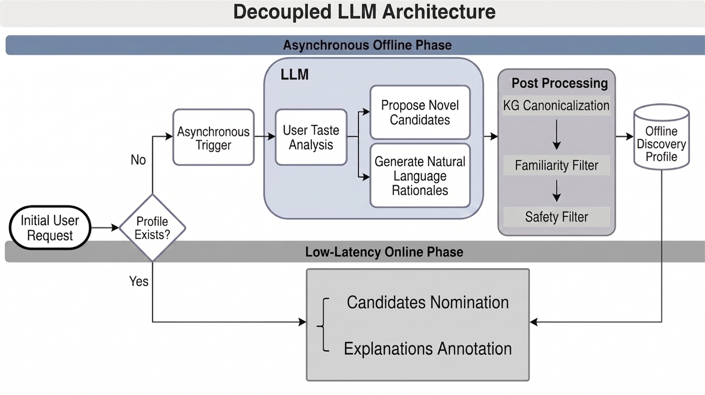

# Google YouTube Music: decoupling offline LLM rationale generation from online serving

<!-- source-sha256: b6244448f447f533aa18e54d849877f17092931e5df27408e8538150b858f389 -->

[简体中文](README.md)

> **Public-data proof of concept.** A real Qwen2.5-7B-Instruct generates new-artist nominations and natural-language rationales. The implementation maps artists to a catalog, filters already-listened artists, checks rationale evidence, and falls back from a read-only cache during online simulation. Google's Gemini, private music knowledge graph, LLM-as-a-judge, and multi-arm online A/B cannot be reproduced publicly. Last.fm hits do not measure trust or online engagement.

## Paper information

| Field | Details |
| --- | --- |
| Paper | [arXiv v1](https://arxiv.org/abs/2609.23877) |
| Organization | Google |
| First public release | 2026-09-20 (arXiv v1) |
| Authors' code | No system implementation released by the authors was found as of 2026-09-27. |
| Adapter | `music-rationales` |
| Local reproduction code | [`src/auto_research/reproductions/music_rationales/`](https://github.com/daiwk/auto-research/tree/main/src/auto_research/reproductions/music_rationales/) |

## Original paper

### Motivation and method

Listeners are comfortable with familiar artists but may hesitate to try unfamiliar ones. The paper moves expensive Gemini inference to an asynchronous offline stage. From complete listening history it generates a discovery profile with unheard artists and personalized rationales, canonicalizes artist entities, and uses an LLM judge to reject unreliable rationales. Online requests fetch the cached profile only and fall back to the existing recommender if it is unavailable. Candidates get explanations without putting an LLM in the request path. The multi-arm holdback separates new nominations from rationale annotations and finds that rationales drive most of the shelf-engagement lift.

~~~mermaid
flowchart LR
  H[Listening history] --> O[Asynchronous offline LLM]
  O --> P[Artist candidates and personalized rationales]
  P --> Q[Canonicalization, novelty and quality checks]
  Q --> C[Cached discovery profile]
  R[Online user request] --> C
  C --> S[Nominations with rationale annotations]
  C -->|Cache miss| B[Fall back to existing recommendations]
~~~

### Original architecture

Figure 2 separates asynchronous profile generation from low-latency serving. See the [paper's diagram and caption](https://arxiv.org/html/2609.23877v1). Copyright remains with the authors.

<!-- paper-figure:start -->
### Key figure from the paper

> **Figure 2:** Core architecture, modules, and their connections. From the [original paper](https://arxiv.org/abs/2609.23877); copyright remains with the authors. Click the image for the source.
<!-- paper-figure:end -->

### Core mechanism

Given user `u` and history `H_u`, the offline generator produces `P_u = {(artist_i, rationale_i)}`. Catalog mapping `canonicalize(artist_i)` ensures a real entity, `artist_i ∉ H_u` ensures novelty, and quality checks ground the rationale in history. Online serving reads `P_u` and annotates results; the existing recommender is the fallback if no profile or valid item is available. The public implementation substitutes a public artist catalog and checkable shared tags for the private knowledge graph and judge. It is **not** an equivalent implementation of the paper's judge.

### Paper results

Table 1 reports `74.00%` nomination uniqueness, `+22.43%` YDD shelf engagement (95% CI `[16.93%, 27.93%]`), and `+8.07%` discovery retention (95% CI `[0.90%, 15.24%]`). All come from Google's multi-arm online experiment. They cannot be subtracted from local Last.fm Hit@5 or claimed as reproduced.

## Local reproduction

> **Local comparison:** Original collaborative-filtering (CF) test Hit@5 is `0.40`; nomination augmentation is `0.38`, or `-5.0%` relative. This single-seed proof of concept on public data does not measure online engagement changes.

The official [HetRec Last.fm 2K](https://files.grouplens.org/datasets/hetrec2011/) data (noncommercial research license, archive SHA-256 `6738f48195667ff03caaab4d32ca9a3133d8cc026b7c3cdaf6ce1010e913c59c`) provide artists, listening behavior, and public tags. A fixed-seed per-user random 80/10/10 split is used. CF candidates come only from training behavior. Offline, the fixed Qwen2.5-7B-Instruct checkpoint selects up to five artists and supplies rationales that mention already-listened artists and shared tags. Simulated online arms either prioritize new nominations and fill remaining slots with CF, or preserve CF ordering and only add explanations. There are no real impressions, explanation click rates, or causal experiments.

See the [fixed metrics file](metrics/lastfm2k-qwen25-7b-seed42.json). `CF Hit@5` is the train-behavior baseline without an LLM; `valid LLM nomination Hit@5` covers generated candidates that pass catalog and rationale checks; `cache + fallback Hit@5` measures the five-item list after augmenting nominations. Rationale-only preserves candidates and order, so offline Hit@5 equals the baseline by construction. Only valid explanation coverage on existing candidates can be measured. Consumption labels **cannot** establish the causal effect of a rationale. Validation fixes prompts and thresholds; test is evaluated once in isolation.

| 100 users, seed 42 | Validation | Test |
|---|---:|---:|
| Original CF Hit@5 | 0.43 | 0.40 |
| Valid LLM nominations only, Hit@5 | 0.14 | 0.14 |
| LLM nominations first, CF fill, Hit@5 | 0.42 | 0.38 |
| Explanations only with unchanged CF order, Hit@5 | 0.43 | 0.40 |
| Valid explanation coverage of original CF slots | 27.6% | 27.6% |
| Users with at least one valid cached nomination | 48% | 48% |

Across 100 users, 197 proposals passed catalog and rationale checks and 301 were rejected, for a 39.6% pass rate among checked proposals. **Nomination augmentation did not improve hits on this public dataset:** test was `0.38` versus `0.40` for CF. A single seed, small sample, and no impressions make this a mechanism diagnostic, not a robust comparison. Unchanged rationale-only hits are a consequence of its construction, not evidence that explanations are useless. Last.fm cannot measure the causal result of the paper's online A/B.

Run with the public data and downloaded model weights at the same revision, for example:

~~~bash
PYTHONPATH=src python -c 'from pathlib import Path; from auto_research.reproductions.music_rationales.experiment import reproduce; print(reproduce(Path("data"), seed=42, split="validation", users=100, device="cuda:0", model_path="/path/to/Qwen2.5-7B-Instruct"))'
~~~

## Reproduction boundaries

- Local execution uses real 7B weights, catalog, novelty, and shared-tag constraints, and cache and fallback paths. It neither calls Gemini nor replicates Google's private knowledge graph or online judge.
- Last.fm lacks exposure and engagement for explanation text. Hit@5 only measures recovery of withheld artist consumption and cannot test trust effects.
- The 2011 public dataset has no reliable exposure timeline. A fixed random user-level split is not temporal causal validation.
- The online `+22.43%` is the authors' evidence; the local measurements only cover the public-data diagnostic above.
