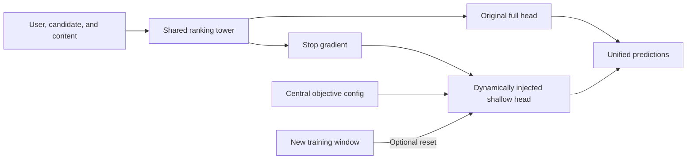
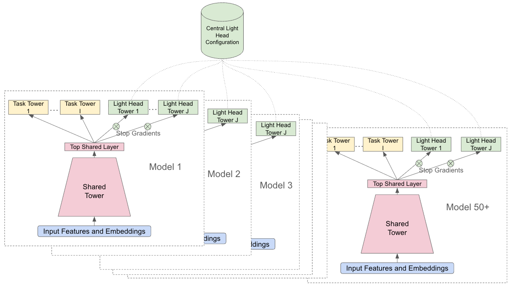

# Lightweight Ranking Heads: Adding Objectives Without Retraining the Shared Tower

<!-- source-sha256: 804cfec3d5246e770799e02ab2b8543659cba82ed611df861e9a361d8ae78cf8 -->

[简体中文](README.md)

> **Public-data core mechanism.** Dynamic injection, stop-gradient, window resets, and two ablations ran. No Google private traffic, continual-training platform, or downstream production model was used.

## Paper information

| Field | Value |
| --- | --- |
| Paper | [arXiv v1](https://arxiv.org/abs/2609.25433) |
| Organization | Google |
| First public release | 2026-09-21 (arXiv v1) |
| Authors' code | No matching author implementation found as of 2026-09-26. |
| Adapter | `light-heads` |
| Local code | [`src/auto_research/reproductions/light_heads/`](https://github.com/daiwk/auto-research/tree/main/src/auto_research/reproductions/light_heads/) |

## Original paper

### Background and contribution

Updating a multitask ranker's shared tower for a new goal can hurt old goals and give parallel experiments incompatible outputs for downstream models. A central config declares the new target, and training dynamically attaches a shallow head. Stop-gradient isolates the shared tower. Resetting the head at new training windows aligns head training age across upstream models. The paper also compares not resetting, which can help sparse targets, and removing isolation, which can hurt the original task.

<!-- paper-figure:start -->
### Key figure from the paper

See the [full caption](https://arxiv.org/html/2609.25433v1) and [paper record](https://arxiv.org/abs/2609.25433). Copyright belongs to the authors.
<!-- paper-figure:end -->

### Core equations

Shared representation `h=f_θ(x)`, original output `p_main=σ(g_φ(h))`, new output `p_light=σ(q_ψ(stop_gradient(h)))`. For light loss alone, `∂L_light/∂θ=0` but `∂L_light/∂ψ≠0`. A new window can set `ψ←init(seed)` without changing `θ` or `φ`. Local tests verify isolation and run no-reset and no-stop-gradient ablations.

### Paper results

YouTube reports a joint experiment cycle of 24→11 days. Its long-horizon goal online experiment reports significant top-line engagement `+0.03%`, low-quality impressions `-0.40%`, and Primetime engagement `+13.83%`. These are production results, not MovieLens measurements.

## Local reproduction

The matched-budget no-reset baseline has test AUC `0.6267` on the new task versus `0.5109` for standard reset, relative `-18.48%`. This is a negative result under short public-data windows.

MovieLens 100K ratings split chronologically per user into roughly 70/15/15. The old task is rating ≥4; new is the sparser rating =5. Train the tower for 120 steps, then the new goal for 40 steps in each of two windows. All three arms share initial tower, data, and optimization budget.

| Three-seed mean test AUC | Original task | New task |
| --- | ---: | ---: |
| Standard isolation and reset | 0.6419 | 0.5109 |
| Keep prior head | 0.6419 | 0.6267 |
| Remove stop-gradient | 0.6244 | 0.6135 |

Reset hurts the new goal at this budget, while removing isolation lowers old-task AUC. This does not predict YouTube production benefit or establish universal superiority. See [per-seed measurements and split](metrics/movielens-100k-seeds42-44.json).

## Reproduction limits

- The shared tower, injected head, gradient isolation, and optional reset really execute; this is not a same-name postprocessor.
- Ratings substitute for two goals, not long-horizon rewards, video consumption, or downstream co-training.
- A short single-machine run does not model continual learning, fleet-wide configuration, or live A/B.
- A future Evolve mapping must actually execute the head and equivalent evaluator, not merely register a name.
