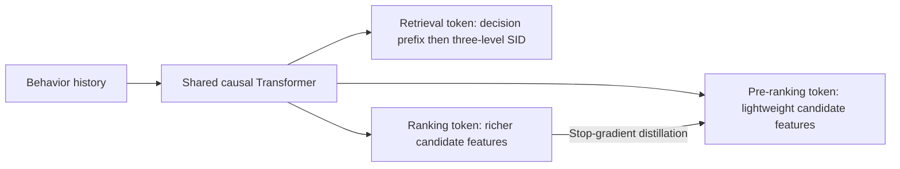
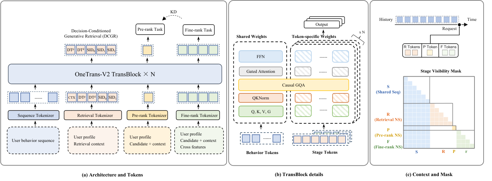

# OneTrans-V2: Shared User Context for Retrieval, Pre-Ranking, and Ranking

<!-- source-sha256: 92e6c9f6f31c4d398bc8b963728618f17f0887dab50b5c6d6752d455b382ac4c -->

[简体中文](README.md)

> **Concept demonstration; L1 mechanism validation on full MovieLens-1M.** All three stages and their losses ran. MovieLens lacks transactions, ad supply, and a real exposure funnel, so proxy metrics are not the paper's business gains.

## Paper information

| Field | Value |
| --- | --- |
| Paper | [arXiv 2609.28589](https://arxiv.org/abs/2609.28589) |
| Organization | ByteDance |
| First public release | 2026-09-23 (arXiv v1) |
| Authors' code | No official author release found as of 2026-09-27. |
| Adapter | `onetrans-v2` |
| Local code | [`src/auto_research/reproductions/onetrans_v2/`](https://github.com/daiwk/auto-research/tree/main/src/auto_research/reproductions/onetrans_v2/) |

## Original paper

### Background and contribution

Industrial recommendation retrieves from a large pool, pre-ranks to narrow it, and ranks a shortlist. Separate models repeatedly encode the same history and make fine-ranker feedback harder to transfer upstream. OneTrans-V2 retains each stage's inputs and objectives but shares a causal Transformer user context. History cannot read stage tokens. Each stage token sees only events before the request and not other stage tokens, reusing encoding without future leakage.



<!-- paper-figure:start -->
### Key figure from the paper

[](https://arxiv.org/html/2609.28589v1/fig2v6.png)

**Original Figure 2:** Architecture, modules, and connections from the [paper](https://arxiv.org/abs/2609.28589); copyright belongs to the authors.
<!-- paper-figure:end -->

### Mechanisms and equations

- **Decision-conditioned generative retrieval (DCGR):** predict a decision prefix then autoregressively predict three semantic ID levels. Business offsets reorder decisions without overwriting the item distribution conditional on a decision. The paper's decisions include purchases, value, novelty, and ad supply. [Section 4.2.1](https://arxiv.org/html/2609.28589v1#S4.SS2.SSS1)
- **Pre-ranking and ranking:** lightweight and richer candidate features predict CTR/CVR, respectively. Detach, center, and temperature-scale fine-ranking logits to teach the pre-ranker. [Section 4.2.2](https://arxiv.org/html/2609.28589v1#S4.SS2.SSS2)

With decision prefix $z$ and SID $c_{1:3}$, $P(z,c_{1:3}\mid H)=P(z\mid H)\prod_{\ell=1}^{3}P(c_\ell\mid H,z,c_{<\ell})$. The local run supervises two observable rating/genre proxies, not the paper's complete purchase, value, discovery, and ad-supply decisions.

The scaled joint objective is $\mathcal L=0.1(\mathcal L_{\rm decision}+\mathcal L_{\rm SID})+\mathcal L_{\rm pre}+\mathcal L_{\rm fine}+\mathcal L_{\rm KD}$. Detached teacher logits are batch-centered, temperature-scaled at $0.5$, and passed through sigmoid; the student is the pre-ranker. This preserves the loss connection, not the original CTR/CVR labels.

### Paper results

[Section 6.3](https://arxiv.org/html/2609.28589v1#S6.SS3) reports a user-level 50/50 live A/B with +9.74% GMV/user and 3.2× three-stage end-to-end QPS at the same hardware budget. These come from private commerce systems. Public proxy scores do not measure GMV, ad revenue, a true funnel, or serving-cluster throughput.

## Local reproduction

There is no independent three-stage cascade baseline. Use full MovieLens-1M chronological histories: the last two events are validation/test, with all training prefixes earlier. Behavior encoding is causal and stage tokens cross-attend only to history. Retrieval fits three-level residual k-means SIDs to item genres, with two proxy decisions and three-level autoregressive cross-entropy. Offsets modify only the two decision logits, not ranking or conditional SID probabilities directly. Pre-ranking reads item IDs; fine ranking adds genres. Both use binary rating ≥3 and ≥4 objectives, with detached ranking-to-pre-ranking distillation. Defaults: seeds 42/43/44, 200 updates each. Evaluate real held-out ratings without sampled negatives; report stage AUC/Brier and decision/SID exactness. Offset testing is a mechanism check, not business impact.

| Three-seed MovieLens-1M mean | Validation | Test |
| --- | ---: | ---: |
| Pre-ranking AUC, rating ≥3 | 0.55085 | 0.54883 |
| Ranking AUC, rating ≥3 | 0.57562 | 0.57336 |
| Pre-ranking AUC, rating ≥4 | 0.55006 | 0.54108 |
| Ranking AUC, rating ≥4 | 0.56393 | 0.56426 |
| Retrieval three-level SID precision | 0.05456 | 0.05553 |

Results vary across seeds and some are low. Ratings are not clicks/conversions and genre novelty is not full discovery. The `concept_demo` label does not claim the paper's GMV, QPS, or full DCGR control.

```bash
auto-research reproduce --paper onetrans-v2 --dataset-dir data --seed 42
```

See [per-seed metrics and data fingerprints](metrics/public-seeds42-44.json). This path is CPU-only as advertised; there is no A100/A30 receipt.

## Reproduction limits

Executed shared causal encoding, stage isolation, autoregressive three-level SID, observable decisions, both multitask BCE stages, and ranking-to-pre-ranking distillation. Not executed: real purchases/value/ad decisions, industrial item encoding, sparse MoE, Sequence-Native Training amortization across impressions, serving, or live A/B.
