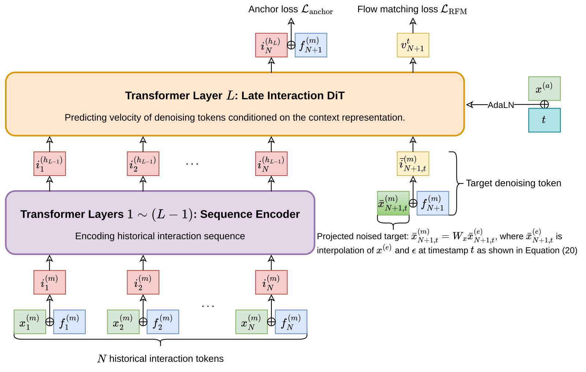

# X-Rec: generative retrieval through spherical flow matching

<!-- source-sha256: fc193c7fbf4c036059eb59c19c36a832d003b26e8b2b850fbc45aa677f0c83cf -->

[简体中文](README.md)

> **Fidelity: core mechanism; evidence: L2 public dataset.** Public MovieLens checks the algorithmic path, not TikTok traffic or the paper's absolute results. This is a low-budget experiment. X-Rec's three-seed mean on MovieLens-1M is below U2I, so no gain is claimed.

## Paper information

| Field | Details |
| --- | --- |
| Paper | [arXiv 2609.29180](https://arxiv.org/abs/2609.29180) |
| Organization | TikTok (ByteDance) |
| First public release | 2026-09-24 (arXiv v1) |
| Authors' code | No official or author code is linked; no author repository was found as of 2026-09-27. |
| Adapter | `xrec` |
| Local reproduction code | [`src/auto_research/reproductions/xrec/`](https://github.com/daiwk/auto-research/tree/main/src/auto_research/reproductions/xrec/) |

## Original paper

### Motivation and method

Traditional user-to-item (U2I) retrieval compresses a user's interests into one or a few vectors; generative semantic-ID methods decode one token at a time. X-Rec generates several retrieval triggers directly on the unit sphere of item embeddings. It predicts a coarse item cluster (anchor), then conditions on that anchor to move spherical noise along a geodesic toward the target item. Nearest-neighbor lookup against the full catalog covers multiple interest regions without semantic-ID quantization.

The computation pattern matters too. User history passes through the first `L-1` Transformer layers. At each denoising step, only the current generated token enters the final layer and interacts with the encoded history. Time and anchor condition that layer via AdaLN. Figure 2 below is the original paper image, not a local redraw.

~~~mermaid
flowchart LR
  A[User history] --> B[Prefill L-1 layers]
  B --> C[Anchor classifier]
  C --> D[Spherical noise and time]
  B --> E[Cached history K/V]
  D --> F[Last-layer interaction velocity field]
  E --> F
  F --> G[Multi-step spherical Euler sampling]
  G --> H[Multi-trigger full-catalog retrieval]
~~~

<!-- paper-figure:start -->
### Key figure from the paper

> **Figure 2:** The two upper losses train anchor prediction and spherical flow. History passes through the earlier layers only during prefill. From the [original paper](https://arxiv.org/html/2609.29180v1#S3.F2); copyright remains with the authors.
<!-- paper-figure:end -->

### Core equations

Given spherical noise $\epsilon$, target item vector $x$, and angle $\omega=\arccos(\epsilon^\top x)$, the training path and velocity are:

$$
\bar x_t=\frac{\sin((1-t)\omega)}{\sin\omega}\epsilon+\frac{\sin(t\omega)}{\sin\omega}x,
\qquad
\dot{\bar x}_t=\frac{\omega}{\sin\omega}\left(\cos(t\omega)x-\cos((1-t)\omega)\epsilon\right).
$$

The model minimizes $\mathcal L=\alpha\mathcal L_{\text{anchor}}+\beta\mathcal L_{\text{RFM}}$. At inference time, project the predicted velocity into the tangent space at the current point, then integrate with Riemannian Euler steps to produce triggers. See [Sections 3.2–3.3](https://arxiv.org/html/2609.29180v1#S3).

### Paper results

The paper reports two successive deployments for TikTok vertical-content retrieval: first spherical flow with last-layer interaction, then anchors. [Section 5, Table 3](https://arxiv.org/html/2609.29180v1#S5) reports **+4.1484%** combined vertical interactions and **+0.0111%** global interactions. Generation throughput was **3.46×** SID-AR in the paper's industrial streaming benchmark. These are author-reported results, not local public-data results. The CPU generation throughput below is not a production GPU streaming benchmark.

## Local reproduction

> **Local comparison:** Under the same full-catalog protocol, the three-seed test NDCG@10 was `0.00185` for U2I and `0.00086` for X-Rec, a relative mean difference of **-53.58%**. Hit@10 was **-60.00%**. This is a negative result on low-budget public data, neither a refutation nor reproduction of TikTok's online lift.

Ratings ≥3 in the full MovieLens-1M dataset form positive user sequences (6,038 users and 3,706 items). Each user's penultimate interaction is validation and final interaction is test; earlier history alone is used for training. Train-only transitions first train normalized item representations with full-catalog contrastive learning, followed by spherical k-means anchors. X-Rec trains on general training prefixes and then on each user's final training prefix. U2I uses the same item vectors, a two-layer Transformer, and the same total number of updates. Both filter seen items and measure full-catalog Hit/NDCG@10, not sampled-negative metrics. Of 818,000 training prefixes, sampling covers only 160 updates plus 40 on final prefixes. The evaluation checks the mechanism and does not compare fully converged capabilities.

| Method, seeds 42/43/44 | Validation Hit@10 | Validation NDCG@10 | Test Hit@10 | Test NDCG@10 |
| --- | ---: | ---: | ---: | ---: |
| Two-layer Transformer U2I | 0.00436 | 0.00178 | 0.00442 | 0.00185 |
| X-Rec core mechanism | 0.00248 | 0.00109 | 0.00177 | 0.00086 |

These are arithmetic means; seeds vary substantially, so online lift cannot be inferred. Per-seed validation and test scores, training budgets, and data fingerprints are in [`metrics/public-seeds42-44.json`](metrics/public-seeds42-44.json).

### SID-AR control with equal update counts

An independent control fits a three-level residual quantizer on the same training prefixes and train-only item vectors. SID-AR uses a two-layer history Transformer to predict semantic-ID tokens autoregressively, level by level, with beam width 20. The codebook reconstructs predicted SIDs into triggers for exact nearest-neighbor retrieval against all item vectors. X-Rec generates 20 spherical triggers. Both use **20 triggers × 1 neighbor each**; U2I uses **1 trigger × 20 neighbors**. All methods filter seen items after retrieval and use the last two chronological interactions per user for validation and test. Each sequence model runs 200 updates at batch size 64. This matches update counts, not parameter counts, FLOPs, or convergence.

| MovieLens-1M, three-seed mean | Validation Recall@20 | Test Recall@20 | CPU generation requests/s |
| --- | ---: | ---: | ---: |
| X-Rec | 0.00381 | 0.00282 | 1,918 |
| SID-AR | 0.00723 | 0.00707 | 9,567 |
| U2I | 0.00944 | 0.00823 | 11,951 |

Throughput covers model generation only, not history tensor assembly or exact nearest-neighbor lookup. Runs share the same CPU, batch size 16, two warmups, and the median of five timed trials. The [per-seed receipt](metrics/fair-budget-seeds42-44.json) records the three-seed means. These are not A100/A30 GPU measurements and do not directly verify the paper's 3.46×. X-Rec trails SID-AR in both recall and throughput on this reduced task; the negative result is retained.

~~~bash
PYTHONPATH=src python scripts/run_staged_retrieval_public.py --paper xrec-fair --dataset-dir data
~~~

~~~bash
auto-research reproduce --paper xrec --dataset-dir data --seed 42
~~~

## Reproduction boundaries

- Executed: item contrastive learning, spherical anchor clustering and cross-entropy, geodesic RFM supervision, final-layer history K/V reuse, time/anchor conditioning, tangent-space velocity, spherical Euler sampling, and multi-trigger full-catalog retrieval.
- Not executed: TikTok's private multi-attribute logs and streaming benchmark, industrial item encoder, ANN/online KV service, or real online A/B. MovieLens lacks the original target attribute, so the local run conditions only on interaction history. The added CPU generation microbenchmark is not production throughput.
- This is reduced CPU training, with no advertised CUDA path or A100/A30 receipt. The results show only that the core mechanism runs; they do not reproduce the paper's outcome.
