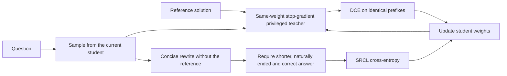
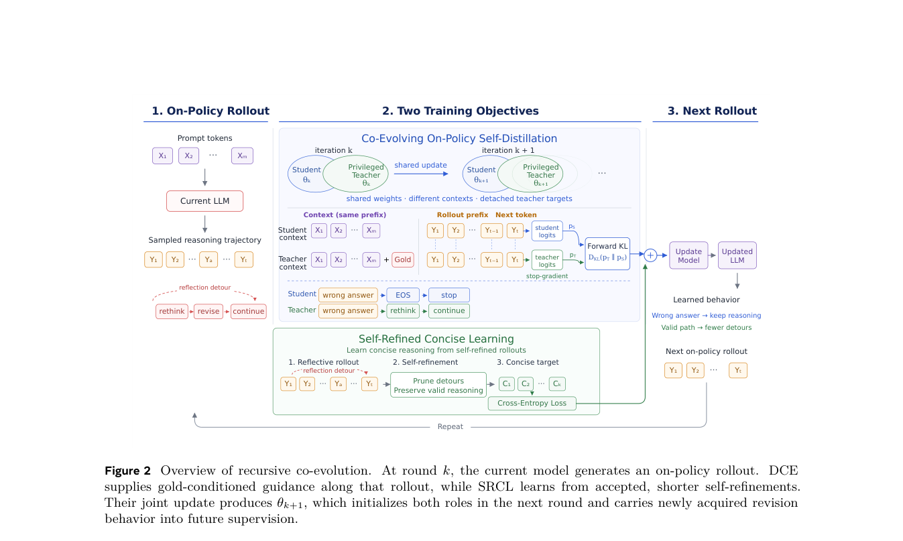

<!-- source-sha256: fcfe432363e5ee570c2f04f865b2058db74d5e3e13f6b331d25453ff5a46e159 -->

[简体中文](README.md) · English

# Recursive Self-Improvement via On-Policy Distillation: Dynamic co-evolution and concise self-rewriting

## Paper information

| Field | Details |
| --- | --- |
| Paper | [arXiv v1](https://arxiv.org/abs/2609.30652) |
| Institutions | Meta AI / University of California, Riverside |
| First public release | 2026-09-25 (arXiv v1) |
| Original source code | No author training repository found as of 2026-09-29. |
| Adapter | `recursive-opsd` |
| Local reproduction code | [`src/auto_research/reproductions/recursive_opsd/`](https://github.com/daiwk/auto-research/tree/main/src/auto_research/reproductions/recursive_opsd/) |

## Original paper summary

The manuscript carries an internal date of 2026-09-11; this page uses the first public arXiv v1 date. Core code: `src/auto_research/post_training/recursive_opsd.py`. Runner: `scripts/recursive_opsd_public_math.py`.

### Background and main changes

Conventional OPSD gives the student only the question and a frozen privileged teacher the reference solution as well. Tokenwise distillation uses the student's own prefixes. Keeping the teacher at initial weights prevents later reflection and correction learned by the student from feeding back to the teacher. Two changes complement each other:

1. **DCE (dynamic co-evolution):** At round `k`, the current student samples answer `yᵏ`. The teacher uses the same current weights, stops gradients and also sees the reference solution to score **the same answer prefixes**, producing `qᵏ`. The student minimizes `KL(qᵏ‖pᵏ)`. Updated weights become both next-round student and teacher; there is no separately optimized teacher model.
2. **SRCL (concise self-rewriting):** The current model sees only the question and its original answer, not the reference, and writes a shorter self-contained solution. Cross-entropy uses only rewrites that end naturally, are actually shorter, do not explicitly refer to prior reasoning or fragments, and pass final-answer verification. If none qualifies, only DCE runs.



<!-- paper-figure:start -->
### Key figure from the paper

[](https://arxiv.org/pdf/2609.30652#page=5)

> **Figure 2:** Overall design and components. From the [paper](https://arxiv.org/abs/2609.30652); copyright belongs to the authors. Click the image for the source.
<!-- paper-figure:end -->

### Core equations

$$
L_{DCE}=\frac{1}{m}\sum_{t=1}^{m}D_{KL}\bigl(q_{k,t}\Vert p_{k,t}\bigr),\qquad
L_{joint}=\lambda_G L_{DCE}+\lambda_S L_{SRCL}.
$$

Only the stop-gradient privileged teacher and verifier get the reference solution. Student rollouts and SRCL prompts never include it. The frozen teacher control holds initial weights fixed under the same assistant-side prompt, not the original paper's OPSD baseline with a **user-side prompt and frozen weights**.

### Paper results

On 14,717 OpenThoughts math training questions, several Qwen3 scales, and four contest benchmarks (AIME24/25/26 and HMMT25), the paper reports `61.88% Average@12` for Qwen3-4B DCE+SRCL versus `22.85%` for OPSD. These are **paper results, not local scores**. Its 32K generation cap, 12 samples per question, 200 training steps, rank-128 LoRA and eight H100s were not run here.

## Local reproduction

The A100 mechanism diagnostic uses public Qwen3-4B-Instruct-2507 and official GSM8K with 4 training, 2 validation and 2 test questions. There are 2 rank-8 updates, a 192-token cap and seed `42`, with the same data, steps and generation limit. See [`qwen3-4b-gsm8k-seed42.json`](metrics/qwen3-4b-gsm8k-seed42.json).

> **Comparison protocol:** Compare validation accuracy before training on the same checkpoint against DCE+SRCL. Both score 1/2. Relative change is not meaningful for two examples.

| Arm | Validation accuracy before → after | Mean validation output tokens before → after | Notes |
|---|---:|---:|---|
| DCE+SRCL | 1/2 → 1/2 | 164.5 → 174.5 | Both SRCL rounds admitted rewrites; LoRA parameter change L2 `0.0100` |
| Frozen teacher | 1/2 → 1/2 | 164.5 → 174.0 | Same assistant-side privileged prompt; not paper OPSD |
| DCE-only | 1/2 → 1/2 | 164.5 → 174.5 | No SRCL gradient |

There is **no evidence of accuracy gains** on the two validation questions, and outputs did not get shorter. Test was read only after training; 2/2 does not establish generalization. See the [A100 validation receipt](../../gpu-validations/recursive-opsd-a100-20260929.json) for raw JSON and public sources.

### Supplementary three-seed matched-budget diagnostic

Use the same public Qwen3-4B checkpoint and official GSM8K revision, fixing seeds `42/43/44`, 2 updates per arm and 96 tokens per generation. All arms share the first 4 training questions, the next 4 validation questions, and the first 4 official test questions in a separate file. Select the method by **mean validation across seeds** only. Test scores never affect selection. The `frozen` arm uses the same assistant-side teacher prompt and remains distinct from paper OPSD.

| Method | Validation accuracy (42/43/44) | Test accuracy (42/43/44) |
|---|---|---|
| Dynamic DCE+SRCL | 0.25 / 0.25 / 0 | 0.5 / 0.5 / 0.5 |
| Frozen teacher + SRCL | 0.25 / 0.25 / 0.25 | 0.5 / 0.5 / 0.5 |
| Dynamic DCE-only | 0.25 / 0.25 / 0 | 0.5 / 0.5 / 0.5 |

Validation selects the frozen teacher control, which ties both other arms on test. This **does not establish a benefit from dynamic co-evolution or SRCL**. Four validation and test questions check training, controls, splits and metrics, not statistical significance or paper-level gains. `scripts/compare_recursive_opsd_public.py` reruns the paired audit; [sanitized three-seed metrics](../../experiments/evidence/recursive-opsd-qwen3-gsm8k-seeds42-44.json) record data hashes, checkpoint revisions, per-seed scores and executed commit.

## Running and scope

Place official [GSM8K](https://github.com/openai/grade-school-math) `train.jsonl` and `test.jsonl` in `data/gsm8k/`, and prepare the public Qwen3-4B-Instruct-2507 checkpoint. Run on CUDA:

```bash
PYTHONPATH=src python scripts/recursive_opsd_public_math.py \
  --checkpoint /path/to/Qwen3-4B-Instruct-2507 \
  --data-dir data --output runs/recursive-opsd/metrics.json \
  --seed 42 --steps 2 --train-examples 4 \
  --validation-examples 2 --test-examples 2 --max-new-tokens 192
```

This is a **proof of concept**: the objective, dynamic teacher refresh, self-rewriting, admission and actual checkpoint updates execute. The question distribution, scale, rank, steps and baseline protocol differ. Numeric answer checking on GSM8K is not the paper's `math_verify` boxed-answer rule. An upgraded results claim requires the exact public OpenThoughts split, all four original contest benchmarks, and matched-budget baselines.

For the supplementary rerun, execute dynamic, frozen teacher and DCE-only for each of `42,43,44`, keeping `--steps 2 --train-examples 4 --validation-examples 4 --test-examples 4 --max-new-tokens 96` fixed. The arms use `--teacher-mode dynamic --lambda-srcl 0.1`, `--teacher-mode frozen --lambda-srcl 0.1`, and `--teacher-mode dynamic --lambda-srcl 0` respectively. Name outputs `dynamic-42.json` and so on in one directory, then run:

```bash
PYTHONPATH=src python scripts/compare_recursive_opsd_public.py \
  --directory runs/recursive-paired --output runs/recursive-paired-summary.json
```
