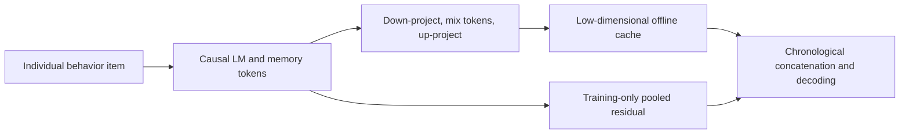
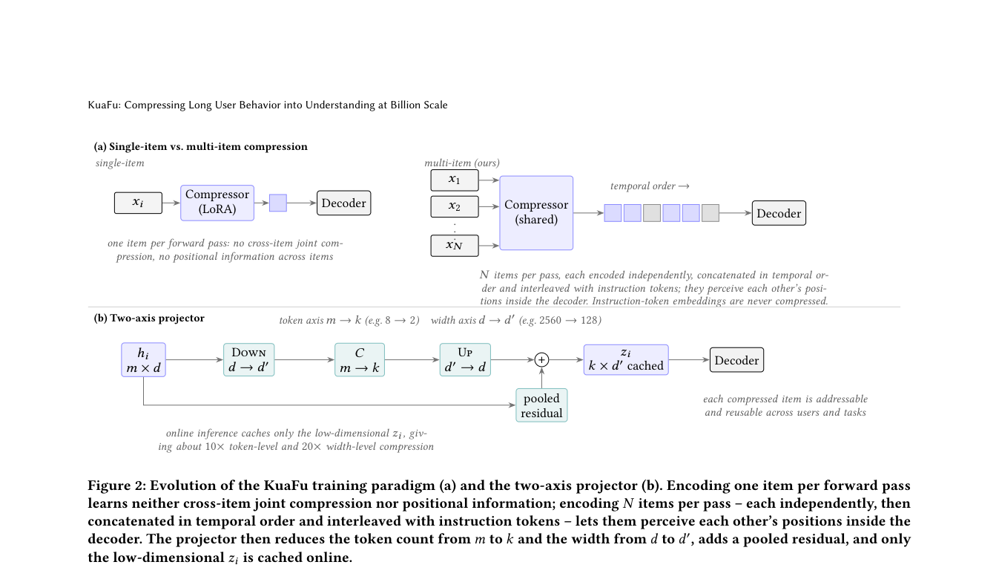

# KuaFu: Item-level behavior compression and factual fidelity

<!-- source-sha256: 373a3f57bc813915807080ce48f0da97e77ab415ca0a77ee670f744eecd7de78 -->

[简体中文](README.md)

> Public-data concept test: Qwen3-4B-Instruct, independent item compression, two-axis projection, and three supervised stages ran. A100 sampled and scored hallucination-aware DAPO, but tied rewards correctly caused no update. Not a completed four-stage run or Tencent GMV reproduction.

## Paper information

| Field | Details |
|---|---|
| Paper | [arXiv v1](https://arxiv.org/abs/2609.31045) |
| Institution | Tencent. |
| First public release | 2026-09-25 (arXiv v1) |
| Author code | No KuaFu training/deployment repository linked in the paper as of 2026-09-29. |
| Local adapter or method key | `kuafu` |
| Local reproduction code | [`src/auto_research/reproductions/kuafu/`](https://github.com/daiwk/auto-research/tree/main/src/auto_research/reproductions/kuafu/) |

## Paper method and evidence

Tencent's weekly profile refresh needs a cheaper alternative to sending each behavior item as raw text or truncating long histories. Compress each item independently from m high-dimensional memory tokens to k low-dimensional cached vectors, then concatenate them in time order with the task prompt. A cached item can be reused across users and need not be recomputed when a user adds an event. The original production cache and two-axis projection are shown in [Figures 1 and 2](https://arxiv.org/html/2609.31045v1).

<!-- paper-figure:start -->
### Original paper figure

Figure 2 shows the training and projection design. From the [original paper](https://arxiv.org/abs/2609.31045); copyright remains with the authors.
<!-- paper-figure:end -->

### Core equation

Per item use `Up(C · Down(hᵢ)) + Pool(hᵢ)`. The pooled training residual is annealed to zero on a cosine schedule; production caches only `k × d′` low-dimensional vectors. The paper chains reconstruction, compressed QA (easy/complex), joint compressor–decoder training, and decoder-only hallucination-aware RL. Local code keeps training parameter sets, cache boundaries, source grounding, and DAPO token ratios, asymmetric clipping, and truncation filtering. Tiny public MRQA cannot substitute for behavior curricula or 5K RL examples.

### Reported results

Section 4.8 reports visitor-randomized production A/B: a 5% holdout after full deployment and ten-month relative GMV lift `1.37%` (95% CI `[0.71%, 2.03%]`). These are Tencent results, not local metrics.

## Local reproduction

From [official MRQA SQuAD train/dev](https://github.com/mrqa/MRQA-Shared-Task-2019), select the first question from 32 distinct passages per split, seed 42. Supervised stages increase item count with at most four items, 24 tokens/item and two cache tokens/item. Dev is evaluation only. [Pinned results](metrics/mrqa-squad-qwen3-4b-seed42.json) record file SHA-256, checkpoint revision, stage loss and full metrics.

| Dev input, 32 questions | EM | Token F1 |
|---|---:|---:|
| KuaFu cache | 0.0000 | 0.0890 |
| Same source budget, head | 0.0000 | 0.1163 |
| Same source budget, tail | 0.0000 | 0.0953 |
| All retained raw input | 0.0000 | 0.2634 |

The head-truncation input diagnostic is −23.4% relative dev F1. These raw controls reuse the compression-trained decoder; they are not independently trained. No gain was observed. A100 RL smoke got four rewards of 1.0, so returned skipped_zero_advantage with no update.

A separate A100 control trained a fresh model on head-truncated input with the same public checkpoint, 32/32 questions, three seeds, and 64 QA updates matching the compression arm's two QA stages. Raw input uses the total budget of two cache tokens per item. Mean dev F1 was 0.0952 for compression and 0.1249 for independent control; compression never won and all EMs were zero. [Control metrics](metrics/mrqa-independent-control-seeds42-44.json) and [sanitized receipt](../../gpu-validations/kuafu-a100-independent-control-20260929.json). Not matched FLOPs: compression also trains reconstruction, encoder and projector.

Place official SQuAD-train.jsonl.gz and SQuAD-dev.jsonl.gz under data/mrqa/ and prepare public Qwen3-4B-Instruct-2507 on NVIDIA CUDA:

~~~bash
export AUTO_RESEARCH_KUAFU_CHECKPOINT=/path/to/Qwen3-4B-Instruct-2507
auto-research reproduce --paper kuafu --dataset-dir data
~~~

Use python scripts/kuafu_public_mrqa.py --help for budgets. For the independent arm add --independent-control --seed 42, then 43 and 44; allow memory to reload a fresh model. Data, checkpoints, and judge are not bundled. Private Tencent logs, four profile tasks, billion-user cache and A/B were not reproduced. The generative reward model weights/labels are not public; stage four had no effective update and this is not Evolve gain evidence.
