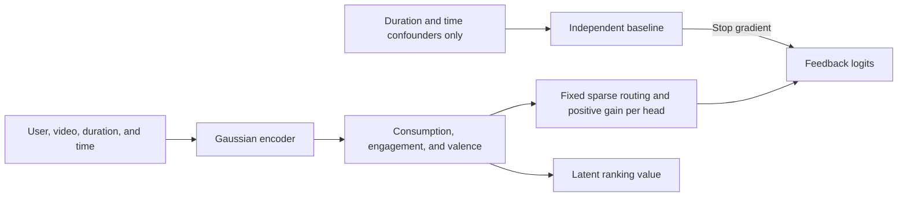
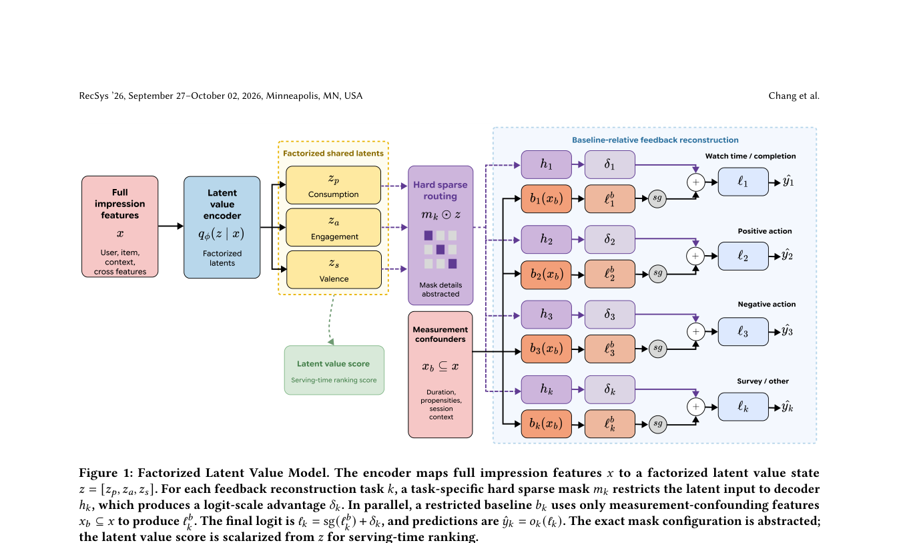

# FLVM: Separating Latent User Value from Behavioral Feedback

<!-- source-sha256: 1a909aab098b1df7a11e89f2b86986c63a19c0c60493560455f2d4214452e4dd -->

[简体中文](README.md)

> **Public-data concept demonstration.** The three-factor Gaussian, restricted baseline, sparse routes, stop-gradient, and KL loss ran locally. YouTube satisfaction surveys, production features, and online experiments are absent; the +2.67% result is not reproduced.

## Paper information

| Field | Value |
| --- | --- |
| Paper | [arXiv v1](https://arxiv.org/abs/2609.32839) |
| Organization | Google / YouTube |
| First public release | 2026-09-26 (arXiv v1) |
| Authors' code | No author FLVM repository linked in the paper as of 2026-09-29. |
| Adapter | `flvm` |
| Local code | [`src/auto_research/reproductions/flvm/`](https://github.com/daiwk/auto-research/tree/main/src/auto_research/reproductions/flvm/) |

## Original paper

### Background and contribution

Short-video watch time also depends on duration, habits, and time of day. Rather than treating all behaviors as one preference, FLVM separates consumption, active engagement, and engagement valence. Measurement confounders enter a restricted baseline; full user/video information enters the latent encoder. Each feedback head reads only relevant factors and adds its logit adjustment to a detached baseline.



<!-- paper-figure:start -->
### Key figure from the paper

[](https://arxiv.org/pdf/2609.32839#page=4)

**Original Figure 1:** Method design from the [paper](https://arxiv.org/abs/2609.32839). Copyright belongs to the authors.
<!-- paper-figure:end -->

[Figure 2](https://arxiv.org/html/2609.32839v1#S4.F2) illustrates duration debiasing and separation of positive/negative feedback; neither figure is a local result.

### Core equations

Use $z=[z_p,z_a,z_s]$ and fixed route $m_k$ for feedback $k$: $\delta_k=\operatorname{softplus}(\alpha_k)h_k(m_k\odot z)$ and $\ell_k=\operatorname{stopgrad}(b_k(x_b))+\delta_k$. The objective combines observed-mask/task-weighted feedback cross-entropy, auxiliary cross-entropy updating only the restricted baseline, and $\beta D_{KL}(q_\phi(z|x)\|N(0,I))$. Rank by $\sigma(z_s)\operatorname{softplus}(z_p)$, not engagement $z_a$ alone. The paper does not publish exact routes. Locally, watching uses consumption, clicks use consumption plus engagement, and like/hate use engagement plus valence.

### Paper results

Section 4 reports YouTube Shorts Like PR-AUC 0.2522→0.3190, Dislike 0.0038→0.0054, and Completion 0.6898→0.6722. The 14-day online A/B reported +2.67% viewer enjoyment with flat guardrails. These are private production results, not directly comparable with public proxy data.

## Local reproduction

Compare scaled FLVM with an independently initialized and trained shared-tower multitask model on identical pre-exposure features, four feedback labels, and update counts. Use all real KuaiRand-Pure impressions with global-time 70/15/15 split. Inputs: user ID, video ID, duration, and impression hour. Clicks, long watches, likes, and hates are labels, never inputs. No satisfaction surveys or production propensity fields; the restricted baseline uses only duration and time. Sparse `is_hate` is not all valence supervision. All four logged labels are present; the loss still supports observation masks for missing values. Validation is reported only and test is isolated.

[Fixed metrics](metrics/public-seeds42-44.json) cover seeds 42/43/44 at 300 steps each. Test contains only 755 likes and 34 hates, so especially the sparse hate results are not reliable gains.

<!-- local-results:start -->
| Method | Validation Like AP | Test Like AP | Test Hate AP |
| --- | ---: | ---: | ---: |
| FLVM | 0.01937 | 0.02075 | 0.00674 |
| Independent multitask baseline | See raw metrics | 0.01850 | 0.00145 |
<!-- local-results:end -->

FLVM test like AP: `0.01779 / 0.02355 / 0.02091`; hate AP: `0.01064 / 0.00122 / 0.00836`. Hate is unstable, long-watch AP trails the baseline for all seeds, and the like–hate mean gap in `z_s` changes sign. **Stable valence separation is not verified**, nor is the component eligible as an Evolve operator with demonstrated benefit.

```bash
python scripts/flvm_public_kuairand.py --dataset-dir data \
  --steps 300 --seeds 42,43,44 \
  --output docs/reproductions/2609.32839-flvm/metrics/public-seeds42-44.json
auto-research reproduce --paper flvm --dataset-dir data --seed 42
```

CPU only; no CUDA claim. The experiment does not verify online enjoyment, survey feedback, production ablations, or new-video lifecycle effects. One public dataset does not identify $z_s$ as user satisfaction.
