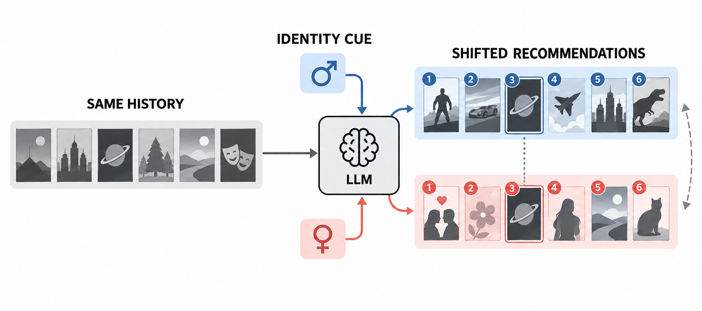

<!-- source-sha256: 8c6464bbc284b90cc1ba735a7223b2b0590ecfd543b277b3ffe76ac1623dffc7 -->

[简体中文](README.md) · English

# Measuring and Mitigating Identity-Cue Preference Drift in LLM-based Recommender Systems

> **L1 core mechanism diagnostic.** List metrics and postprocessing reranker run. Identity slices and relevance come from public fixtures; no real user profiles are generated.

## Paper information

| Field | Details |
| --- | --- |
| Paper | [arXiv 2609.34229](https://arxiv.org/abs/2609.34229) |
| Institution | University of Electronic Science and Technology of China |
| First public release | 2026-09-28 (arXiv v1) |
| Original source code | No public author repository found as of 2026-09-30. |
| Adapter | `promptshift` |
| Local reproduction code | [`src/auto_research/reproductions/promptshift/`](https://github.com/daiwk/auto-research/tree/main/src/auto_research/reproductions/promptshift/) |

## Original paper summary

### Background and main changes

Hold behavior history fixed and compare identity-cued rankings with a reference without identity. Drift and SliceShift measure the resulting shift. Mitigation blends original score and inverse group popularity according to each user's mainstreamness.

<!-- paper-figure:start -->
### Key figure from the paper

> **Figure 1:** Overall method and components. From the [paper](https://arxiv.org/abs/2609.34229); copyright belongs to the authors. Click for the source.
<!-- paper-figure:end -->

### Core equations

For reference list $R$ and identity-cued list $C$, calculate $Drift(R,C)$ from set-overlap loss and normalized rank changes for shared items, and $SliceShift$ from group popularity differences. The reranker uses mainstreamness $m$ to mix normalized relevance with inverse popularity: $s'=(1-m)\hat{s}+m(1-p)$.

### Offline and online results

Benchmarks, speed and training curves in the paper are the authors' results. The three-seed mini-suite checks only mechanisms and invariants. It neither compares at paper scale nor extrapolates to online gains.

## Local reproduction

See [`metrics/mechanism-seeds42-44.json`](metrics/mechanism-seeds42-44.json). The results are marked `diagnostic_only=true` and cannot enter formal capability rankings.

> **Comparison protocol:** Unmitigated identity-cued ranking versus adaptive inverse-popularity reranking. Relative improvement is not applicable to this L1 mechanism diagnostic.

## Scope

Only list metrics and postprocessing reranking execute. Public fixtures supply identity slices and relevance; no real user profiles are generated.
