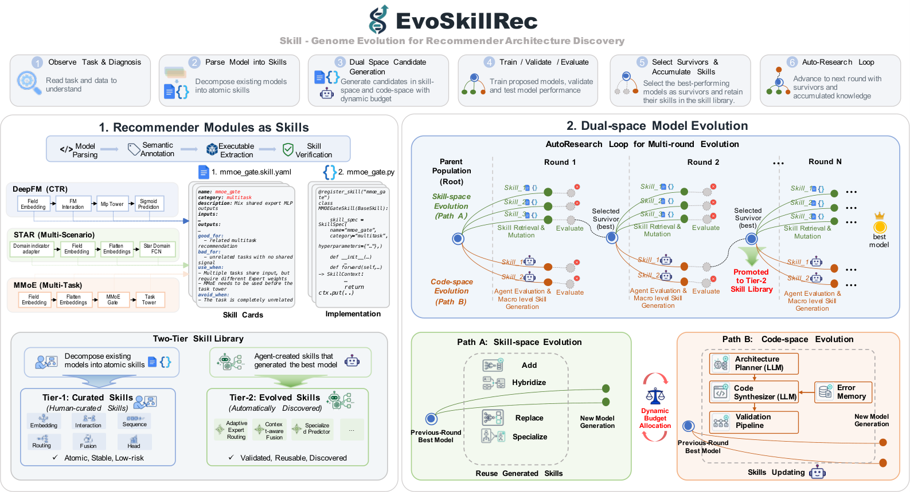

# EvoSkillRec: Skill-Genome Evolution for Recommender Architecture Discovery

<!-- source-sha256: 45e89370cd05c739dfea0d299386fad0ce0c25407151345d5b3fec7f418ad033 -->

[简体中文](README.md)

> **L1 mechanism diagnostic.** Typed genomes, validation, promotion, and reuse execute. No external LLM invents arbitrary code and no large-scale search gain is claimed.

## Paper information

| Field | Value |
| --- | --- |
| Paper | [arXiv 2609.34552](https://arxiv.org/abs/2609.34552) |
| Affiliation | City University of Hong Kong |
| First public release | 2026-09-28 (arXiv v1) |
| Authors' code | [EvoSkill-Rec](https://github.com/Xiaopengli1/EvoSkill-Rec) |
| Adapter | `evoskillrec` |
| Local code | [evoskillrec](https://github.com/daiwk/auto-research/tree/main/src/auto_research/reproductions/evoskillrec/) |

## Original paper

### Background and contribution

Split a recommender into executable skills with typed inputs and outputs. The controller composes within constraints; only validated innovations advance to the reusable library.

<!-- paper-figure:start -->
### Key figure from the paper

Original components and connections from the [paper](https://arxiv.org/abs/2609.34552); copyright belongs to the authors.
<!-- paper-figure:end -->

### Core equation and evidence

A genome $g=(s_1,\ldots,s_n)$ is executable only if adjacent types satisfy $O(s_i)=I(s_{i+1})$. Promote to the reusable library only when $V(g)>V(g_0)+\epsilon$. The local adapter runs type checking, composition, validation, promotion, and reuse. Paper benchmarks, speed, and learning curves are separate from the local three-seed mini-suite and imply no online gains here.

## Local reproduction

Compare a fixed genome without skill transformations to typed composition with validation-gated promotion. [Three-seed metrics](metrics/mechanism-seeds42-44.json) are `diagnostic_only=true`, not relative capability scores or rankings.

## Reproduction limits

The controller executes the constrained workflow, not arbitrary LLM-generated code or the paper's large-scale search.
