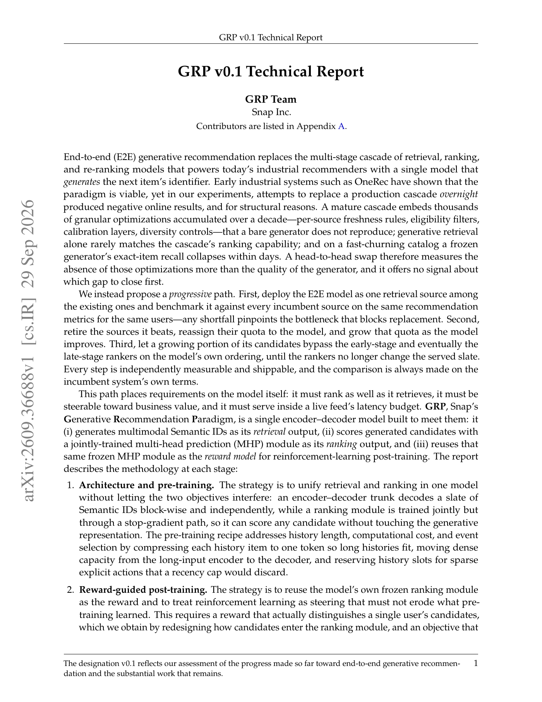

# GRP v0.1: Progressive end-to-end generative recommendation

<!-- source-sha256: 8ef75d82181ab9ea6509b47ddc6d2c41b173acd5730f5c7a6c592af0636bfc99 -->

[简体中文](README.md)

> L1 architecture/objective diagnostic, not Snap online reproduction.

## Paper information

| Field | Details |
|---|---|
| Paper | [arXiv v1](https://arxiv.org/abs/2609.36688) |
| Institution | Snap Inc. |
| First public release | 2026-09-29 (arXiv v1) |
| Author code | No author repository found as of 2026-09-30. |
| Local adapter or method key | `grp` |
| Local reproduction code | [`src/auto_research/reproductions/grp/`](https://github.com/daiwk/auto-research/tree/main/src/auto_research/reproductions/grp/) |

## Paper method and evidence

Gradually add the unified generator as a retrieval source, replace weaker sources, increase its quota and bypass rankers. Encoder–decoder outputs multimodal SIDs. MHP ranks from detached encoder/SID states and then serves as frozen RL reward.

<!-- paper-figure:start -->
### Original paper figure

First-page overview of the architecture. From the [original paper](https://arxiv.org/abs/2609.36688); copyright remains with the authors.
<!-- paper-figure:end -->

### Core equation

mGRPO keeps clipped policy ratios and adds a one-sided logged-target margin only when the current policy sacrifices target retrieval beyond tolerance. Ranking loss cannot reach the generator.

### Reported results

Online retrieval-only comparison: view time +0.46%, shares +0.77%. Bypass plus weak-source replacement: +0.82%, +2.56%, and end-to-end retrieval latency 69% lower. Author industrial P0 evidence, not local measurements.

## Local reproduction

Run `auto-research reproduce --paper grp` for block isolation, candidate score differentiation and finite generation/mGRPO gradients. Same GRPO surrogate without the one-sided guard is the comparison; no capability estimate. [Three-seed metrics](metrics/mechanism-seeds42-44.json). No private Snap logs, Qwen3-VL SID tokenizer, production training, CUDA graph serving, inverted index or live traffic. `concept_demo / l1_mechanism`, not Evolve gain evidence.
