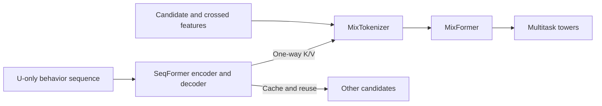
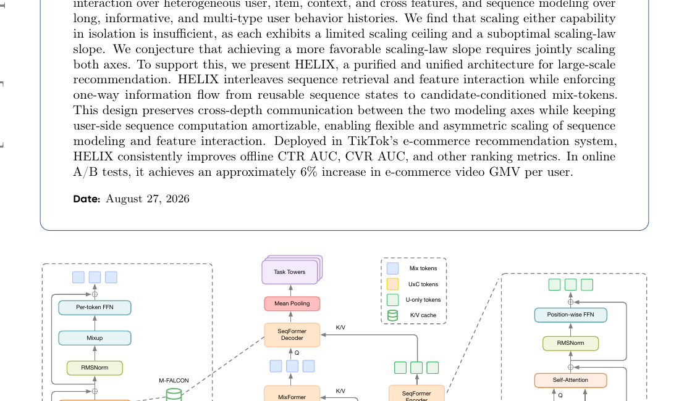

<!-- source-sha256: 79c75db3cdf8d2b9c647055e3de469901e64c8dec0bf2ba27b470a8e370dc75b -->

[简体中文](README.md) · English

# HELIX: Scaling feature interaction and sequence modeling together

> **L1 architecture mechanism.** Three token streams, one-way U-only caching, cross-depth MixFormer/SeqFormer interactions and multitask heads are implemented. No private TikTok data or online traffic is used.

## Paper information

| Field | Details |
| --- | --- |
| Paper | [arXiv v1](https://arxiv.org/abs/2609.37183) |
| Company | TikTok / ByteDance |
| First public release | 2026-09-29 (arXiv v1) |
| Original source code | No author repository found as of 2026-09-30. |
| Adapter | `helix` |
| Local reproduction code | [`src/auto_research/reproductions/helix/`](https://github.com/daiwk/auto-research/tree/main/src/auto_research/reproductions/helix/) |

## Original paper summary

The manuscript also lists 2026-08-27. This site uses the publicly verifiable arXiv v1 date.

### Background and main changes

Industrial rankers scale heterogeneous feature interactions and long behavior sequences separately, but each axis has limits alone. HELIX interleaves SeqFormer and MixFormer while information flows only from reusable user-only sequence state to candidate-conditioned mix tokens. User computation can be shared across candidates while both axes still interact across depths.

<!-- paper-figure:start -->
### Key figure from the paper

> Figure 1 shows U-only, U×C and mix tokens and one-way M-FALCON interactions. From the [paper](https://arxiv.org/abs/2609.37183); copyright belongs to the authors.
<!-- paper-figure:end -->

### Core equations

Local candidate-conditioned cross-attention is $M' = M + \mathrm{Attn}(Q=M,K=S_U,V=S_U)$, while updates to $S_U$ cannot read candidate tokens. The MPTF branch gates position-wise and per-token FFN outputs. Tests check that candidate changes affect outputs but not the cached user state.

### Offline and online results

The TikTok e-commerce full-traffic A/B reports approximately 6% GMV/user lift, with a corresponding detailed result as high as 5.4624%, alongside CTR/CVR AUC gains. This is evidence for industrial P0 selection, not a local result.

## Local reproduction

> **Comparison protocol:** Candidate A versus B under the same user cache. This checks candidate sensitivity and cache invariance, not public performance; relative change is not applicable.

`auto-research reproduce --paper helix` generates mechanism metrics. See [`metrics/mechanism-seeds42-44.json`](metrics/mechanism-seeds42-44.json) for the three-seed diagnostic covering finite loss, candidate-conditioned output changes, an unchanged user cache and finite gradients.

## Scope

The local run uses synthetic tensors without private training data, online A/B or paper-scale systems optimization, so `reproduction_level=concept_demo`. Capability reproduction or Evolve search would first need fair public data, baselines and isolated validation/test over multiple seeds.
