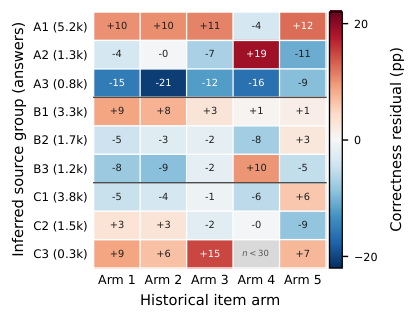

# Challenges and Solutions for Bandits in the Wild: Warm-Started Mixture Bandits for Cross-Cohort Slate Recommendation

<!-- source-sha256: 9289be82b4f0feb456084ded0dd00ff1d798789e5f5ab8ab5ab5cf228e22beff -->

[简体中文](README.md)

> **L1 core-mechanism diagnostic.** Implements fixed-strength mixture priors, Thompson slates, and posterior updates, not historical matrix factorization or the 25-day deployment.

## Paper information

| Field | Details |
|---|---|
| Paper | [arXiv 2609.37800](https://arxiv.org/abs/2609.37800) |
| Organization | DFKI / RPTU Kaiserslautern-Landau |
| First public release | 2026-09-29 (arXiv v1) |
| Authors' code | [Official public code](https://github.com/etowho/university-games) |
| Adapter | `cohortmix-ts` |
| Local reproduction code | [`src/auto_research/reproductions/cohortmix_ts/`](https://github.com/daiwk/auto-research/tree/main/src/auto_research/reproductions/cohortmix_ts/) |

## Original paper

### Motivation and method

Learn user groups and item arms from historical cohorts. Use metadata to build a fixed-strength mixture Beta prior for a new user. At each round, Thompson sampling selects a previously unexposed slate; feedback updates each user's posterior independently.

~~~mermaid
flowchart LR
  I[Public input and current state] --> M[CohortMix-TS mechanism]
  M --> A[Auditable intermediates]
  A --> O[Output or state update]
~~~

<!-- paper-figure:start -->
### Key figure from the paper

> **Figure 3:** Original method design and components. From the [paper](https://arxiv.org/abs/2609.37800); copyright remains with the authors.
<!-- paper-figure:end -->

### Core equation

$\hat\mu_{c,a}=(\alpha_0+s_{c,a})/(\alpha_0+\beta_0+s_{c,a}+f_{c,a})$. The new user's prior uses fixed-strength Beta pseudo-counts weighted by cohort membership.

### Paper results

In the 25-day randomized deployment, the between-group difference in early-to-late correctness change was 6.23 percentage points in the restricted full-window subgroup, with 95% bootstrap interval [0.5, 11.9] and p=0.043. Engagement among all registered users did not differ significantly.

## Local reproduction

> **Local comparison:** The baseline disables the mechanism or uses the default state, and the treatment enables the core operator. This checks invariants and state transitions only; cross-model relative changes are not applicable.

See the [three-seed diagnostic](metrics/mechanism-seeds42-44.json). `diagnostic_only=true` indicates executable state transitions, gradients, or scheduling invariants only, not eligibility for capability ranking.

## Reproduction boundaries

Fixed-strength mixture priors, Thompson slates, and posterior updates are implemented. Historical matrix factorization and the 25-day deployment were not reproduced.
