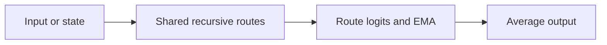
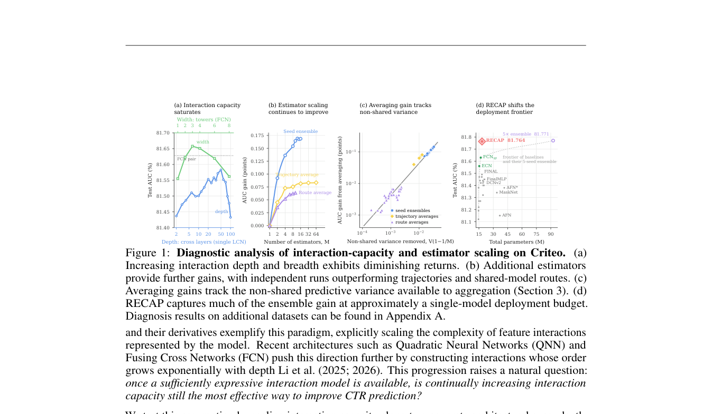

# Beyond Interaction Capacity: Estimator Scaling with Recursive Models for CTR Prediction

<!-- source-sha256: 618fc50609675182037636e07166963f851839276c4918fdb2b8003f19b46077 -->

[简体中文](README.md)

> **L1 mechanism diagnostic.** Shared recursion, route averaging, trajectory EMA, and a runnable RankMixer Evolve block execute.

## Paper information

| Field | Value |
| --- | --- |
| Paper | [arXiv 2609.37905](https://arxiv.org/abs/2609.37905) |
| Affiliations | Georgia Institute of Technology / Google Research |
| First public release | 2026-09-29 (arXiv v1) |
| Authors' code | No public author repository found as of 2026-10-01. |
| Adapter / method | `recap-ctr` |
| Local code | [`src/auto_research/reproductions/recap_ctr/`](https://github.com/daiwk/auto-research/tree/main/src/auto_research/reproductions/recap_ctr/) |

## Original paper

### Background and contribution

Scale related estimators rather than only increasing the interaction capacity of one predictor. A shared recursive backbone generates routes, combined with independent-model distillation, training-trajectory EMA, and inference route averaging.

<!-- paper-figure:start -->
### Key figure from the paper

Original Figure 1: RECAP architecture. From the [paper](https://arxiv.org/abs/2609.37905); copyright belongs to the authors. Not a local result.
<!-- paper-figure:end -->

### Core mechanism

Average route logits as $\bar Z_M=M^{-1}\sum_m Z_m$. A shared block recurs over routes and the implementation keeps training-trajectory EMA.

### Paper results

The paper improves the performance–parameter Pareto frontier on public CTR benchmarks without quantified online A/B. This is an academic mechanism and Evolve operator, not production evidence.

## Local reproduction

Compare disabled/default and enabled behavior. [Three-seed diagnostics](metrics/mechanism-seeds42-44.json), `diagnostic_only=true`, check transitions, gradients, and invariants, not relative capability rankings.

## Reproduction limits

The recursion, averaging, EMA, and runnable RankMixer block are supported; benchmark training and independent model distillation were not run.
