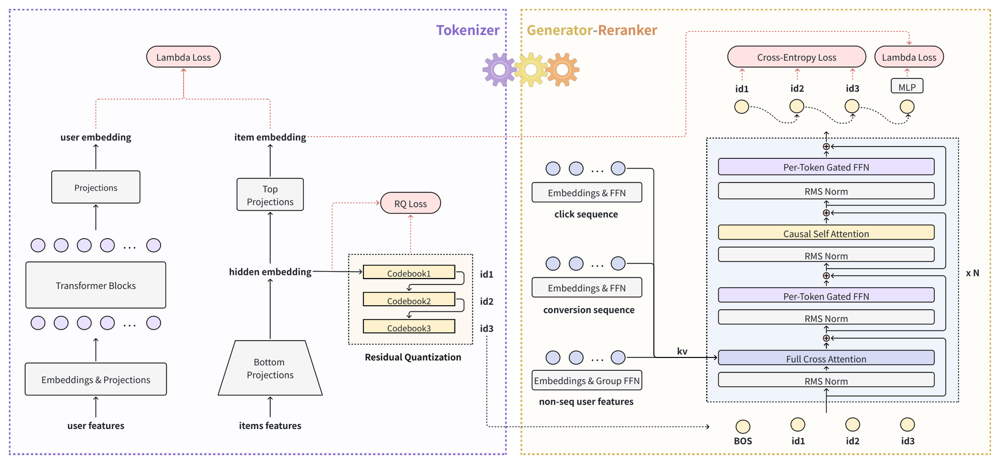

# Generative End-to-end Ad Retrieval at Douyin

<!-- source-sha256: 443295f066b19a53714631b89fc28e1f675a703722329485f54f663d474ccf42 -->

[简体中文](README.md)

> **L1 core-mechanism diagnostic.** Runs BasisVQ, the prefix residual-quantization interface, and collision reranking. No streaming parameter server, minute-level index, or online traffic is reproduced; random tensors are not advertising outcomes.

## Paper information

| Field | Details |
|---|---|
| Paper | [Generative End-to-end Ad Retrieval at Douyin](https://arxiv.org/abs/2609.39327) |
| Organization | ByteDance |
| First public release | 2026-09-30 (arXiv v1) |
| Authors' code | No public author implementation was found as of 2026-10-02. |
| Adapter / method | `gear` |
| Local reproduction code | [`src/auto_research/reproductions/gear/`](https://github.com/daiwk/auto-research/tree/main/src/auto_research/reproductions/gear/) |

## Original paper

### Motivation and method

GEAR parameterizes BasisVQ/BasisRQ with an orthogonal basis so codebook updates share structure globally and rotate stably. The generator outputs hierarchical tokens; a context-conditioned reranker ranks items with collisions.

~~~mermaid
flowchart LR
  I[Public input and current state] --> M[gear mechanism]
  M --> A[Auditable intermediates]
  A --> O[Output or state update]
~~~

<!-- paper-figure:start -->
### Key figure from the paper

> **Key figure:** Original architecture, training flow, or system protocol. From the [original paper](https://arxiv.org/abs/2609.39327); copyright remains with the authors. Click the image for the source.
<!-- paper-figure:end -->

### Core equations

$q(z)=B c_{argmin_j\|zB-c_j\|}$. Within a collision group, rank by $s_i=h_u^Te_i$.

### Paper results

In a seven-day Douyin Ads online A/B test with 5% traffic per arm, ADSS rose 0.563%, ADVV rose 0.658%, and cold-start activation rose 1.46%.

## Local reproduction

> **Local comparison:** The baseline disables the mechanism or uses default state; the treatment enables the core operator. Relative percentage change is not applicable. This checks invariants, gradients, or state transitions, not paper-scale effects.

- [Three-seed diagnostic](metrics/mechanism-seeds42-44.json)
- `diagnostic_only=true`; ineligible for formal capability ranking.

## Reproduction boundaries

BasisVQ, prefix residual quantization, and collision reranking run locally. The streaming parameter server, minute-level index, and online traffic are not reproduced. Random tensors do not measure ad effectiveness.
