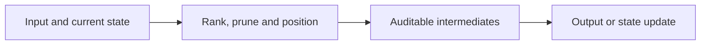
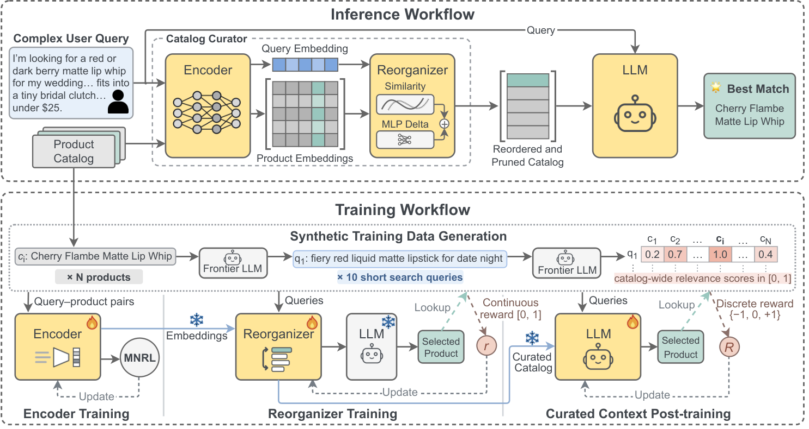

<!-- source-sha256: 28921b9f8ec97d56b37ce075b29c35b698affa749e9d20863d0e6c7664760c27 -->

[简体中文](README.md) · English

# RPTune: Learned Context Curation for LLM Catalog Search

> **L1 core mechanism diagnostic.** Only rank/prune/position orchestration runs. Gemini/Gemma, merchant catalogs and the paper's training are not used.

## Paper information

| Field | Details |
| --- | --- |
| Paper | [arXiv v1](https://arxiv.org/abs/2610.00964) |
| Institution | Google |
| First public release | 2026-10-01 (arXiv v1) |
| Original source code | No public author implementation found as of 2026-10-03. |
| Adapter | `rptune` |
| Local reproduction code | [`src/auto_research/reproductions/rptune/`](https://github.com/daiwk/auto-research/tree/main/src/auto_research/reproductions/rptune/) |

## Original paper summary

### Background and main changes

A query–product encoder, learned adjustment and downstream LLM feedback determine what products to retain and where to place them. Higher-priority items go near the prompt end. Post-train selection on the curated catalog.

<!-- paper-figure:start -->
### Key figure from the paper

> **Figure 2:** Core architecture, modules and connections. From the [paper](https://arxiv.org/abs/2610.00964); copyright belongs to the authors. Click for the source.
<!-- paper-figure:end -->

### Core equation

$s_i=10e_q^Te_i+MLP([e_q;e_i])$. Keep the top-k items and sort them by ascending score.

### Offline and online results

Across 7 real merchants, the paper reports a mean curation gain of 14.0 exact-match points and another 10.3 points from post-training.

## Local reproduction

> **Comparison protocol:** Disabled or default mechanism versus its defining operator. L1 does not report formal relative gains; percentages are not applicable.

- Three-seed diagnostic: [`metrics/mechanism-seeds42-44.json`](metrics/mechanism-seeds42-44.json).
- `diagnostic_only=true`; excluded from formal capability rankings.

## Scope

Only rank/prune/position orchestration executes. There are no Gemini/Gemma calls, merchant catalogs or paper training.
