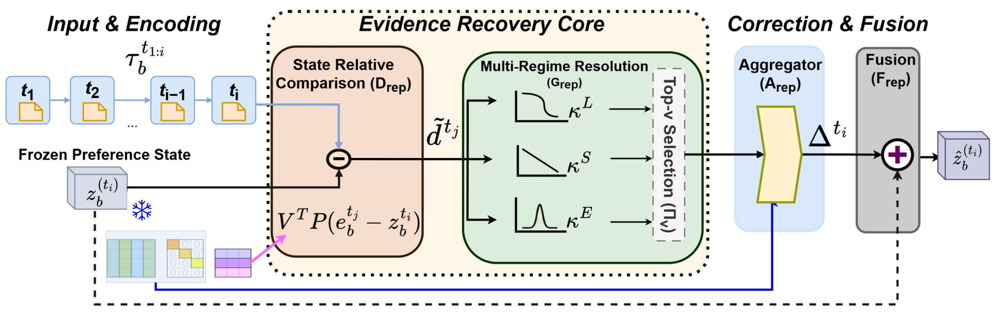

<!-- source-sha256: cbc97a85b5aa3dc217bd71e1de09b1c811fe918cbcd26c418a05c8c1f9251d89 -->

[简体中文](README.md) · English

# Not All Is Lost: Repairing Lossy User Preference States of Personalization Encoders

> **L1 core mechanism diagnostic.** Frozen-cache evidence selection and residual correction run. User-approved academic/Evolve exception; no production A/B.

> **Inclusion exception:** The user explicitly approved this academic/Evolve mechanism on 2026-10-02. The paper has no quantitative online A/B and does not contribute to industrial evidence claims.

## Paper information

| Field | Details |
| --- | --- |
| Paper | [arXiv v1](https://arxiv.org/abs/2610.01270) |
| Institution | The first page does not list the first author's affiliation. |
| First public release | 2026-10-01 (arXiv v1) |
| Original source code | No public author implementation found as of 2026-10-02. |
| Adapter | `repair-state` |
| Local reproduction code | [`src/auto_research/reproductions/repair_state/`](https://github.com/daiwk/auto-research/tree/main/src/auto_research/reproductions/repair_state/) |

## Original paper summary

### Background and main changes

Freeze the encoder and task head. Compare per-timestep representations in the existing forward cache against the current preference state, select corrective evidence from long-term, recent or locally concentrated behavior, and apply a residual repair.

<!-- paper-figure:start -->
### Key figure from the paper

> **Paper figure:** Core architecture, training flow or protocol. From the [paper](https://arxiv.org/abs/2610.01270); copyright belongs to the authors. Click for the source.
<!-- paper-figure:end -->

### Core equation

$z'=z+\sum_{t\in TopK}softmax(q^T(h_t-z))(h_t-z)$.

### Offline and online results

All 12 recommendation hosts improved in the paper. Mamba4Rec on MovieLens gained +3.96 MRR points, versus +0.19 for head-only. Personalized generation gains reach +25.23%.

## Local reproduction

> **Comparison protocol:** Disabled or default mechanism versus enabled core operator. Relative percentages are not applicable; metrics verify invariants, gradients or state transitions, not paper-scale effects.

- Three-seed diagnostic: [`metrics/mechanism-seeds42-44.json`](metrics/mechanism-seeds42-44.json).
- `diagnostic_only=true`; excluded from formal capability rankings.

## Scope

Frozen-cache evidence selection and residual correction execute. This is a user-approved academic/Evolve exception without online A/B.
