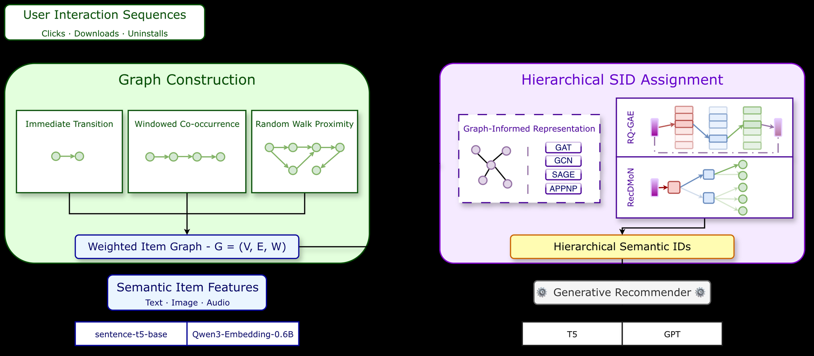

# Neither Black nor White: Balancing Semantic and Collaborative Signals with Graph-Informed Semantic IDs (GrIS)

<!-- source-sha256: 935a3b852282dfcd0c4937935a654647784551de67f551eefd7a826a6c5f9cbf -->

[简体中文](README.md)

> **L1 mechanism diagnostic.** User-approved academic/Evolve exception on 2026-10-02; no online A/B or industrial evidence claim.

## Paper information

| Field | Value |
| --- | --- |
| Paper | [arXiv v1](https://arxiv.org/abs/2610.01533) |
| Affiliations | Huawei Ireland Research Centre |
| First public release | 2026-10-01 (arXiv v1) |
| Authors' code | [graph-informed-sids](https://github.com/hirc-airecs/graph-informed-sids) |
| Adapter / method | `gris` |
| Local code | [`src/auto_research/reproductions/gris/`](https://github.com/daiwk/auto-research/tree/main/src/auto_research/reproductions/gris/) |

## Original paper

### Background and contribution

Build semantic IDs by hierarchical graph partitions. Nodes carry content semantics and edges collaboration. Empty graphs reduce to content quantization.

<!-- paper-figure:start -->
### Key figure from the paper

Original GrIS method figure. From the [paper](https://arxiv.org/abs/2610.01533); copyright belongs to the authors. Not a local result.
<!-- paper-figure:end -->

### Core mechanism

$SID(i)=RecursivePartition(G,X)_i$. Each layer combines smoothed semantics and adjacency.

### Paper results

Up to 52% higher Hit@10 than CF-aware state of the art across real datasets, as reported by the authors.

## Local reproduction

Compare disabled/default versus enabled. [Three-seed diagnostics](metrics/mechanism-seeds42-44.json) verify transitions and invariants, not paper-scale effects (`diagnostic_only=true`).

## Reproduction limits

The graph-informed binary hierarchy executes. The exception is not production A/B evidence.
