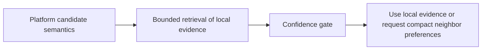
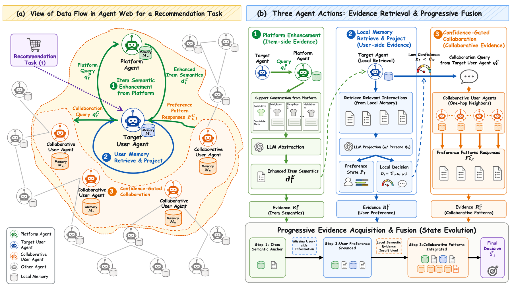

# AgentWebRec: Compact Evidence Fusion over the Agent Web for Personalized Recommendation

<!-- source-sha256: c4a44ce06cea9f8d55ed3c816d8dbd64c37ac897344f47e42b31591afe627bd6 -->

[简体中文](README.md)

> L1 mechanism diagnostic: bounded retrieval and confidence gating; no private-record exposure or LLM Agent Web execution.

## Paper information

| Field | Details |
|---|---|
| Paper | [arXiv v1](https://arxiv.org/abs/2610.01705) |
| Institution | Beihang University. |
| First public release | 2026-10-01 (arXiv v1) |
| Author code | No public author implementation found as of 2026-10-03. |
| Local adapter or method key | `agent-web-rec` |
| Local reproduction code | [`src/auto_research/reproductions/agent_web_rec/`](https://github.com/daiwk/auto-research/tree/main/src/auto_research/reproductions/agent_web_rec/) |

## Paper method and evidence

Fetch candidate semantics from the platform, then retrieve private memories for the target user by semantic relevance and time decay. Only when local evidence confidence is too low does the method query compact preference summaries from neighboring agents.

<!-- paper-figure:start -->
### Original paper figure

Figure 2 shows the evidence-fusion workflow. From the [original paper](https://arxiv.org/abs/2610.01705); copyright remains with the authors.
<!-- paper-figure:end -->

### Core equation

$w=\beta w_{sem}+(1-\beta)e^{-\gamma\Delta t}$; collaborate only when $\kappa<\theta$.

### Reported results

The paper reports better results than the compared baselines in all four InstructRec domains.

## Local reproduction

Compare the defining operator with its disabled/default baseline. The [three-seed diagnostic](metrics/mechanism-seeds42-44.json) is `diagnostic_only=true`; no formal improvement estimate or capability ranking.
