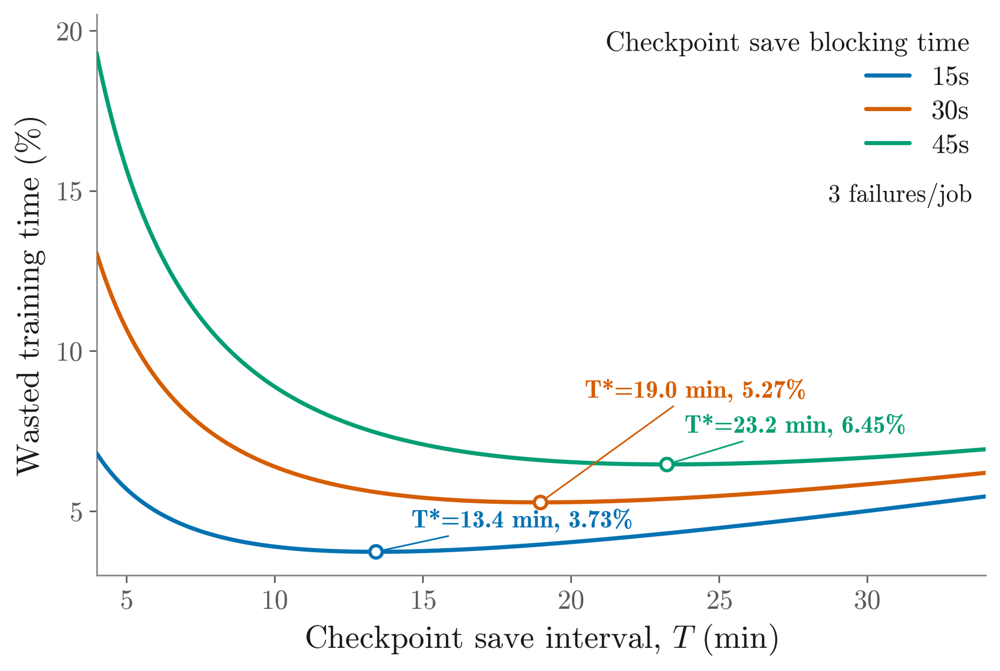

# Optimizing Effective Training Time for Large-Scale Recommendation Systems

<!-- source-sha256: aa493874ee746e481930fd7f7d89b15afd90cd0bcf0d87021a60d0aff4730cfe -->

[简体中文](README.md)

> L1 effective-training-time and owner attribution diagnostic. User-approved industrial training-infrastructure exception (2026-10-02); ETT is not online A/B or recommendation quality.

## Paper information

| Field | Details |
|---|---|
| Paper | [arXiv v1](https://arxiv.org/abs/2610.02057) |
| Institution | Meta Platforms, Inc. |
| First public release | 2026-10-01 (arXiv v1) |
| Author code | No public author implementation found as of 2026-10-02. |
| Local adapter or method key | `effective-training-time` |
| Local reproduction code | [`src/auto_research/reproductions/effective_training_time/`](https://github.com/daiwk/auto-research/tree/main/src/auto_research/reproductions/effective_training_time/) |

## Paper method and evidence

Decompose wall time into useful training on new data versus lifecycle costs: initialization, compilation, checkpointing, publishing, and recovery. Attribute lost time by owner so it can be addressed.

<!-- paper-figure:start -->
### Original paper figure

The original paper figure shows the infrastructure protocol. From the [original paper](https://arxiv.org/abs/2610.02057); copyright remains with the authors.
<!-- paper-figure:end -->

### Core equation

$ETT=training\_on\_new\_data / wall\_time$.

### Reported results

Representative models averaged 15.5% higher ETT, the largest workload reached 85%, and the deployed fleet rose from about 80% to above 90%. These measure infrastructure, not ranking lift.

## Local reproduction

Compare with the corresponding operator disabled or in its default state. [Three-seed metrics](metrics/mechanism-seeds42-44.json) are diagnostic_only=true: they verify execution and invariants, not formal gains or capability ranking.
