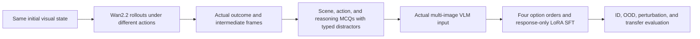
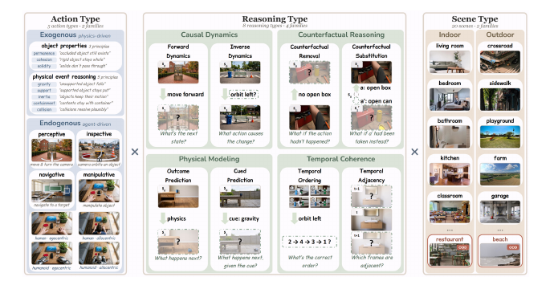

# WOVEN: Visual State Transitions as a Shared Training Primitive

<!-- source-sha256: 3c7f5518fd36be1bc8aa964050531232d66f297057e8e0ccd57f3f4376d2f575 -->

[简体中文](README.md)

## Paper information

| Field | Value |
| --- | --- |
| Paper | [arXiv 2610.12417](https://arxiv.org/abs/2610.12417) |
| Affiliations | Northwestern University / Carnegie Mellon University / UNC Chapel Hill / Amazon |
| First public release | 2026-10-08 (arXiv v1) |
| Authors' code | Yes: [WOVEN](https://github.com/mll-lab-nu/WOVEN) |
| Adapter | `woven` |
| Local code | [`src/auto_research/reproductions/woven/`](https://github.com/daiwk/auto-research/tree/main/src/auto_research/reproductions/woven/) |

The authors released training code and train data on 2026-10-09. As of 2026-10-12, their public card marked validation and three test splits as pending upload. The catalog uses the paper's v1 date, not the code release date.

## Original paper

### Background and contribution

Static recognition is not understanding change. WOVEN uses $(s,a,s')$ as its common object, obtaining outcomes and intermediate states from video-model rollouts rather than writing outcomes into prompts. Different actions from the same initial state provide counterfactuals. Scene, action, and reasoning axes control supervision; typed distractors distinguish errors.

The mechanism is **training a multimodal LM with actual visual-transition supervision**, not an image scorer. The corpus contains 36,076 four-option questions, 20 scene types, 5 action types, and 8 operations: 22,728 train, 2,508 validation, 6,228 ID test, 3,496 scene-OOD, and 1,116 state-perturbation items. Supervision operation predicts transfer better than scene content, and change magnitude affects robustness.



The [v1 PDF](https://arxiv.org/pdf/2610.12417v1), page 5 Figure 2, confirms all three axes. Dashed boxes are inferred transition elements; restaurant/beach belong only to scene-OOD. This is not a local accuracy plot.

<!-- paper-figure:start -->
### Key figure from the paper

[](https://arxiv.org/pdf/2610.12417v1)

Original Figure 2, page 5 of the [paper](https://arxiv.org/pdf/2610.12417v1), showing the independent controlled axes and held-out scenes. Copyright belongs to the authors.
<!-- paper-figure:end -->

### Core equations

Forward, inverse, and counterfactual operations use $P(s'\mid s,a)$, $P(a\mid s,s')$, and $P(s'_{a_{alt}}\mid a,s',a_{alt})$. Temporal order and adjacency infer relationships between observed frames, not image classes. Local SFT preserves the response-only path:

$$
\mathcal L_{SFT}=-\sum_{t\in\text{response}}\log p_\theta(y_t\mid s,a,\mathrm{options},y_{<t}),\quad W'=W+\tfrac\alpha r BA.
$$

The four option permutations move the target letter with its option, preserving content and image references. Original SFT uses LoRA rank 16/alpha 4/dropout .05, q/k/v/o projections, three epochs, and lr 1e-4. Full-mix uses SFT only; subset experiments add GRPO. See [Section 2 and Appendix G.1](https://arxiv.org/html/2610.12417v1#S2). Local runs do not include GRPO.

### Paper results

| Qwen2.5-VL-3B, Table 3 | Base | Full-train SFT |
| --- | ---: | ---: |
| ID accuracy % | 26.4 | 89.3 |
| Held-out scene % | 27.8 | 88.2 |
| State perturbation % | 21.1 | 38.3 |

Controlled subsets of about 2,000 examples cover 22/26 external benchmarks with gains up to 27.3 pp. Different benchmarks use different subsets; this is not one model gaining on all 22. High ID scores do not establish robustness. See [Sections 3–5](https://arxiv.org/html/2610.12417v1#S3). No production A/B was reported.

## Local reproduction

> Compare response SFT on real transitions with the same frozen public VLM at zero LoRA residual. The source-grouped small accuracy is L1, not an original benchmark comparison.

`woven_prompt` supplies questions, option labels/content, and actual images. `answer` is training target or post-hoc scoring only; `is_correct/distractor_type/is_static/action_id` stay out of the prompt. The processor reads real PIL images in order. Both vision encoder and autoregressive decoder run, not CLIP/class scoring.

```bash
PYTHONPATH=src python scripts/run_oct12_multimodal.py --paper woven \
  --device cuda --seed 42 --maximum 96 --steps 24 --lora-rank 16 \
  --dataset-dir data/oct12-woven --output runs/oct12/woven-s42
```

The default evaluates native option order; `--evaluation-rotations 4` adds a circular diagnostic. Training cycles four arrangements. Steps and hyperparameters are fixed before test.

### Data and results

Use [MLL-Lab/WOVEN](https://huggingface.co/datasets/MLL-Lab/WOVEN) revision `9ebd698c8500f4d4729ffe39bd78f4fd694904aa`, bounded public train prefix only. Split by initial-frame `source_id`; related actions/questions cannot cross partitions. Report item/group counts and hashes. Fewer than five groups fails rather than falling back to random-question splits. This is not official test or formal benchmark evidence.

Public [SmolVLM-256M-Instruct](https://huggingface.co/HuggingFaceTB/SmolVLM-256M-Instruct), revision `7e3e67edbbed1bf9888184d9df282b700a323964`, trains actual language q/k/v/o LoRA; visual encoder and base weights are frozen. `scripts/prepare_oct12_public_sources.py --source woven` streams the subset. Sync only `woven.jsonl`, images, and `provenance.json`; verify row/image/file SHA256s offline. `--checkpoint-path` selects a mirror without substituting the path for a public revision or exposing it in receipts.

On 2026-10-12 A100 ran a 96-item prefix split by source into 56/16/24 and trained 24 steps. Four orders per local test item gave 96 scores. Frozen accuracy was `0.28125`; LoRA gave `0.27083`. Retain the degradation. Test did not select the budget; this is neither official test nor evidence of transfer.

[Measurements and group hashes](metrics/public-vlm-a100-42.json) and [GPU receipt](../../gpu-validations/oct12-woven-a100.json) preserve provenance. Tests cover option/target remapping, image order, gold exclusion, and source isolation.

### Code and boundaries

`multimodal/oct12_reward_transition.py::{woven_prompt,LoRALinear,sft_response_loss,run_woven}` implements the mechanism alongside the CLI and preparation scripts. It uses real images derived from author rollouts without regenerating Wan videos. It does not reproduce 3B/7B/32B, GRPO, 22,728-example training, or the 26 transfer benchmarks. Labels go only to trainer/evaluator, not candidate generation. A nonofficial small test remains diagnostic with additional seeds. No Evolve integration claimed.
