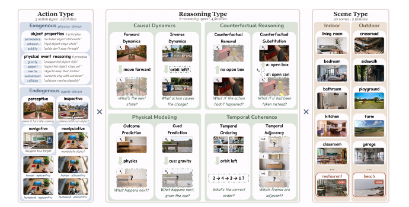

# WOVEN：视觉状态转移作为共享训练原语

## 论文信息

| 字段 | 内容 |
|---|---|
| 论文链接 | [arXiv 2610.12417](https://arxiv.org/abs/2610.12417) |
| 公司/机构 | Northwestern University、Carnegie Mellon University、UNC Chapel Hill、Amazon |
| 首次公开日期 | 2026-10-08（arXiv v1） |
| 原文开源代码 | 是：[mll-lab-nu/WOVEN](https://github.com/mll-lab-nu/WOVEN) |
| Adapter | `woven` |
| 本地复现代码 | [`src/auto_research/reproductions/woven/`](https://github.com/daiwk/auto-research/tree/main/src/auto_research/reproductions/woven/) |

作者2026-10-09发布训练代码和train split；截至2026-10-12，公开card标明validation与三组test尚待上传。目录日期是原文v1，不是源码释放日期。

## 原始论文总结

### 背景与主要改动

静态识别不等于理解状态变化。WOVEN以$(s,a,s')$为共同对象，用视频生成模型rollout提供结果/中间状态，而非在prompt里预写结果。相同初始状态在不同动作下的rollout提供counterfactual候选；按scene、action、reasoning三个轴形成可控监督，用error-typed distractors区分错误机制。

该paper的核心是**真实视觉转移监督进入MLLM训练**，不是训练图片class scorer。36,076道四选一、20类场景、5类动作、8类操作，训练22,728、validation2,508、ID test6,228、scene-OOD3,496、state-perturbation1,116。监督操作比内容场景更能预测迁移，状态变化幅度影响鲁棒性。


原图检查：已检查 [v1 PDF](https://arxiv.org/pdf/2610.12417v1) 第5页Figure2；确认scene/action/reasoning三轴，虚线框是被推断的transition部分，restaurant/beach只属于scene-OOD。原图不是本地accuracy图。

<!-- paper-figure:start -->
### 原论文关键图

[](https://arxiv.org/pdf/2610.12417v1)

图片来自[原论文](https://arxiv.org/pdf/2610.12417v1)第5页Figure2，版权归原作者所有；已检查三个独立controlled axes和held-out scenes。
<!-- paper-figure:end -->

### 核心公式

前向、反向与反事实操作分别为 $P(s'\mid s,a)$、$P(a\mid s,s')$、$P(s'_{a_{alt}}\mid a,s',a_{alt})$；temporal ordering/adjacency从观察到的frames推断顺序或相邻状态，而非图片标签分类。

本地SFT保留该训练链路：

$$\mathcal L_{SFT}=-\sum_{t\in\text{response}}\log p_\theta(y_t\mid s,a,\mathrm{options},y_{<t}),\quad W'=W+\tfrac\alpha r BA.$$

四种option permutation同步搬迁target letter，但不改变选项内容/图像指向。原文SFT采用LoRA r16/alpha4/dropout.05，q/k/v/o投影、3epochs、lr1e-4；full-mix只SFT，subset另接GRPO。[原文 §2与AppendixG.1](https://arxiv.org/html/2610.12417v1#S2)。本地只执行SFT，不把“尚未运行GRPO”藏起来。

### 论文离线与线上效果

| 原文Qwen2.5-VL-3B，Table3 | Base | Full-train SFT |
|---|---:|---:|
| ID accuracy % | 26.4 | 89.3 |
| held-out-scene accuracy % | 27.8 | 88.2 |
| state-perturbation accuracy % | 21.1 | 38.3 |

受控约2,000样本subset组合覆盖22/26外部benchmark，最高+27.3pp；它是不同benchmark选择不同subset后的覆盖，不是一个模型无条件提升22项。较强ID分数也不代表鲁棒性问题解决。[原文 §3–5](https://arxiv.org/html/2610.12417v1#S3)。**线上 A/B：未报告**。

## 本地复现

> **本地对照口径**：同一冻结公共VLM零LoRA残差为基线，真实transition response SFT为实验组；相对原论文benchmark不适用，source_id分组小样本accuracy只用于L1诊断。

`woven_prompt`只向模型投影question、option的label/content与真实image；`answer`仅作训练target或后验evaluation，`is_correct/distractor_type/is_static/action_id`不进入prompt。processor按阅读顺序接收真实PIL图像，visual encoder与autoregressive decoder实际前向；不是CLIP/图像class scorer。

```bash
PYTHONPATH=src python scripts/run_oct12_multimodal.py --paper woven \
  --device cuda --seed 42 --maximum 96 --steps 24 --lora-rank 16 \
  --dataset-dir data/oct12-woven --output runs/oct12/woven-s42
```

默认native option-order评测，`--evaluation-rotations 4`用于额外circular诊断。train循环四种排列；step预算和超参数预先固定，test不参与选择。

### 数据协议、公开资源与结果

固定 [MLL-Lab/WOVEN](https://huggingface.co/datasets/MLL-Lab/WOVEN) revision `9ebd698c8500f4d4729ffe39bd78f4fd694904aa`。只用已公开train的bounded prefix，按**source_id初始frame**分组切train/validation/test，多个action/question不能跨split；精确example/group数量、group hash、item hash写入result。若少于5组直接失败，不退化为随机question切分。它**不是官方test，也不是正式公开benchmark比较**。

公共VLM [SmolVLM-256M-Instruct](https://huggingface.co/HuggingFaceTB/SmolVLM-256M-Instruct) revision `7e3e67edbbed1bf9888184d9df282b700a323964`。只训练language q/k/v/o的实际LoRA参数，视觉encoder/base权重冻结。

`scripts/prepare_oct12_public_sources.py --source woven` 可streaming导出小subset。同步只需 `woven.jsonl`、images与 `provenance.json`；每行/图片/file有SHA256，离线读取必须hash验证。checkpoint镜像用 `--checkpoint-path`，固定public身份与revision保留，不把本地path当public revision或写进receipt。

`metrics/protocol.json`记录待GPU验证，不伪造accuracy。单测已核验option-target重映射、真实image引用顺序、gold metadata剔除和source分组隔离。计划receipt `docs/gpu-validations/oct12-woven-a100.json`，A100/A30实跑前该门槛未通过。

### 代码映射与边界

实现 `multimodal/oct12_reward_transition.py::{woven_prompt,LoRALinear,sft_response_loss,run_woven}`；CLI与离线准备脚本可直接执行。未重生成Wan视频，使用作者已发布rollout衍生真实图像；未复刻3B/7B/32B、GRPO、完整22,728样本或26项迁移。训练标签与test答案只供trainer/evaluator，未提供给候选生成prompt。非发布test的小诊断、多seed也不能升级成formal能力比较。未声明evolve集成。
