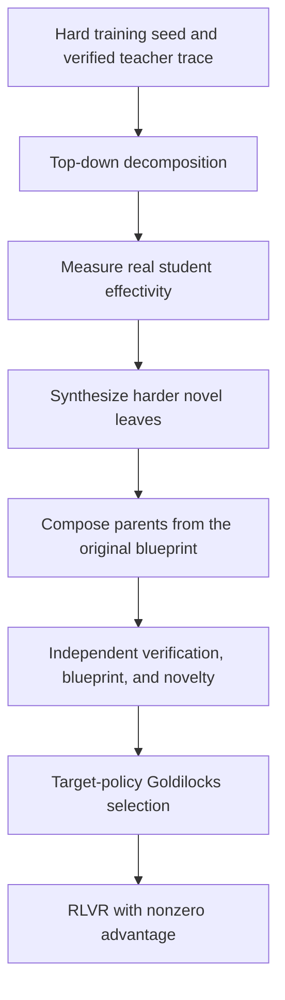
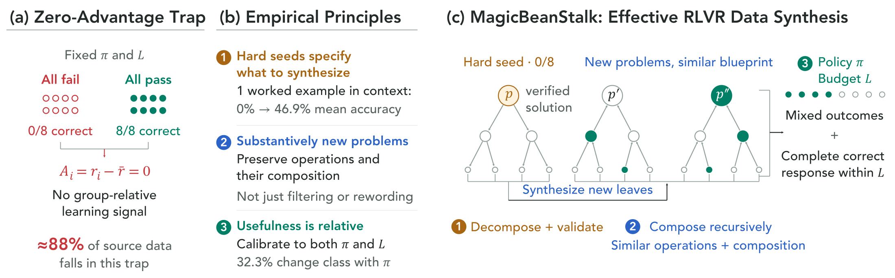

# MagicBeanStalk: Escaping the RLVR Zero Advantage Trap with Recursive Data Synthesis

<!-- source-sha256: 0dae11e5a22c809430fbc7f83c9d326e528c604f72ab5f82b90ef7568fe4ef6e -->

[简体中文](README.md)

> Deferred due to cost; complete-method acceptance remains pending (2026-10-14). At the user's direction, the candidate pool was not expanded, the teacher was not replaced, and further seeds were not launched. The historical key `magicbeanstalk` was removed from the executable registry, batch reproduction, and public runner. The paper notes, source, and all failed evidence remain. The CUDA gate in `deferred-spec.json` was not waived; there is no pass receipt or Evolve integration.

## Paper information

| Field | Details |
|---|---|
| Paper | [arXiv 2610.12659](https://arxiv.org/abs/2610.12659) |
| Institutions | NVIDIA / University of Washington / Carnegie Mellon University / Stanford University |
| First public release | 2026-10-08 (arXiv v1) |
| Author code | No released implementation found in the paper or linked primary sources as of 2026-10-13; this is not proof of universal absence. |
| Local adapter | `magicbeanstalk` (historical planned key; no runnable entry point) |
| Local reproduction code | [`src/auto_research/reproductions/magicbeanstalk/`](https://github.com/daiwk/auto-research/tree/main/src/auto_research/reproductions/magicbeanstalk/) |
| Evidence level | L0/L1 real-model mechanism work, not full benchmark reproduction. Complete CUDA acceptance requires execution on A100/A30 and a sanitized, source-bound receipt. |

## Paper method and evidence

A problem's utility for RLVR depends on the current policy and rollout budget. MBS extracts reasoning blueprints from verified hard seeds, decomposes them top-down, measures whether solved children improve parent accuracy, synthesizes harder novel leaves, and composes them bottom-up according to the original dependencies. Independent validation must preserve the blueprint and meaningful novelty, then the target policy must have mixed successes and failures with at least one complete, correct solution within budget.



<!-- paper-figure:start -->
### Original paper figure

[](https://arxiv.org/html/2610.12659v1/figure1_v3.svg)

[Pinned Figure 1](https://arxiv.org/html/2610.12659v1#S0.F1) illustrates zero advantage for uniform-success/failure groups, the three synthesis principles, and verified top-down decomposition followed by bottom-up composition. The values are from the paper, not the local attempts. See the [original SVG](https://arxiv.org/html/2610.12659v1/figure1_v3.svg) and [provenance and SHA-256](figure-source.json). Copyright remains with the authors; the Mermaid above is an explanatory redraw.
<!-- paper-figure:end -->

### Core equations

$$
\bar r_{\pi,L}(p)=N^{-1}\sum_i r_i,\quad \hat A_i=r_i-\bar r_{\pi,L}(p).
$$

All-success or all-failure groups have zero advantage. Goldilocks requires $0<\bar r_{\pi,L}(p)<1$ and at least one correct response that terminates normally. Effectivity independently requires $acc_{\rm cond}(parent\mid children)>acc(parent)$ for a student, and does not replace the final target-policy filter. Success caps on the weakest student are 0.8 for leaves and 0.625 for parents.

### Reported results

About 88% of roughly 78K math problems fall into zero-advantage groups. Across eight math benchmarks with a 16K reasoning budget, average pass@1 rose from 61.2 to 69.8 for gpt-oss-120b and 72.4 to 77.9 for DeepSeek v4 Flash. Hard-seed conversion was 74.7% versus 43.8% for direct synthesis. SecQue and FinanceBench improved by 6.9 and 2.4 percentage points. No production A/B was reported. [Paper-reported values and sources](paper-results.json) are not local measurements.

## Local implementation and attempted validation

Compare with seed-RLVR under the same student and configured step/group/response caps, accounting for synthesis and filtering separately. This is not matched total cost or a stable-improvement comparison. Pin public data and checkpoint revisions and verify input files with `checkpoint_source` and `validate_holdout`. Only the official GSM8K train split supplies local train and validation; official test is not opened. Qwen2.5-0.5B-Instruct is pinned to `7ae557604adf67be50417f59c2c2f167def9a775`; the Qwen2.5-7B-Instruct teacher/reasoner to `bb46c15ee4bb56c5b63245ef50fd7637234d6f75`.

Gold is restricted to an external training verifier, SFT targets, and explicitly train-only construction. The construction teacher may see training demonstrations and verified traces; the independent solver sees only the question; the effectivity student sees the parent question and independently worked child examples, never parent gold or plan. Effectivity and final target-policy selection are separate. A hard seed requires every calibrated attempt to fail and terminate normally. Scaffolds reject duplicate parent questions/full traces before external review for direct answer or full-plan leakage, which is not a formal proof. Invalid decomposition, absence of verified novel descendants, or no Goldilocks group writes failure; no substitute examples are fabricated.

### Historical command — disabled

The historical method is no longer selectable in the runner, and direct adapter calls reject it. This command is for auditing prior evidence, not a runnable tutorial. Reopening requires explicit direction after cost review and a new complete GPU acceptance, not just re-registration. The historical configuration specified local snapshots, public IDs/revisions, train/validation, a split manifest, and dataset revision.

```bash
PYTHONPATH=src python scripts/run_oct13_post_training.py \
  --method magicbeanstalk --config data/oct13_execution.json \
  --device cuda --seed 42 --steps 2 --train-examples 4 --group 4 --depth 1 --max-tokens 768 --decomposition-retries 2 --synthesis-retries 2 \
  --output runs/oct13/magicbeanstalk-42
```

Record real generations, rejections, calibration, teacher profiling, and supervised-token cost. Failure writes immutable `failure.json`; success writes `result.json`/`report.md`. A directory name is not provenance. JSON boolean `construction_teacher_sample` defaults to true; false makes only independent teacher solving and construction JSON generation deterministic. It does not change student calibration, randomized effectivity pools, RL rollouts, thresholds, or information access. No mode can force safety, effectivity, novelty, or verification to pass.

[CPU mechanism contracts](metrics/mechanism-contracts.json) record deterministic tensor/fixture checks with `diagnostic_only: true` and `formal_comparison: false`; they do not replace checkpoint runs or a GPU receipt.

### Failed A100 attempts and teacher-only probe

| Evidence | What actually ran and why it did not pass |
|---|---|
| [Original 6a, seed 42](metrics/public-a100-failed-seed42-6aabe57a.json) | Source `6aabe57a`, 85.60 seconds, 4,741 calibration and 1,541 evaluation tokens, no teacher generations. Four seed outcomes were all correct, 2/4, all incorrect with two truncations, and 2/4. No verified hard root; construction, effectivity, Goldilocks, and RL did not run. |
| [Bounded 0f, seed 42](metrics/public-a100-bounded-failed-seed42-0f5dca9f.json) | 348.24 seconds; 16 train examples, up to four roots, cap 1,024 and wall 1,800 seconds, unchanged depth/retries/group/two-step training and thresholds. Roots [4,7,8] all failed without truncation, and construction was attempted three times. No surviving descendants or paired RL roots; both arms had zero updates. Generated tokens: 29,408 calibration, 2,577 construction verification, 1,231 student effectivity, 1,038 teacher effectivity, 334 construction teacher, 1,541 initial validation. Raw output has two teacher rejections but does not identify the third root's precise gate; do not attribute it to Goldilocks or novelty. |
| [b908 response traces](metrics/public-a100-trace-failed-seed42-b9086275.json) | `b90862754bf51b1beeb5add3f7dc2a51ca00ace4`, 54 source hashes, same 16-train/four-root/1,024-token/1,800-second budget. Only root 4 passed initial verification. Its two proposals each contained two valid child objects, one verified child each. Roots 7/8 failed. 343.03793690539896 seconds, 36,129 generated tokens including 1,541 initial validation, no pairs or RL updates, effectivity/synthesis/Goldilocks not reached. Only response hashes, roles, lengths, and truncation/verification outcomes are public. |
| [5c self-contained prompt](metrics/public-a100-selfcontained-failed-seed42-5c863ab8.json) | `5c863ab8fdee702ddb1abcda6b6255646dc832fd` added a general self-contained-child instruction, not problem-specific numbers or extra budget. Both top-level arrays were malformed; historical parser found an inner object, zero proposed/schema-valid children, no repair. Roots 7/8 failed verification. 322.58301595784724 seconds, 35,069 tokens including 1,541 validation, empty pairs and zero updates. |
| [773 JSON serialization prompt](metrics/public-a100-json-contract-failed-seed42-773da4e3.json) | `773da4e31f5ee3de2b7e4b03b524d61a1513cbdf`, 54 source hashes. Two malformed top-level outputs parsed as no JSON value or an inner object, zero child proposals, no repair/retry. 330.63136535696685 seconds, 35,413 tokens including 1,541 initial validation, three roots, empty pairs, zero updates in both arms. |
| [f924 constrained JSON](metrics/public-a100-schema-failed-seed42-f92413aa.json) | `f92413aabaef0a7d84dcddcb3d4064f5c2d464a3`, 54 source hashes and nine raw/config/resource/dependency/grammar hashes. Same 16 train, four roots, group 4, depth 1, cap 1,024, wall 1,800 seconds, and retries. 374.29659676365554 seconds, 36,728 tokens including 1,541 validation, exit 1. Two valid two-child proposals, but all four children failed independent checks. Only root 4's initial check passed among 13 (12 rejected); roots 7/8 still failed. Empty pairs and zero updates. |
| [ce4 schema-order fix](metrics/public-a100-schema-order-failed-seed42-ce4a4a34.json) | `ce4a4a34520419a50fb730d93967aaed5024fa77`, 54 source and nine provenance hashes. Actual CUDA path orders `question→trace→answer` with a new `b60afb6e…` schema hash, not a rebound f924 result. Same budget and verifier. Exit 1; 351.71331273019314 seconds; 36,425 tokens including 1,541 initial validation; 86 construction/calibration responses. Two valid two-child proposals yielded zero and one verified child. Two of 12 independent checks accepted (root 4 and one child), 10 rejected. Three hard roots, zero pairs and updates; effectivity, synthesis, and final Goldilocks not reached. No causal claim about schema order. |
| [4c complete attempt](metrics/public-a100-failed-seed42-4c4710cd.json) | `4c4710cd`, exit 1 naturally in 314.887 seconds with 34,814 tokens, not a timeout. Three hard roots from 16 training examples. Root 4 was independently solved, but fresh student/teacher success was 25%/100%; no empirically zero-success student remained in the pool, so decomposition did not start. Root 7/8 verification failed. A frozen independent CPU replay matched all 77 responses, audit entries, and paired root selection exactly; stale 0/4 was not used in place of fresh 1/4. No descendants or RL updates; seeds 43/44 not launched. |

[Teacher-only diagnostic dd540](metrics/public-a100-teacher-quality-seed42-dd54035d.json) retains a frozen entry point, real A100 output, ten provenance/audit hashes, and 28 per-call snapshots. Fourteen teacher responses generated 3,876 tokens. One of three training roots solved correctly; both children of its one greedy decomposition independently verified. Four fixed validation prompts scored 50% with sampling and 75% greedy, with all failures retained. Internal/outer times were 156.41/157.33 seconds; another SkillDreamer task ran concurrently, so there is no exclusive throughput or savings claim. No student, scaffold safety, effectivity, synthesis, Goldilocks, or optimizer update. This motivated the 4c path, not a complete-method pass. Public evidence excludes prompt/answer text, token IDs, and host details.

### Optional schema contract

The JSON boolean `construction_json_schema: true` (default false) uses the [XGrammar Hugging Face interface](https://xgrammar.mlc.ai/docs/latest/start/quick_start.html) and the optional `structured-generation` dependency to enforce syntax during generation. Length two only implements the original instruction; answer content and verdicts are not forced. Student and independent solver are not constrained. Prompts, budgets, sampling, Goldilocks, and RL stay unchanged. Cache compiled grammar, never reuse a generation matcher, and record actual version, schema hash, and token cost. Missing dependency or compilation fails closed; no repair or inner-object extraction on invalid or truncated JSON. The earlier f924 run serialized `answer→question→trace`, not the later order. This structural issue does not explain every missing premise, inconsistent trace/answer, or independent solver error. The f924 and ce4 records remain separate; validity of two-child JSON is not acceptance.

### Code and limitations

`algorithm.py` handles effectivity and bottom-up tree construction; `checkpoint.py` handles real teacher proposal/verification, student measurement, Goldilocks, RLVR, and seed control. Shared `post_training/oct13_common.py` handles loading, costing, likelihoods, optimizer steps, and output. Behavioral tests live in `tests/reproductions/test_oct13_post_training.py`. The historical path reduces model pool, depth, and attempts and covers math only, not finance re-grounding. Teacher-proposed labels are independently re-solved, not formally proven; novelty and blueprint use actual teacher calls. These failures are not GPU receipts (`not_gpu_receipt=true`), and no test result, legal JSON, or isolated parameter update substitutes for the defining chain. No complete pass, Evolve mapping, automatic retry, or stable capability claim.
