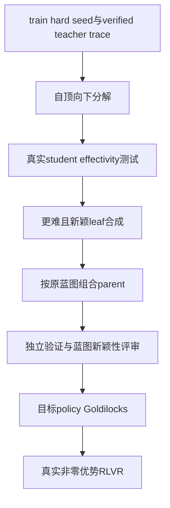
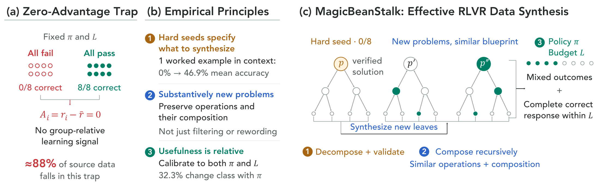

# MagicBeanStalk: Escaping the RLVR Zero Advantage Trap with Recursive Data Synthesis

## 论文信息

| 字段 | 内容 |
| --- | --- |
| 论文链接 | [arXiv 2610.12659](https://arxiv.org/abs/2610.12659) |
| 公司/机构 | NVIDIA / University of Washington / Carnegie Mellon University / Stanford University |
| 首次公开日期 | 2026-10-08（arXiv v1） |
| 原文开源代码 | 否：原文与关联原始来源未找到本方法已发布源码（2026-10-13核验）；不是宣称全网不存在 |
| Adapter | `magicbeanstalk` |
| 本地复现代码 | [`src/auto_research/reproductions/magicbeanstalk/`](https://github.com/daiwk/auto-research/tree/main/src/auto_research/reproductions/magicbeanstalk/) |
| 实现/评测层级 | 核心算法实际模型路径；L0/L1机制诊断，不是原benchmark完整复现 |
| GPU门禁 | 必须真实A100/A30执行并提交绑定源码的脱敏回执；未取得者仍未验收 |

## 原始论文总结

### 背景与主要改动

RLVR有效性取决于problem、当前policy、rollout预算。MBS从verified hard seed提炼reasoning蓝图，自顶向下分解并实测child worked examples是否提高parent正确率，再合成更难新leaf、自底向上按原依赖组合。最终独立验证、保蓝图和实质新颖性，并满足目标policy Goldilocks及预算内完整正确解。

### 架构与数据流

以下为本地重绘，不冒充原论文图片。



<!-- paper-figure:start -->
### 原论文关键图

[](https://arxiv.org/html/2610.12659v1/figure1_v3.svg)

中文图注（原论文 Figure 1）：左侧解释全错或全对的 rollout 组为何没有组相对优势；中间给出“困难种子、保持推理操作与组合、相对策略及预算校准”三条原则；右侧展示验证教师解的自顶向下有效分解、新叶子合成与自底向上组合，最终保留有混合成败且预算内存在完整正确响应的根题。图中数值来自原论文，不是本地实验结果。

精确来源：[固定 v1 的 Figure 1，HTML `S0.F1`](https://arxiv.org/html/2610.12659v1#S0.F1)；[原始 SVG](https://arxiv.org/html/2610.12659v1/figure1_v3.svg)。本地原始字节副本与 SHA-256 记录在 [figure-source.json](figure-source.json)，版权归原作者；与上方本地 Mermaid 重绘分开。

> **原论文 Figure 1（关键图）**：上文说明所选原图或方法截图的范围；并非本地测量。图片来自[原论文](https://arxiv.org/html/2610.12659v1/figure1_v3.svg)，版权归原作者所有；点击图片可查看固定版本来源。
<!-- paper-figure:end -->

### 核心公式

$$
\bar r_{\pi,L}(p)=N^{-1}\sum_i r_i,\quad \hat A_i=r_i-\bar r_{\pi,L}(p).
$$
全成功或全失败组给零优势。Goldilocks要求 $0<\bar r_{\pi,L}(p)<1$，且至少一条正确响应正常结束。
Effectivity是独立条件：某student的 $acc_{\rm cond}(parent\mid children)>acc(parent)$，不能替代最终目标policy筛选。最弱student上的leaf/parent成功率上限分别0.8/0.625。

### 论文离线与线上效果

约78K数学语料中约88%问题落入零优势组。8个数学benchmark、16K推理预算下，gpt-oss-120b平均pass@1从61.2到69.8，DeepSeek v4 Flash从72.4到77.9。hard seed转化率74.7%，direct synthesis为43.8%。金融SecQue/FinanceBench分别+6.9/+2.4个百分点。未报告生产线上A/B。

选取的原文稳定标量与出处保存于 [paper-results.json](paper-results.json)，全部标为paper-reported，不是本地测量。

## 本地复现

> **本地对照口径**：基线为相同学生、steps/group/response上限的seed-RLVR；合成/筛选开销另计，不宣称总成本匹配；实验组仅支持本页L0/L1机制，稳定相对提升不适用。

### 数据与标签访问协议

公开checkpoint/data必须固定revision并通过既有 `checkpoint_source` / `validate_holdout` 的文件hash验证。GSM8K仅从官方train拆train/validation，官方test不打开。Qwen2.5-0.5B-Instruct revision为 `7ae557604adf67be50417f59c2c2f167def9a775`，需要teacher/reasoner时用Qwen2.5-7B-Instruct revision `bb46c15ee4bb56c5b63245ef50fd7637234d6f75`。参考答案仅在外部训练verifier、SFT监督target或明确的train-only数据构建teacher边界读取；被评估student/agent prompt不接收当前题gold/plan。

外部构建teacher仅对train seed读demonstration/verified solution；独立验证teacher只收待解问题。student effectivity仅收parent问题与独立child worked examples，不接收parent gold/plan。effectivity与最终target筛选分开。无有效分解、新颖verified descendant或Goldilocks组时写failure.json，不制造替代题。

seed先在目标policy真实校准，必须全失败且全部正常结束；截断造成的0成功率不被登记为verified hard seed。

worked-child scaffold先拒绝与parent相同的问题/完整trace，再由外部构建teacher实际评审是否直接泄露parent答案或完整plan；该安全评审不等于形式化语义证明。

### 可执行入口与预算

入口为 `scripts/run_oct13_post_training.py --method magicbeanstalk`，adapter则从数据目录读取 `oct13_execution.json`。必须提供student/teacher镜像路径、public id/revision、train/validation路径、split manifest与dataset revision。下面是待实跑配置示例，不表示GPU已完成：

```bash
PYTHONPATH=src python scripts/run_oct13_post_training.py \
  --method magicbeanstalk --config data/oct13_execution.json \
  --device cuda --seed 42 --steps 2 --train-examples 4 --group 4 --depth 1 --max-tokens 768 --decomposition-retries 2 --synthesis-retries 2 \
  --output runs/oct13/magicbeanstalk-42
```

真实生成、拒绝、难度校准、teacher profiling及监督token预算进入结果；失败写不可覆盖的 `failure.json`，成功写 `result.json` / `report.md`。不能仅以本地目录名伪造source metadata。

配置中的 `construction_teacher_sample` 必须为 JSON 布尔值，默认 `true` 保留原有随机教师行为。可选 `false` 只将教师独立解题与构造 JSON 改为确定性生成；学生 hard-seed/Goldilocks 校准、effectivity 的学生/教师随机池、RL rollout 和所有验收门槛保持不变。独立解题仍只见 question，构造教师读取 train 参考解的权限不变；该选项不能强制安全、有效性、新颖性或验算通过。

本轮新路径固定在 `4c4710cd`，仅依据 train/validation 教师短诊断提出，尚须新源码完整 GPU 验证。短诊断没有学生训练；4条validation的随机50%/greedy75%不是稳定收益结论。完整构造失败仍保留原样，不以生成合法JSON、两子题验算正确或单独参数变化替代论文定义链路。

### 当前结果与验收状态

[mechanism-contracts.json](metrics/mechanism-contracts.json)保存已CPU执行的公式/行为合同标量，deterministic tensor/fixture协议，`diagnostic_only: true`、`formal_comparison: false`。不替代公开checkpoint训练、GPU回执、同预算能力比较或原benchmark。GPU指标由实际结果核验后另行摘录；本页不声明未执行实验已经完成。

最新完整尝试[4c失败记录](metrics/public-a100-failed-seed42-4c4710cd.json)在真实A100自然结束（exit1，314.887秒、34814生成tokens，未超时），没有合格后代和RL更新。原16条train选出3个hard roots；root4独解通过，但独立重新测量学生/教师成功率为25%/100%，池中没有经验零成功学生，未进入分解。root7/8独立教师验算失败。77条构造/校准响应、全部audit与配对根选择已用冻结算法独立CPU回放，结果精确一致；没有用旧0/4校准覆盖新1/4测量或放宽门槛。43/44没有启动，整方法GPU仍未验收。

### 教师质量短诊断：不是整方法通过

[dd540教师诊断记录](metrics/public-a100-teacher-quality-seed42-dd54035d.json)绑定独立冻结入口、实际A100输出与10份来源/审计SHA、28份逐调用快照。教师实际生成14个响应、3876tokens；3个train hard根题只有1个独解正确，其一次greedy分解的2个子题均通过独立验算。四条固定validation的随机/greedy正确率分别50%/75%，负根题和失败validation全部保留。

诊断没有加载学生、没有执行scaffold安全评审、effectivity、合成或Goldilocks，optimizer更新为0。因此它仅用于定位教师生成质量，不填补完整MBS门禁，不证明稳定收益。内部/外层耗时156.41/157.33秒；当时与一个SkillDreamer任务并存，不作独占延迟、吞吐或总计算节省比较。公开记录只保留响应SHA与计数，不含原提示、答案文本、token IDs或机器信息。

### 2026-10-14 实际失败记录（旧6a源码）

[seed42脱敏负结果](metrics/public-a100-failed-seed42-6aabe57a.json)绑定实际A100执行与源码 `6aabe57a`，不是GPU通过回执。原4个校准种子的正确性分别为全对、2/4、全错但2条截断、2/4；严格verified-hard门禁没有接纳任何root，构造/effectivity/Goldilocks/RL未到达。实际elapsed85.60秒，学生校准生成4741tokens、评估1541tokens，教师未生成，不把无更新签成通过。

### 0f有界校准扩展：真实失败

[0f bounded seed42负结果](metrics/public-a100-bounded-failed-seed42-0f5dca9f.json)已实际执行348.24秒：原序16train校准，最多4hard roots、cap1024、wall1800s，其余depth/retries/group/2steps和门槛保持。学生测量接纳原indices[4,7,8]三条非截断全错roots，实际construction attempts3；没有surviving descendant，paired RL roots为空，方法和seed-RL控制均0更新。不是“仍无hard roots”，也不是整方法通过。

完整账记录target calibration29408、construction verification2577、effectivity student1231/teacher1038、construction teacher334、初始validation1541生成tokens。现有raw含两次teacher verification拒绝，但未保存构造回应全文/每个内部门禁拒绝轨迹，不能断言第三root具体因Goldilocks或新颖性失败。没有降低门槛、强制优势或追加retry；旧6a失败保持，整方法实际有效RL与多seed计划仍缺。

### 代码映射

algorithm.py：effectivity树与bottom-up构建；checkpoint.py：真实teacher提案/独立验证/学生测量/Goldilocks/RLVR及seed控制。

共享 `post_training/oct13_common.py` 只承担资源装载、成本记录、response likelihood、真实optimizer step和输出；论文机制保留在本目录。行为测试为 `tests/reproductions/test_oct13_post_training.py`；State/GPPO/TAPO还保留既有专属测试。

### 边界与未完成项

缩小模型pool、树深和尝试次数，只广告数学路径，不广告finance re-grounding。synthetic label由teacher提出并被独立re-solve校验，不是形式证明；蓝图与新颖性评审实际调用teacher，不用数值替换。seed-RLVR控制仅匹配配置训练上限，合成前处理成本另计。

仍需适用A100/A30路径及对照实跑、新源码绑定脱敏receipt、全局目录同步与CI。三个seed不会自动升级机制诊断为正式能力证据。本条未注册未经验证的evolve映射。

### b908 真实响应 trace：构造仍失败

[b908 seed42 脱敏负记录](metrics/public-a100-trace-failed-seed42-b9086275.json)绑定实际源码 `b90862754bf51b1beeb5add3f7dc2a51ca00ace4`、54个源码SHA与完整成本。原16train/最多4roots/cap1024/wall1800s不变，3条非截断全错校准root中仅root4独立教师验证通过；其两次分解各产生2个合法子题对象、各仅1个子题验证成功，root7/8独立验证失败。实际343.03793690539896秒、36129生成tokens（含1541初始validation tokens），paired集合为空，方法与控制均0 RL更新，effectivity条件测试、synthesis和最终Goldilocks未到达。这里只公开响应SHA、角色、长度、截断/验证结果，不公开响应文本或token IDs；train构造teacher可见parent答案/trace，独立验证仍只见question。不是完整方法通过或能力结论。

### 5c 通用 self-contained 提示：单次真实失败

[5c seed42 脱敏负记录](metrics/public-a100-selfcontained-failed-seed42-5c863ab8.json)绑定实际源码 `5c863ab8fdee702ddb1abcda6b6255646dc832fd`，只增加通用独立子题说明，未注入当前题数字、未增加采样/retry/预算或放宽verifier。3条校准root仍被选中；两次构造外层JSON均非法，原历史parser读到内层dict而非array，得到0个proposed/schema-valid子题；没有自动修复响应。root7/8独立验证失败。实际322.58301595784724秒、35069生成tokens（同样含1541初始validation tokens），paired集合为空，两臂均0 RL更新。两次新负记录与旧0f分别保存，均明确 `not_gpu_receipt=true`、整方法GPU门禁未通过；不能把单次提示修复、真实CUDA调用或严格curation测试当作验收。

### 773 通用 JSON 序列化提示：真实失败

[773 seed42 脱敏负记录](metrics/public-a100-json-contract-failed-seed42-773da4e3.json)绑定实际源码 `773da4e31f5ee3de2b7e4b03b524d61a1513cbdf` 与54个Git源码SHA，原预算不增。两次构造外层JSON仍非法，历史parser分别得到无JSON值、内层dict，均0个proposed子题；未自动repair或追加retry。实际330.63136535696685秒、35413生成tokens（含1541初始validation tokens），3条校准root、空paired集合，方法与控制均0 RL更新。保留旧记录，不签GPU通过回执或推导能力结论。

### 可选结构约束生成（待真实新源码验证）

配置 `construction_json_schema: true`（仅bool，默认false）通过 [XGrammar HF接口](https://xgrammar.mlc.ai/docs/latest/start/quick_start.html)在生成token时约束构造教师的JSON结构；需要独立 `structured-generation` 可选依赖。分解array长度2只对齐原提示的 exactly two，答案内容与判断布尔值不被强制。独立verifier与学生不使用schema；提示、采样次数、预算、Goldilocks和RL不变。编译grammar缓存，生成matcher不复用；审计记录实际XGrammar版本、schemaSHA和生成token成本。缺依赖或编译失败不退回无约束生成，截断/非法JSON不抽取内层对象或repair。默认false保留原历史parser与生成参数。当前仅CPU合同测试，不代表此新路径已执行真实CUDA或通过整方法门禁。

### f924 结构约束生成：真实格式合法、构造失败

[f924 seed42 脱敏负记录](metrics/public-a100-schema-failed-seed42-f92413aa.json)绑定实际源码 `f92413aabaef0a7d84dcddcb3d4064f5c2d464a3`、54个Git源码SHA与9份原始/配置/资源/依赖/grammar审计SHA。原16train/最多4roots/group4/depth1/cap1024/wall1800s与重试次数不变，实际374.29659676365554秒、36728生成tokens（含1541初始validation tokens）、exit1。两次教师提案均为合法的2子题JSON，共4个子题全部未通过独立验算；13次独立验证仅root4的初始验证被接受，12次拒绝，root7/8仍失败。paired集合为空，方法与控制均0 RL更新；格式合法不等于完整构造或GPU门禁通过。

执行中的schema序列化排序使输出字段为 `answer→question→trace`，旧schemaSHA保持，不回绑到后续 `question→trace→answer` 修复源码；这是已确认的结构约束问题，不足以解释全部题设缺失、trace/answer不一致或独立solver算错。上节待真实新源码验证的状态特指最新顺序修复路径。train构造teacher可见parent答案/trace，独立verifier与学生仍只见其允许的question/示例；未放宽validator、repair响应或扩预算。本记录明确 `not_gpu_receipt=true`，保留旧三次负记录，不宣称能力提升。

### ce4 顺序修复：同预算单次真实构造失败

[ce4 seed42 脱敏负记录](metrics/public-a100-schema-order-failed-seed42-ce4a4a34.json)绑定实际源码 `ce4a4a34520419a50fb730d93967aaed5024fa77`、54个Git源码SHA与9份来源SHA。最新状态以本节为准：`question→trace→answer` 已真实CUDA执行，schemaSHA为新的 `b60afb6e…`，不是将旧f924记录换绑。原配置/预算/采样/verifier门槛不变；实际exit1、351.71331273019314秒、36425生成tokens（含1541初始validation tokens），86条构造/校准响应。

两次提案均为合法2子题JSON，第一次0个子题验算通过、第二次1个通过；12次独立验证共2次接受（root4初验与第二次提案的一个child）、10次拒绝。3条校准hard roots、空paired集合、方法与控制均0 RL更新；effectivity条件测试、synthesis及最终Goldilocks仍未到达。此单seed结果不证明顺序修复造成能力或因果提升，也不签整方法通过回执；保留f924及更早负记录，未repair、扩预算或降低验证门槛。

