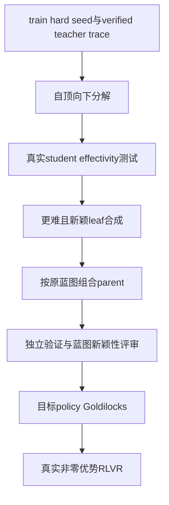

# MagicBeanStalk: Escaping the RLVR Zero Advantage Trap with Recursive Data Synthesis

## 论文信息

| 字段 | 内容 |
| --- | --- |
| 论文链接 | [arXiv 2610.12659](https://arxiv.org/abs/2610.12659) |
| 公司/机构 | NVIDIA / University of Washington / Carnegie Mellon University / Stanford University |
| 首次公开日期 | 2026-10-08（arXiv v1） |
| 原文开源代码 | 否：原文与关联原始来源未找到本方法已发布源码（2026-10-13核验）；不是宣称全网不存在 |
| Adapter | `magicbeanstalk` |
| 本地复现代码 | [`src/auto_research/reproductions/magicbeanstalk/`](https://github.com/daiwk/auto-research/tree/main/src/auto_research/reproductions/magicbeanstalk/) |
| 实现/评测层级 | 核心算法实际模型路径；L0/L1机制诊断，不是原benchmark完整复现 |
| GPU门禁 | 必须真实A100/A30执行并提交绑定源码的脱敏回执；未取得者仍未验收 |

## 原始论文总结

### 背景与主要改动

RLVR有效性取决于problem、当前policy、rollout预算。MBS从verified hard seed提炼reasoning蓝图，自顶向下分解并实测child worked examples是否提高parent正确率，再合成更难新leaf、自底向上按原依赖组合。最终独立验证、保蓝图和实质新颖性，并满足目标policy Goldilocks及预算内完整正确解。

### 架构与数据流

以下为本地重绘，不冒充原论文图片。



<!-- paper-figure:start -->
### 原论文关键图

[](https://arxiv.org/html/2610.12659v1/figure1_v3.svg)

中文图注（原论文 Figure 1）：左侧解释全错或全对的 rollout 组为何没有组相对优势；中间给出“困难种子、保持推理操作与组合、相对策略及预算校准”三条原则；右侧展示验证教师解的自顶向下有效分解、新叶子合成与自底向上组合，最终保留有混合成败且预算内存在完整正确响应的根题。图中数值来自原论文，不是本地实验结果。

精确来源：[固定 v1 的 Figure 1，HTML `S0.F1`](https://arxiv.org/html/2610.12659v1#S0.F1)；[原始 SVG](https://arxiv.org/html/2610.12659v1/figure1_v3.svg)。本地原始字节副本与 SHA-256 记录在 [figure-source.json](figure-source.json)，版权归原作者；与上方本地 Mermaid 重绘分开。

> **原论文 Figure 1（关键图）**：上文说明所选原图或方法截图的范围；并非本地测量。图片来自[原论文](https://arxiv.org/html/2610.12659v1/figure1_v3.svg)，版权归原作者所有；点击图片可查看固定版本来源。
<!-- paper-figure:end -->

### 核心公式

$$
\bar r_{\pi,L}(p)=N^{-1}\sum_i r_i,\quad \hat A_i=r_i-\bar r_{\pi,L}(p).
$$
全成功或全失败组给零优势。Goldilocks要求 $0<\bar r_{\pi,L}(p)<1$，且至少一条正确响应正常结束。
Effectivity是独立条件：某student的 $acc_{\rm cond}(parent\mid children)>acc(parent)$，不能替代最终目标policy筛选。最弱student上的leaf/parent成功率上限分别0.8/0.625。

### 论文离线与线上效果

约78K数学语料中约88%问题落入零优势组。8个数学benchmark、16K推理预算下，gpt-oss-120b平均pass@1从61.2到69.8，DeepSeek v4 Flash从72.4到77.9。hard seed转化率74.7%，direct synthesis为43.8%。金融SecQue/FinanceBench分别+6.9/+2.4个百分点。未报告生产线上A/B。

选取的原文稳定标量与出处保存于 [paper-results.json](paper-results.json)，全部标为paper-reported，不是本地测量。

## 本地复现

> **本地对照口径**：基线为相同学生、steps/group/response上限的seed-RLVR；合成/筛选开销另计，不宣称总成本匹配；实验组仅支持本页L0/L1机制，稳定相对提升不适用。

### 数据与标签访问协议

公开checkpoint/data必须固定revision并通过既有 `checkpoint_source` / `validate_holdout` 的文件hash验证。GSM8K仅从官方train拆train/validation，官方test不打开。Qwen2.5-0.5B-Instruct revision为 `7ae557604adf67be50417f59c2c2f167def9a775`，需要teacher/reasoner时用Qwen2.5-7B-Instruct revision `bb46c15ee4bb56c5b63245ef50fd7637234d6f75`。参考答案仅在外部训练verifier、SFT监督target或明确的train-only数据构建teacher边界读取；被评估student/agent prompt不接收当前题gold/plan。

外部构建teacher仅对train seed读demonstration/verified solution；独立验证teacher只收待解问题。student effectivity仅收parent问题与独立child worked examples，不接收parent gold/plan。effectivity与最终target筛选分开。无有效分解、新颖verified descendant或Goldilocks组时写failure.json，不制造替代题。

seed先在目标policy真实校准，必须全失败且全部正常结束；截断造成的0成功率不被登记为verified hard seed。

worked-child scaffold先拒绝与parent相同的问题/完整trace，再由外部构建teacher实际评审是否直接泄露parent答案或完整plan；该安全评审不等于形式化语义证明。

### 可执行入口与预算

入口为 `scripts/run_oct13_post_training.py --method magicbeanstalk`，adapter则从数据目录读取 `oct13_execution.json`。必须提供student/teacher镜像路径、public id/revision、train/validation路径、split manifest与dataset revision。下面是待实跑配置示例，不表示GPU已完成：

```bash
PYTHONPATH=src python scripts/run_oct13_post_training.py \
  --method magicbeanstalk --config data/oct13_execution.json \
  --device cuda --seed 42 --steps 2 --train-examples 4 --group 4 --depth 1 --max-tokens 768 --decomposition-retries 2 --synthesis-retries 2 \
  --output runs/oct13/magicbeanstalk-42
```

真实生成、拒绝、难度校准、teacher profiling及监督token预算进入结果；失败写不可覆盖的 `failure.json`，成功写 `result.json` / `report.md`。不能仅以本地目录名伪造source metadata。

### 当前结果与验收状态

[mechanism-contracts.json](metrics/mechanism-contracts.json)保存已CPU执行的公式/行为合同标量，deterministic tensor/fixture协议，`diagnostic_only: true`、`formal_comparison: false`。不替代公开checkpoint训练、GPU回执、同预算能力比较或原benchmark。GPU指标由实际结果核验后另行摘录；本页不声明未执行实验已经完成。

### 代码映射

algorithm.py：effectivity树与bottom-up构建；checkpoint.py：真实teacher提案/独立验证/学生测量/Goldilocks/RLVR及seed控制。

共享 `post_training/oct13_common.py` 只承担资源装载、成本记录、response likelihood、真实optimizer step和输出；论文机制保留在本目录。行为测试为 `tests/reproductions/test_oct13_post_training.py`；State/GPPO/TAPO还保留既有专属测试。

### 边界与未完成项

缩小模型pool、树深和尝试次数，只广告数学路径，不广告finance re-grounding。synthetic label由teacher提出并被独立re-solve校验，不是形式证明；蓝图与新颖性评审实际调用teacher，不用数值替换。seed-RLVR控制仅匹配配置训练上限，合成前处理成本另计。

仍需适用A100/A30路径及对照实跑、新源码绑定脱敏receipt、全局目录同步与CI。三个seed不会自动升级机制诊断为正式能力证据。本条未注册未经验证的evolve映射。

