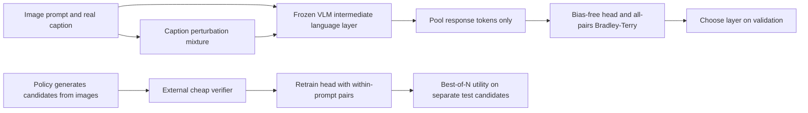
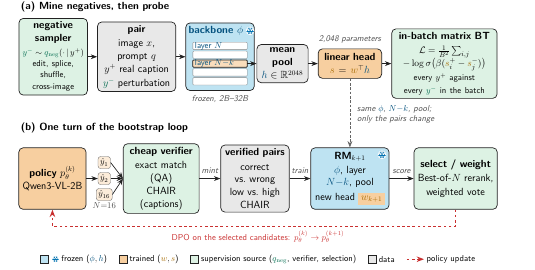

# UMRM: A multimodal reward model from frozen intermediate layers without preference annotations

<!-- source-sha256: c1112e24c9522e3a549429a2c9a85f5fa0c71a14782a201d6b2e5ab64c80d3a1 -->

[简体中文](README.md)

## Paper information

| Field | Details |
|---|---|
| Paper | [arXiv 2610.12707](https://arxiv.org/abs/2610.12707) |
| Institutions | Massachusetts Institute of Technology / Cornell University / Scale AI / Harvard University |
| First public release | 2026-10-08 (arXiv v1) |
| Author code | No public source found as of 2026-10-12. |
| Local adapter | `umrm` |
| Local reproduction code | [`src/auto_research/reproductions/umrm/`](https://github.com/daiwk/auto-research/tree/main/src/auto_research/reproductions/umrm/) |
| Evidence level | `core_mechanism / L1`; bounded A100 run using a real frozen VLM, not a CLIP scorer. |

## Paper method and evidence

Preference pairs are expensive, and reward-benchmark ranking need not predict deployment selection utility. The authors freeze Qwen3-VL, pool only response tokens from an intermediate language layer, and train a bias-free linear reward head. Public captions are positives; negatives are single-span color/count/size/direction edits, tail splices, shuffled clauses, and cross-image captions. No human preferences are needed for these training pairs. Layer selection still uses a labeled development benchmark; bootstrapping still uses cheap verifier labels. Different negative samplers learn different reward directions, so caption perturbation accuracy is not policy hallucination detection. A second experiment generates the policy's own candidates, creates success/failure pairs with a verifier, and retrains the head. Deployment utility improved while reward-benchmark scores fell.



<!-- paper-figure:start -->
### Original paper figure

[](https://arxiv.org/pdf/2610.12707v1)

[Figure 2, v1 PDF page 3](https://arxiv.org/pdf/2610.12707v1) separates perturbation-to-probe and policy-generation-to-verifier bootstrapping. The backbone is frozen, the head is trainable, and test prompts omit reference objects and gold. Copyright remains with the authors.
<!-- paper-figure:end -->

### Core equation

$$
s_w(x,q,y)=w^\top\frac1{|y|}\sum_{t\in y}h^{N-k}_t,\quad \mathcal L=\frac1{B^2}\sum_{i,j}-\log\sigma\big(\beta(s_i^+-s_j^-)\big).
$$

Use $B=8,\beta=.1$ and all $B^2$ chosen/rejected combinations, not just same-pair comparisons. Image/prompt features cannot enter the response pool. The external negative mixture $q_{neg}=\sum_o\pi_oT_o(y^+)$ edits responses while holding images fixed, with near edit k1 and cross-image probability .15. Density-ratio arguments require additional assumptions; [Section 2](https://arxiv.org/html/2610.12707v1#S2) discusses within-entry dependence and length artifacts.

### Reported results

A 32B probe exceeded GPT-4o by 6.6 percentage points on VL-RewardBench; the 2B head has 2,048 parameters, and intermediate-layer selection gained 5.8 points over the final layer. Cheap-verifier bootstrapping reduced caption CHAIRs by 5.1 points versus greedy (95% CI -7.1 to -3.1), and 8B image-generation verifier pass rate rose by 5.4 points versus random. However, VL-RB fell from .679 for the mined probe to .615 for the verified head. See [Section 3.4 and Tables 7–8](https://arxiv.org/html/2610.12707v1#S3.SS4). These are offline Best-of-N results, not production A/B.

## Local reproduction

Compare a zero bias-free head (ties count half) with the actual intermediate head selected on validation; compare bootstrapping separately against random selection over own-policy candidates. SmolVLM encodes real images; a precise response mask controls pooling. Only the linear head updates. Perturbation counts and fallback edits are retained. Clause shuffles and cross-image captions are not guaranteed false; this is a sampler diagnostic. Exclude embeddings and final layer from candidates; train each head then choose on validation, never test.

```bash
PYTHONPATH=src python scripts/run_oct12_multimodal.py --paper umrm \
  --device cuda --seed 42 --maximum 80 --steps 200 \
  --bootstrap-prompts 8 --bootstrap-candidates 4 \
  --dataset-dir data/oct12-coco --output runs/oct12/umrm-s42
```

Use a bounded validation prefix from the public [COCO-Caption2017 mirror](https://huggingface.co/datasets/lmms-lab-encoder/COCO-Caption2017), revision `3bdd5827e243cc3084ac69a1111e69c3ab9193ff`, split by image ID into local train/validation/test. This is not an official reward benchmark. Captions, negatives, and own-policy candidates stay within split; save exact counts and item/group SHA-256. The public [SmolVLM-256M-Instruct checkpoint](https://huggingface.co/HuggingFaceTB/SmolVLM-256M-Instruct) is pinned at `7e3e67edbbed1bf9888184d9df282b700a323964`. `scripts/prepare_oct12_public_sources.py --source coco` exports hashed JSONL/images/rows; `--source smolvlm` prepares the checkpoint and `--checkpoint-path` verifies its input file hashes.

Bootstrapping prompts include only the image and a request for one accurate sentence. After generation, the verifier checks objects against a COCO lexicon supported by public captions. This is not official CHAIR or a general visual-truth judge: captions and aliases can be incomplete. Object-free candidates abstain. With no real score difference, record `verified_pairs=0/head_retrained=false` rather than making a pair. Report bootstrap supervision separately from caption perturbations.

### Measured A100 results

On 2026-10-12, one A100 used 40 COCO images (24/8/8), trained frozen-SmolVLM heads for 200 steps, and chose layer 10 on validation. Pair accuracy on eight synthetic-negative test items was `1.0` versus `0.5` for a tied zero head. This is saturation on a limited set, not general reward ability. Eight training prompts generated four candidates each, producing six verified pairs and two abstentions; the head was genuinely retrained. On separate test Best-of-N candidates, the caption-supported object scores were `0.58333` for the probe and `0.48611` for both verified head and random. No gain from bootstrapping; not CHAIR. [Metrics](metrics/public-vlm-a100-42.json) and [GPU receipt](../../gpu-validations/oct12-umrm-a100.json).

### Code and limits

`multimodal/oct12_reward_transition.py::{response_features,mean_response_states,in_batch_bt,train_reward_head,select_probe_layer}` implements the frozen probe; `caption_negative` is the sampler; `generate_candidates,mint_verified_pair,run_umrm` provide independent policy/verifier/bootstrap and isolated test selection. Smaller CLI budgets and more seeds do not raise evidence level. No Qwen3-VL2B–32B, author 22K bank, annotated development benchmark, three official reward benchmarks, CHAIR, image generation, or DPO actor was reproduced. Retain negative and no-pair cases; test never selects the negative recipe. Scorer access to gold is not agent capability. No Evolve integration is claimed.
