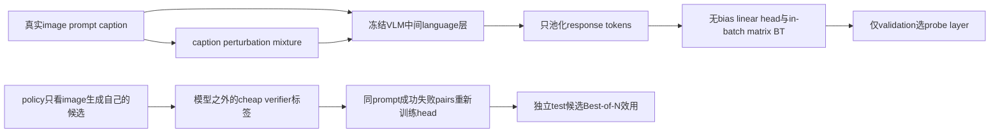
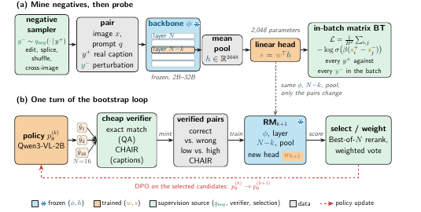

# UMRM：冻结中间层的无偏好标注多模态奖励模型

## 论文信息

| 字段 | 内容 |
|---|---|
| 论文链接 | [arXiv 2610.12707](https://arxiv.org/abs/2610.12707) |
| 公司/机构 | MIT、Cornell University、Scale AI、Harvard University；原文注明相关工作不在NVIDIA期间完成 |
| 首次公开日期 | 2026-10-08（arXiv v1） |
| 原文开源代码 | 否：截至2026-10-12未找到作者公开源码 |
| Adapter | `umrm` |
| 本地复现代码 | [`src/auto_research/reproductions/umrm/`](https://github.com/daiwk/auto-research/tree/main/src/auto_research/reproductions/umrm/) |

本地 `core_mechanism / L1`；使用真实冻结VLM、不用CLIP scorer替代；GPU gate仍待真实回执。

## 原始论文总结

### 背景与主要改动

偏好pair昂贵，reward benchmark名次也不必代表部署选择效用。作者冻结Qwen3-VL，在中间language层只均值池化response tokens，再训练无bias线性reward head；公开caption为positive，同一caption的颜色/数量/尺寸/方位单span变化、tail splice、clause shuffle及cross-image caption为negative，不需人工偏好标注。

“无监督”只修饰训练偏好来源：层选择使用标注development benchmark，bootstrap使用cheap verifier标签。不同negative sampler确定不同reward方向；不能把caption扰动上的高准确率当成识别真实policy hallucination。作者还单独生成policy own Best-of-N候选，用verifier产生success/failure pair重新训练head，部署效用改善但reward benchmark分数下降。



原图检查：已检查 [v1 PDF](https://arxiv.org/pdf/2610.12707v1) 第3页Figure2，确认“perturbation→probe”与“policy generation→verifier→bootstrap”是不同监督链，backbone冻结，head训练，test prompt不含参考对象或gold答案。

<!-- paper-figure:start -->
### 原论文关键图

[](https://arxiv.org/pdf/2610.12707v1)

图片来自[原论文](https://arxiv.org/pdf/2610.12707v1)第3页Figure2，版权归原作者所有；已检查冻结/训练/监督来源的不同角色。
<!-- paper-figure:end -->

### 核心公式

$$s_w(x,q,y)=w^\top\frac1{|y|}\sum_{t\in y}h^{N-k}_t,\quad \mathcal L=\frac1{B^2}\sum_{i,j}-\log\sigma\big(\beta(s_i^+-s_j^-)\big).$$

$B=8,\beta=.1$。必须使用全部B²chosen-rejected组合，而非只做B个same-pair logistic。只有response位置进入pooling；image/prompt token即使特征幅度大也不能混入。negative mixture $q_{neg}=\sum_o\pi_oT_o(y^+)$ 在模型之外编辑response，保持图像不变，near编辑k1、cross-image概率.15。密度比分析依赖额外假设，paper也讨论同entry耦合和length artifact，不应声称不带条件的“真实质量识别”。[原文 §2](https://arxiv.org/html/2610.12707v1#S2)。

### 论文离线与线上效果

原文32B probe在VL-RewardBench比GPT4o高6.6pp，2B head仅2,048参数，选层比final层高5.8pp。paper报告cheap-verifier bootstrap使caption CHAIRs相对greedy下降5.1pp（95%CI -7.1至-3.1），8B image-generation verifier pass率相对random增加5.4pp；同时VL-RB从mined probe .679降为verified .615。这是reward方向/部署目标错配的反例，不能只摘正结果。[原文 §3.4、Tables7–8](https://arxiv.org/html/2610.12707v1#S3.SS4)。**线上 A/B：未报告**；Best-of-N离线实验不是生产流量A/B。

## 本地复现

> **本地对照口径**：零bias-free head的tie计半为pair基线，验证集选中的真实中间层head为实验组；bootstrap另与random own-candidate选择比较，相对原论文CHAIR不适用，小样本诊断不代表稳定能力提升。

真实SmolVLM visual encoder接收image；language层返回的hidden states在**人工构造准确response mask**后池化，backbone全部冻结，只有linear head更新。caption-negative mixture留存每类实际次数与不适用编辑的fallback；clause shuffle可能不是真错误、cross-image也可能部分事实正确，因此只作为sampler诊断。验证层候选排除embedding与final层，先train各head，再用validation pair accuracy决定层；test不进入选择。

```bash
PYTHONPATH=src python scripts/run_oct12_multimodal.py --paper umrm \
  --device cuda --seed 42 --maximum 80 --steps 200 \
  --bootstrap-prompts 8 --bootstrap-candidates 4 \
  --dataset-dir data/oct12-coco --output runs/oct12/umrm-s42
```

### 数据协议与verifier边界

公开 [COCO-Caption2017镜像](https://huggingface.co/datasets/lmms-lab-encoder/COCO-Caption2017) revision `3bdd5827e243cc3084ac69a1111e69c3ab9193ff`，只取val bounded prefix，按image-id分组本地train/val/test，**不是官方reward benchmark**。negative pool按split隔离，同image的caption、扰动和own-policy候选不跨split。记录精确count与item/group SHA256。

公共checkpoint [SmolVLM-256M-Instruct](https://huggingface.co/HuggingFaceTB/SmolVLM-256M-Instruct) revision `7e3e67edbbed1bf9888184d9df282b700a323964`。离线资源可由 `scripts/prepare_oct12_public_sources.py --source coco` 导出小图文cache，逐JSONL/图片/row哈希；`--source smolvlm`准备模型，`--checkpoint-path`验证其全部输入文件哈希后加载。

bootstrap没有把reference caption送给生成模型。policy prompt只有image和“准确描述一句”；verifier在生成完成后，用公共reference captions支持的COCO-object lexicon检查候选的缺席对象。本地这是**caption-supported object score，不是正式CHAIR**：参考caption可能不完整，词典/别名不覆盖所有mention，不能当视觉真实性的通用判定。object-free候选abstain；没有真实candidate score差异时不造pair，记录 `verified_pairs=0/head_retrained=false`。head自举的监督不是caption perturbation，二者单独报告。

### 本地结果与验证状态

`metrics/protocol.json`仅保存待验证协议。CPU单测已检查response mask、B²loss、head真实更新、validation-only选层及verifier/no-pair分支；fixture不是能力指标。计划A100/A30 receipt `docs/gpu-validations/oct12-umrm-a100.json`，真实运行结果由主集成回填，不能预填pair accuracy或CHAIR改进。

### 代码映射与边界

`multimodal/oct12_reward_transition.py::{response_features,mean_response_states,in_batch_bt,train_reward_head,select_probe_layer}`对应冻结probe；`caption_negative`对应sampler；`generate_candidates,mint_verified_pair,run_umrm`执行独立policy-verifier-bootstrap与isolatedtest选择。CLI可降低budget做链路诊断，但不得因多seed升级证据等级。

未复刻Qwen3-VL2B–32B、作者22k pair bank、原论文标注development benchmark、三个reward benchmarks、官方CHAIR、图像生成或DPO actor。benchmark下降/无可用bootstrap pairs都保留；不用test选择negative recipe，也不把observer读取gold当成agent能力。未声明evolve集成。
