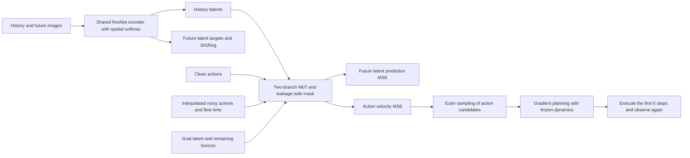
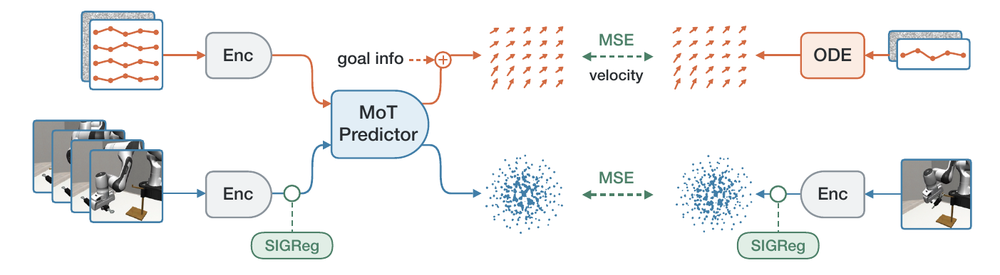
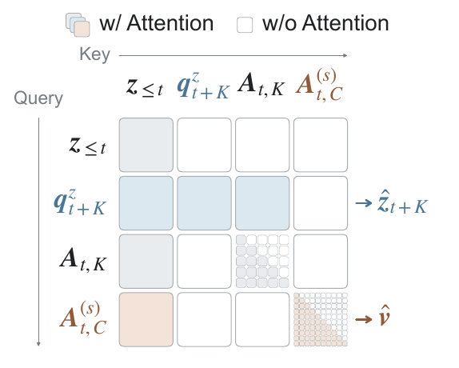
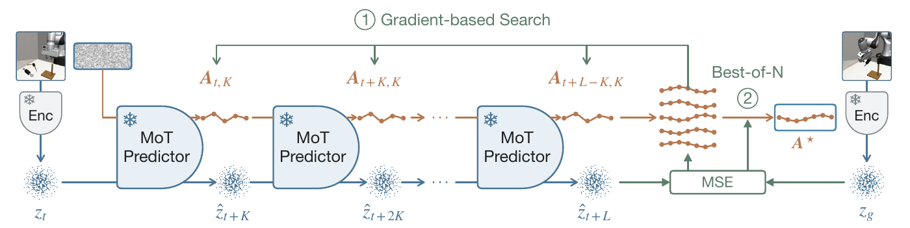

<!-- source-sha256: 5e991ab90d6400d319dbccbf83e7ff06f2749baa45a5e10a79ea26b235f1ed45 -->

[简体中文](README.md) · English

# LeWAM: End-to-end joint JEPA world and action modeling

> **`core_mechanism`.** A real A100 ran scaled joint training followed by a closed-loop, three-arm evaluation of newly trained candidates across three seeds. Evidence is bound to the actual implementation and weight hashes. Goals come from training trajectories, so this remains a non-holdout diagnostic. Planning did not outperform the reactive policy here; this is not a full reproduction of the paper's results.

## Paper information

| Field | Details |
| --- | --- |
| Paper | [arXiv 2610.12818](https://arxiv.org/abs/2610.12818) |
| Institutions | UC San Diego / ETH Zurich / University of British Columbia / Brown University |
| First public release | 2026-10-08 (arXiv v1) |
| Original source code | Yes: [authors' repository](https://github.com/MinghaoFu/lewam) |
| Adapter | `lewam` |
| Local reproduction code | [`src/auto_research/reproductions/lewam/`](https://github.com/daiwk/auto-research/tree/main/src/auto_research/reproductions/lewam/) |

The original upload was at 23:58:36 UTC on 2026-10-08. The authors' code is pinned to MIT-licensed revision `22914305c15c5fab767ce4122a97b05338cd0bd0`. No checkpoints are copied into this repository.

## Original paper summary

### Background and main changes

A conventional JEPA learns to predict the state that follows a given action, then trains an inverse-dynamics model or searches for actions online. These separate stages prevent control supervision from shaping visual representations, and broad Gaussian action search can be expensive. LeWAM jointly updates the visual encoder, latent dynamics, and stochastic policy: it predicts future latents from actions and learns how to act by flow matching.

The visual encoder combines a ResNet-18 trained from scratch, spatial softmax, and a two-layer projection MLP. The simulation model has about 16.9M parameters, latent/MoT width 192, 4 layers and 4 heads. Each example has two history frames, one state query, 5 clean actions and 10 noisy actions. The two modality branches have separate Q/K/V, outputs, and FFNs, but share global attention with a structured mask. History attends only to history. The state query attends to history and clean actions; noisy actions can see only history, their own causal prefix, and an optional goal. This blocks clean actions from leaking through intermediate layers into the policy.

### Architecture



The diagram is a local redraw; see [architecture.mmd](assets/architecture.mmd). Pinned paper, code and resources are recorded in [source-provenance.json](assets/source-provenance.json).

<!-- paper-figure:start -->
### Key figures from the paper

[](https://arxiv.org/pdf/2610.12818v1#page=1)

Figure 1: The shared visual encoder and SIGReg connect the two training branches. Clean actions drive future-latent MSE; noisy actions and goal information drive flow-matching velocity MSE. The crop includes only the upper training panel, not the results overview below it. Sources: Fu et al., [v1 Figure 1](https://arxiv.org/html/2610.12818v1#S0.F1), [PDF page 1](https://arxiv.org/pdf/2610.12818v1#page=1).



Figure 3: Colored cells allow attention; white cells block it. The state query reads history and clean actions, while noisy actions read only history and their own causal prefix, not clean actions. The small grids show causal masking for action tokens. Sources: Fu et al., [v1 Figure 3](https://arxiv.org/html/2610.12818v1#S3.F3), [PDF page 4](https://arxiv.org/pdf/2610.12818v1#page=4).



Figure 4: Freeze the encoder and MoT and use policy proposals to roll out future latents in segments. Optimize actions by gradient search, select best-of-N by distance to the goal latent, and execute the first K steps before observing again. Sources: Fu et al., [v1 Figure 4](https://arxiv.org/html/2610.12818v1#S3.F4), [PDF page 5](https://arxiv.org/pdf/2610.12818v1#page=5).

These are visually checked 250 dpi crops of the original PDF, without changes to text in the figures. They do not show local experimental results. The figures are CC BY 4.0 and credited to the authors. See [original-figures.json](assets/original-figures.json) for PDF/image SHA256, page numbers and crop boundaries.

> **Figure 1 (upper training panel):** The captions above describe the selected paper figures or method crops, not local measurements. From the [paper](https://arxiv.org/pdf/2610.12818v1#page=1); copyright belongs to the authors. Click the image for the pinned source.
<!-- paper-figure:end -->

### Core equations

Action flow runs from noise toward the data:

$$
A^{(s)}=(1-s)\epsilon+sA,\qquad v=A-\epsilon.
$$

$$
\mathcal L=\operatorname{MSE}(\hat z_{t+K},z_{t+K})+\operatorname{MSE}(\hat v,A-\epsilon)+0.04\mathcal L_{SIGReg}.
$$

SIGReg compares empirical and standard-Gaussian characteristic functions along 1024 random unit directions. It approximates Epps–Pulley distance with 17 quadrature nodes rather than constraining only mean and variance. The paper uses online-encoder targets and latent prediction MSE, with no momentum encoder. The planner applies Adam to action plans sampled from the policy:

$$
J(A)=\operatorname{MSE}(\hat z_{t+L}(A),z_g)+0.01\|A-A_{sample}\|_F^2.
$$

Optimization updates only actions. Candidate retention and selection use the **goal cost without the proximity penalty**; original proposals are retained so refinement cannot discard a better initial proposal.

### Offline and online results

| Paper metric | LeWAM | Paper baseline and context |
| --- | --- | --- |
| Mean goal-reaching success over ten tasks | 93.5% | LeWM CEM 50.9%; target offsets differ by task |
| ToolHang goal-reaching | 94.7% | LeWM CEM 35.4% |
| Mean 100-step goal success over four tasks | 46.2% | LeWM 10.9% |
| Planning throughput over four tasks | 52.50 plans/s | LeWM CEM 1.62 on the same H100 with different planning parameters |
| Mean success over three real-robot tasks | 33.3% | Diffusion Policy 38.9%; π0.5 28.9%; 30 trials per task |

Source: [Section 4 and appendices](https://arxiv.org/html/2610.12818v1). Real-robot performance does not beat the controls on every task. No production A/B test is reported. Website results, paper tables and current checkpoint evaluation settings should be kept separate: most short goals in the paper use 25/50 steps, while the current ToolHang evaluation config uses 50/100.

## Local reproduction

> **Comparison protocol:** Use each seed's newly trained, validation-selected checkpoint. Compare its reactive policy with best-of-K and gradient planning. Goals come from training trajectories, so a stable relative capability gain is not applicable. The released-checkpoint entry point remains available, but its scores do not substitute for scores of new candidates.

`worker.py` loads actual author ResNet/MoT weights in an isolated Python environment and uses author HDF5 sampling, ToolHang, the policy, and the planner. It does not simulate success. Resource SHA256 checks run file by file after downloads; execution is offline and cannot silently switch to CPU.

```bash
PYTHONPATH=src python scripts/run_oct13_robotics.py \
  --paper lewam --config /path/to/lewam.json --seed 42 \
  --output runs/lewam/seed42.json
```

The config contains `source_root`, isolated `python`, `model_dir`, `data_dir`, immutable `output_dir` and `device`. Scaled defaults are 2 episodes per seed, 4 proposals, 5 gradient updates and seeds 42/43/44. `lewam.json` is also direct adapter input. LeWAM and SmolWAM require separate environments because their robosuite/MuJoCo versions differ.

### Data protocol, results, and scope

Checkpoint: [LeWAM/lewam-toolhang](https://huggingface.co/LeWAM/lewam-toolhang), revision `39512799122797828f13c29071d3d797852ce9b5`. HDF5: [authors' ToolHang data](https://huggingface.co/datasets/LeWAM/lewam-toolhang), revision `465df45efe1b87aead4f423d3f8670833c5ddaf4`, 5,030,456,346 bytes. HDF5 is read directly rather than expanding a 14.4 GB copy of decoded frames. The released checkpoint is for goal-reaching, not goal-free behavior cloning.

The authors explicitly sample goal-reaching starts and goals from training trajectories, so results are marked `diagnostic_only=true` and `promotion_eligible=false`. No held-out generalization is claimed. Original 50-epoch joint training, the other nine environments, and real-robot experiments were not run. See [implementation-contract.json](metrics/implementation-contract.json) for L0 formula-test evidence only.

On 2026-10-14, frozen source `0f5dca9f` ran native joint training for seeds 42/43/44 on a real A100. Strictly load each newly selected checkpoint and compare three arms from the same initial state and goal in closed loop. Each seed used 1 epoch × 4 training batches × 8 examples, plus 4 validation batches. All had 4 nonzero gradient updates; sampled parameter L2 changes were 0.029696/0.028428/0.028228. Action flow, latent MSE, SIGReg, total loss and validation all executed and were finite.

| Seed | Reactive | Best-of-K | Gradient | Training plus three-arm runtime |
| --- | --- | --- | --- | --- |
| 42 | 1/2 successful | 1/2 successful | 1/2 successful | 115.62 seconds |
| 43 | 0/2 successful | 0/2 successful | 0/2 successful | 157.10 seconds |
| 44 | 0/2 successful | 0/2 successful | 0/2 successful | 165.90 seconds |

All arms scored 16.67% ± 28.87% (sample standard deviation across seeds); there was no observed planning advantage over the reactive policy. Each arm per seed used 2 episodes, a 100-step budget, 4 proposals and 5 gradient steps. Total training and closed-loop runtime was capped at 1800 seconds per seed. The data's Robosuite metadata is 1.4.1, whereas the authors require runtime 1.5.1. The original warning is retained and isolated dependencies do not modify shared Torch.

See [actual training and new-candidate control metrics](metrics/native-candidate-a100-seeds42-44.json) for per-batch values, gradients, candidate weights and implementation SHAs, plus paths and hashes for six exact raw JSON records. The [sanitized GPU receipt](../../gpu-validations/oct13-lewam-a100.json) confirms execution of this scaled mechanism, not a formal capability gain.

### Code map

| Local file | Paper or author implementation |
| --- | --- |
| `algorithm.py` | Section 3 action flow and SIGReg, Appendix A mask, and best-iterate planner contract |
| `external.py` | Pinned source, isolated process, timeouts and offline resource checks |
| `worker.py` | Actual closed loop using author `build_model` / `build_policy` / `World.evaluate` |
| `paper.yaml` | `core_mechanism`, scaled budget and mandatory GPU gate; no Evolve operators |

Behavioral tests: `python -m pytest tests/reproductions/test_oct13_agents_jepa.py`. They check multi-layer mask reachability, gradients of all three losses, and best-iterate selection using only the unpenalized cost. Test success is not a substitute for actual control experiments.

### Accepted joint-training entry point

The manifest binds actual SHA256 of local `external.py`, `algorithm.py`, `training.py` and `worker.py` and verifies them again before closed-loop use. Author pins alone are insufficient. Update counts must be positive integers, and parameter change must be finite and positive. NaN/Inf or implementation hash changes fail closed.

Actual action, latent, SIGReg and total loss for every training and validation batch, along with stepwise gradients, are stored in the manifest. Both recording and closed-loop loading require all fields, finite values, nonempty validation, and matching trace and aggregate counts. Missing loss, NaN/Inf or count mismatches disqualify new candidates from control.

Joint training remains in scope. `--phase train` calls pinned `scripts/train_lewam.py:main.__wrapped__` with verified actual ToolHang HDF5, the real visual encoder/MoT, and native losses, not a tensor fixture. `data.source=h5`, `load_in_ram=false`. Native `train.steps_per_epoch` caps both train and validation. Defaults are 1 epoch × 4 batches × 8 examples per seed with actual action flow, latent MSE and SIGReg updates.

```bash
PYTHONPATH=src python scripts/run_oct13_robotics.py --paper lewam --phase train \
  --config /path/to/lewam-train.json --seed 42 --output runs/lewam/train-seed42.json
```

Configuration uses `source_root/python/output_dir/data_dir/device=cuda` and can set `train_epochs`, `train_steps_per_epoch` and `train_batch_size`. `training.py` records actual per-batch losses, optimizer-step gradients, trainable parameter differences and the validation-selected checkpoint. Validation follows the authors' random decision-point split; it is not a separate trajectory-level test. Scaled joint training and three-arm control of new candidates were completed; the full 50 epochs were not rerun, and released-checkpoint control does not fill that gap.

`native-training/training-provenance.json` binds each new candidate to seed, pinned author source, public data, actual updates and the SHA256 of `lewam_best.pt` and `lewam_config.json`. Point closed-loop config `trained_model_dir` at that directory. The runner rejects seed, selection-protocol or hash mismatches and evaluates reactive, best-of-K and gradient arms on the same new model. All arms resample identical starts and goals from the same seed. Released weights cannot substitute for new candidates. The GPU evidence above is from actual execution of this full connection.
