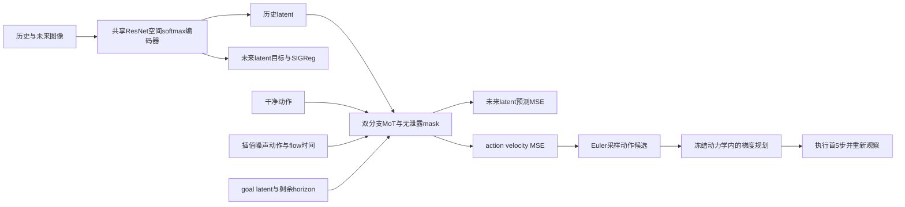
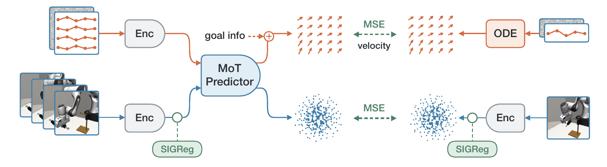
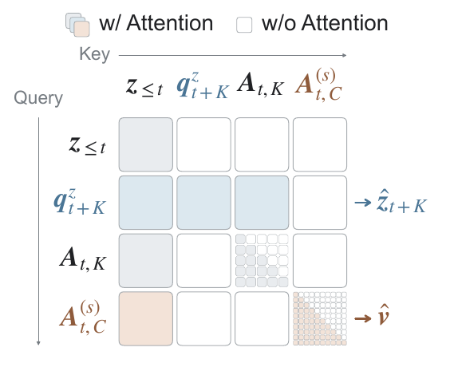
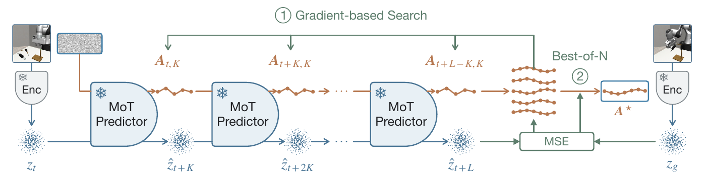

# LeWAM：端到端 JEPA 世界—动作联合建模

> 当前为 `core_mechanism`：实现公式合同，并提供调用固定作者代码的完整视觉策略/规划与联合训练入口。CUDA 实跑尚需独立 GPU receipt 验证；不把入口存在、单测通过或原文结果当作已完成 GPU 实验。

## 论文信息

| 项目 | 内容 |
| --- | --- |
| 论文链接 | [arXiv 2610.12818](https://arxiv.org/abs/2610.12818) |
| 公司/机构 | UC San Diego / ETH Zurich / University of British Columbia / Brown University |
| 首次公开日期 | 2026-10-08（arXiv v1） |
| 原文开源代码 | 是：[作者 LeWAM 仓库](https://github.com/MinghaoFu/lewam) |
| Adapter | `lewam` |
| 本地复现代码 | [`src/auto_research/reproductions/lewam/`](https://github.com/daiwk/auto-research/tree/main/src/auto_research/reproductions/lewam/) |

原文首次上传时间为 2026-10-08 23:58:36 UTC。作者代码固定到 `22914305c15c5fab767ce4122a97b05338cd0bd0`，许可证 MIT；本地不复制 checkpoint。

## 原始论文总结

### 背景与主要改动

传统 JEPA 学习“给定动作会到什么状态”，之后另训逆动力学或在线搜索动作。两阶段会使控制监督无法塑造视觉表征，宽高斯动作搜索也较昂贵。LeWAM 在同一训练阶段更新视觉编码器、潜在动力学和随机策略：既预测动作导致的未来 latent，又通过 flow matching 学习如何行动。

视觉编码器由从零训练的 ResNet-18、空间 softmax 和两层投影 MLP 组成。模拟版本约 16.9M 参数，latent/MoT 宽度 192，4 层、4 头。每个样本包含两帧历史、一个状态查询、5 个干净动作和 10 个噪声动作。两个模态分支有独立 Q/K/V、输出和 FFN，但共享带结构化 mask 的全局注意力。历史只读历史；状态查询读历史及干净动作；噪声动作只读历史、自己的因果前缀与可选 goal。这个约束阻止干净动作经中间层泄漏给策略。

### 架构流程



上方为本地重绘示意，源码：[architecture.mmd](assets/architecture.mmd)。固定全文、代码和资源版本见 [source-provenance.json](assets/source-provenance.json)。

<!-- paper-figure:start -->
### 原论文关键图

[](https://arxiv.org/pdf/2610.12818v1#page=1)

图 1：共享视觉 encoder 与 SIGReg 正则连接两条训练分支；干净动作驱动未来 latent 的 MSE，噪声动作与 goal 信息驱动 velocity 的 flow-matching MSE。此处仅截取原文 Figure 1 的上部训练面板，未包含下方结果概览。来源：Fu 等，[v1 Figure 1](https://arxiv.org/html/2610.12818v1#S0.F1)，[原 PDF 第 1 页](https://arxiv.org/pdf/2610.12818v1#page=1)。



图 3：填色为允许注意力，白色为禁止；state query 读取历史与干净动作，噪声动作仅读取历史及自身因果前缀，不能读取干净动作。小网格表示动作 token 的因果 mask。来源：Fu 等，[v1 Figure 3](https://arxiv.org/html/2610.12818v1#S3.F3)，[原 PDF 第 4 页](https://arxiv.org/pdf/2610.12818v1#page=4)。



图 4：冻结 encoder 与 MoT，以策略产生的候选动作逐段 rollout 未来 latent；对动作做梯度搜索，再按 goal latent 的距离选择 best-of-N。执行前 K 步后重新观察，形成闭环规划。来源：Fu 等，[v1 Figure 4](https://arxiv.org/html/2610.12818v1#S3.F4)，[原 PDF 第 5 页](https://arxiv.org/pdf/2610.12818v1#page=5)。

以上为原文 PDF 的 250 dpi 局部截图，图内文字未改写，已逐张视觉核验；不是本地实验结果。论文图示采用 CC BY 4.0，归原作者所有。PDF/图片 SHA256、页码与裁切范围见 [original-figures.json](assets/original-figures.json)。

> **原论文 Figure 1（上部训练面板）（关键图）**：上文说明所选原图或方法截图的范围；并非本地测量。图片来自[原论文](https://arxiv.org/pdf/2610.12818v1#page=1)，版权归原作者所有；点击图片可查看固定版本来源。
<!-- paper-figure:end -->

### 核心公式

动作 flow 使用从噪声到数据的方向：

$$
A^{(s)}=(1-s)\epsilon+sA,\qquad v=A-\epsilon.
$$

$$
\mathcal L=\operatorname{MSE}(\hat z_{t+K},z_{t+K})+\operatorname{MSE}(\hat v,A-\epsilon)+0.04\mathcal L_{SIGReg}.
$$

SIGReg 在 1024 个随机单位方向上比较经验特征函数与标准高斯特征函数，以 17 个积分结点近似 Epps–Pulley 距离，不是仅约束均值和方差。原文采用在线 encoder target、MSE latent prediction，没有 momentum encoder。规划对策略采样的候选 action plan 进行 Adam 更新：

$$
J(A)=\operatorname{MSE}(\hat z_{t+L}(A),z_g)+0.01\|A-A_{sample}\|_F^2.
$$

优化仅更新动作；保留、选择候选时使用**未加入 proximity penalty 的 goal cost**，并保留原始候选以避免精炼退化。

### 论文离线与线上效果

| 原文指标 | LeWAM | 原文对照与口径 |
| --- | --- | --- |
| 十任务目标到达平均成功率 | 93.5% | LeWM CEM 50.9%；不同任务目标偏移有区别 |
| ToolHang 目标到达 | 94.7% | LeWM CEM 35.4% |
| 四任务 100-step goal 平均成功率 | 46.2% | LeWM 10.9% |
| 四任务规划吞吐 | 52.50 plans/s | LeWM CEM 1.62；相同 H100，规划参数不同 |
| 真实机器人三任务平均成功率 | 33.3% | Diffusion Policy 38.9%，π0.5 28.9%；每任务 30 次 |

来源为[原文 §4 与附录](https://arxiv.org/html/2610.12818v1)。真实机器人结果并非所有任务优于对照。未报告生产线上 A/B。网站结果、正文图表和作者当前 checkpoint 的评测设置需区分：正文大部分短目标为 25/50 步，当前 ToolHang eval config 为 50/100 步。

## 本地复现

> **本地对照口径**：基线为同固定 checkpoint 的 reactive policy，实验组为 best-of-K 与梯度规划；原目标来自训练轨迹，稳定能力相对提升不适用。

`worker.py` 在隔离 Python 环境实际加载作者 ResNet/MoT 权重，用作者 HDF5 采样、ToolHang 环境、策略与 planner 执行；不是自行模拟 success。资源在下载后逐文件验证 provenance SHA256，运行中离线，不允许隐式改成 CPU。

```bash
PYTHONPATH=src python scripts/run_oct13_robotics.py \
  --paper lewam --config /path/to/lewam.json --seed 42 \
  --output runs/lewam/seed42.json
```

配置含 `source_root`、隔离环境 `python`、`model_dir`、`data_dir`、不可变 `output_dir`、`device`。默认缩放为 2 episodes/seed、4 proposals、5 gradient updates；三 seed 为 42/43/44。`lewam.json` 也是 adapter 的直接输入。LeWAM 与 SmolWAM 的 robosuite/MuJoCo 版本不同，必须分开环境。

### 数据协议、结果与边界

Checkpoint 为 [LeWAM/lewam-toolhang](https://huggingface.co/LeWAM/lewam-toolhang)，revision `39512799122797828f13c29071d3d797852ce9b5`；HDF5 为[作者 ToolHang 数据](https://huggingface.co/datasets/LeWAM/lewam-toolhang)，revision `465df45efe1b87aead4f423d3f8670833c5ddaf4`，5,030,456,346 bytes。直接读取 HDF5，不生成 14.4GB 解压帧副本。已发布 checkpoint 为 goal-reaching，不冒充 goal-free behavior cloning。

原作者明确说明目标到达评测从训练轨迹抽取起点和 goal；因此结果固定 `diagnostic_only=true`、`promotion_eligible=false`。没有以此宣称 held-out 泛化，也没有运行原版 50 epoch 联合训练、其他九环境或真实机器人。本轮公式测试见 [implementation-contract.json](metrics/implementation-contract.json)；该文件只有 L0 证据，GPU 结果待独立 receipt 与公开指标回写，不捏造完成。

### 代码映射

| 本地文件 | 对应原文/作者实现 |
| --- | --- |
| `algorithm.py` | §3 action flow、SIGReg、附录 A mask 与 best-iterate planner 合同 |
| `external.py` | 固定 source revision、隔离进程、超时、离线资源核验 |
| `worker.py` | 作者 `build_model` / `build_policy` / `World.evaluate` 的实际闭环 |
| `paper.yaml` | core_mechanism、缩放预算与必需 GPU gate；Evolve operators 为空 |

行为测试：`python -m pytest tests/reproductions/test_oct13_agents_jepa.py`。验证 mask 多层可达性、三项 loss 的梯度以及只按未惩罚 cost 选择最优迭代，不以测试通过代替实际控制实验。

### 接受范围中的联合训练入口

训练 manifest 还绑定本地 `external.py`、`algorithm.py`、`training.py`、`worker.py` 的实际 SHA256，闭环前逐一重核；仅作者 PINS 不足以证明本地训练实现。参数更新计数必须为正整数，参数差异必须为正有限数，NaN/Inf 或实现哈希变化均 fail closed。

实际 train/validation 各 batch 的 action、latent、SIGReg、总 loss 和逐步梯度也保存到 manifest；记录与闭环加载两端均检查必需字段、有限性、非空 validation，以及 trace 与汇总计数一致。任何缺 loss、NaN/Inf 或计数不一致均拒绝作为可控制的新候选。

联合训练没有从本轮 scope 删除。新增 `--phase train` 调用固定作者 `scripts/train_lewam.py:main.__wrapped__`，用已验证的真实 ToolHang HDF5、真实视觉 encoder/MoT 与原生 loss，禁止以 tensor fixture 替代数据。`data.source=h5`、`load_in_ram=false`，原生 `train.steps_per_epoch` 同时限制训练和 validation；默认 1 epoch × 4 batch × 8 examples/seed，仍保留 action flow、latent MSE、SIGReg 三项实际更新。

```bash
PYTHONPATH=src python scripts/run_oct13_robotics.py --paper lewam --phase train \
  --config /path/to/lewam-train.json --seed 42 --output runs/lewam/train-seed42.json
```

配置用 `source_root/python/output_dir/data_dir/device=cuda`，可显式设 `train_epochs`、`train_steps_per_epoch`、`train_batch_size`。`training.py` 记录每个真实 batch 的三项 loss、优化步梯度、trainable 参数抽样差异与 validation-selected checkpoint。validation 仍按作者 decision-point 随机 split，不伪称独立轨迹 test。该入口尚需 A100 实跑；完整 50 epoch 与新训练 candidate 的闭环评测仍未完成，发布 checkpoint 的控制结果不能填补这些阶段。

新训练产物在 `native-training/training-provenance.json` 中绑定 seed、固定作者源码、公开数据、实际参数更新证据，以及 `lewam_best.pt`/`lewam_config.json` 的 SHA256。闭环配置可用 `trained_model_dir` 指向该目录；运行前拒绝 seed、选择协议或哈希不符的候选，再由同一新模型执行 reactive / best-of-K / gradient 三臂。三臂按同 seed 重新采样相同起点与目标；发布权重不会替代新候选。该连接是可执行入口，尚不等于真实训练或闭环已完成。
