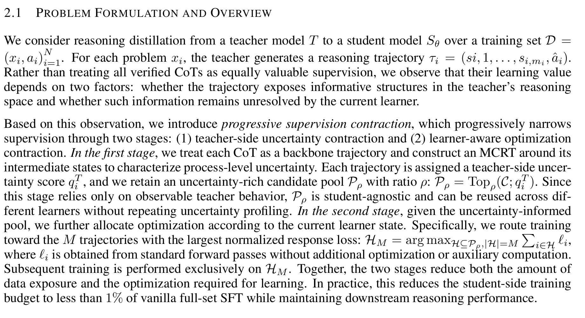
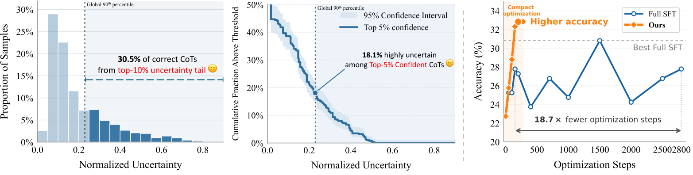

# Learning More by Training Less: Uncertainty-Guided Progressive Contraction

<!-- source-sha256: 88a1b993c5f9c2dcfb4d48b4974a9e13c34f5a6d8bff902e473d3b3cca63168d -->

[简体中文](README.md)

## Paper information

| Field | Value |
| --- | --- |
| Paper | [arXiv 2610.12933](https://arxiv.org/abs/2610.12933) |
| Affiliations | National University of Singapore / Nanjing University / Fudan University / The University of Sydney / The Chinese University of Hong Kong / Nanyang Technological University |
| First public release | 2026-10-09 (arXiv v1) |
| Author code | Not released or not found in paper-linked primary sources, checked 2026-10-13 |
| Adapter | `progressive-contraction` |
| Local implementation | [src/auto_research/reproductions/progressive_contraction/](https://github.com/daiwk/auto-research/tree/main/src/auto_research/reproductions/progressive_contraction/) |
| Evidence tier | Actual model path for the core algorithm; L0/L1 mechanism diagnostics, not the full original benchmark |
| GPU validation | [A100 three-seed mechanism receipt](../../gpu-validations/progressive-contraction-a100-20261014-seeds42-44.json) binds executed 32f source; still L1 |

## Original paper

### Motivation and method

Even a correct teacher chain of thought can contain prefixes with both correct and incorrect reasoning continuations. The paper samples Monte Carlo continuations from the actual prefixes, contracts the teacher pool by branch uncertainty, runs a real student probing epoch, and then selects and reroutes top-M examples by current student NLL. Teacher profiling cost and student exposure must be accounted for separately.


The diagram is a local redraw. [](https://arxiv.org/pdf/2610.12933v1#page=3) shows teacher-side MCRT continuation, pool contraction, and selection by normalized student response loss. It is a screenshot of the source text, not an author-drawn flowchart; no dedicated architecture or workflow figure was found in the pinned v1 HTML and full PDF. The [v1 PDF, page 3](https://arxiv.org/pdf/2610.12933v1#page=3) and [HTML Section 2.1](https://arxiv.org/html/2610.12933v1#S2.SS1) are the sources. The image was rendered at 300 DPI and cropped without editing; see [provenance](figure-source.json).



[Figure 1](https://arxiv.org/html/2610.12933v1#S1.F1) shows how a correct or confident CoT can still have high process uncertainty and compares the paper method with full SFT on steps and accuracy. It is not an architecture diagram or local result. The local image is an unchanged copy of the [original PNG](https://arxiv.org/html/2610.12933v1/fig1-v2.png); copyright stays with the authors.

### Core equations

$$
\hat p_{i,t}=K^{-1}\sum_kZ^{(k)}_{i,t},\quad
\hat U_{i,t}=4\hat p_{i,t}(1-\hat p_{i,t}),\quad
q_i^T=m_i^{-1}\sum_t\hat U_{i,t}.
$$

Retain $\lfloor\rho N_c\rfloor$ verified trajectories with high uncertainty. Student routing scores $q_i^S=-|\mathcal R_i|^{-1}\sum_{j\in\mathcal R_i}\log p_\theta(\tau_{i,j}\mid x_i,\tau_{i,<j})$ and selects top-M. Exposure over three epochs changes from $3N$ to $|\mathcal P_\rho|+2M$; this excludes teacher profiling and is not a total GPU speedup.

### Paper-reported results

For Qwen3.5-4B with rho 10%, student exposure is 0.74% of full SFT. AIME25 is 83.3% versus 56.7% for full SFT; the 9B results are 90.0% versus 86.7%. These figures exclude teacher profiling compute. Some v1 HTML appendix sections have missing labels and no readable appendix pipeline; the local implementation follows main-text Eqs. 1–8 and records this source gap. No production A/B test is reported. [Selected paper results](paper-results.json) are paper-reported, not local measurements.

## Local reproduction

> The reference is full SFT on the same verified teacher corpus, with the same number of epochs. Teacher profiling is outside the student exposure ratio. The intervention supports L0/L1 only, so stable relative gains are not applicable.

### Data and label-access protocol

Public checkpoint and data revisions are pinned and file hashes checked with `checkpoint_source` / `validate_holdout`. GSM8K train and validation are split only from official train; official test is never opened. Qwen2.5-0.5B-Instruct revision is `7ae557604adf67be50417f59c2c2f167def9a775`; teacher/reasoner is Qwen2.5-7B-Instruct revision `bb46c15ee4bb56c5b63245ef50fd7637234d6f75` when needed. Reference answers are only read by external training verification, as SFT supervision targets, or at an explicit train-only teacher data-construction boundary. Evaluated student or agent prompts never receive the current gold answer or plan.

Verify the actual teacher backbone externally first. Reuse each reasoning-paragraph prefix in the same open assistant token sequence and sample MC continuations independently, not by substituting a new user prompt. Account for failed teacher attempts and all MCRT tokens. A zero-sized floor pool is a failure, not silently replaced with max(1,…). Real probing, NLL routing, and full-SFT control execute.

### Entry point and budget

Use `scripts/run_oct13_post_training.py --method progressive-contraction`, or the adapter reads `oct13_execution.json` from the dataset directory. Supply local student/teacher checkpoint paths, public IDs and revisions, train/validation paths, a split manifest, and a dataset revision. The following is a configuration example, not itself evidence of GPU execution.

```bash
PYTHONPATH=src python scripts/run_oct13_post_training.py \
  --method progressive-contraction --config data/oct13_execution.json \
  --device cuda --seed 42 --train-examples 8 --teacher-attempts 2 --branches 4 --prefix-states 2 --pool-ratio 0.5 --active-size 1 --epochs 3 --max-tokens 512 \
  --output runs/oct13/progressive-contraction-42
```

Actual generation, rejections, calibration, teacher profiling, and supervised-token budgets are recorded. Failures write non-overwritable `failure.json`; success writes `result.json` / `report.md`. A local directory name cannot stand in for public source metadata.

### Local results

[CPU mechanism contracts](metrics/mechanism-contracts.json) record formula and behavior scalars from deterministic tensors/fixtures, marked `diagnostic_only: true` and `formal_comparison: false`. These do not replace public-checkpoint training, a GPU receipt, equal-budget capability evaluation, or the original benchmark.

#### 2026-10-14 retained failure on old source

[Old seed 42 result](metrics/public-a100-failed-seed42-6aabe57a.json) binds the real A100 run at `6aabe57a`. All 5 verified teacher answers out of 8 train examples had no detected reasoning-paragraph prefix, so the run never reached MC profiling, contraction, or SFT. It generated 2484 teacher tokens, evaluated 1419 student tokens, took 108.03 seconds, and performed 0 updates. It is not signed as passed.

The shared paragraph helper missed Qwen tokens merging punctuation and newline; this was fixed in 32f. The old failure is not a valid negative algorithm result and cannot replace verification after the fix. A floor pool of zero, no verified pool, or zero updates is still a failure; definitions and thresholds were not relaxed.

#### Fixed full mechanism, seed 42

[Mechanism results](metrics/public-a100-complete-seed42.json) and the [32f GPU receipt](../../gpu-validations/progressive-contraction-a100-20261014.json) were independently checked. The run took 217.54 seconds. Each of 4 verified teacher trajectories had 2 real paragraph prefixes with 4 MC continuations each. All reachability was 1 and uncertainty 0; the teacher pool retained 2 trajectories by original order at the tie, without manufacturing a signal. NLL routing selected 1 active trajectory. All 3 intervention SFT and 3 verified-full-SFT control updates were nonzero.

On 4 validation examples, initial accuracy was 0.5; both arms reached 0.75, with no relative benefit. Intervention exposure was 4 versus 12 for the control. The 1/3 ratio is supervised instance exposure only, excluding teacher MC; it is not a total compute saving. Full token accounting is separate. The old receipts remain, and the following subsection provides all three seeds.

#### Fixed full mechanism, seeds 42/43/44

[Actual results](metrics/public-a100-complete-seeds42-44.json) and the [independent three-seed receipt](../../gpu-validations/progressive-contraction-a100-20261014-seeds42-44.json) bind 32f. All three seeds completed a verified teacher backbone, MC from original token prefixes, teacher contraction, student response-NLL routing, and 3 updates each for the intervention and verified-full-SFT control. Validation accuracy by seed was 0.75/0.5/0.5 for both arms, mean 0.5833, std 0.1443, from a mean 0.5 initial accuracy. There was no gain over full SFT.

All MC and construction costs are retained. The exposure ratio is not total compute or a 135× gain. The reduced chain for all three default seeds ran, but tiny validation, LoRA, and public substitute data still support only L1 mechanism evidence, not a formal capability comparison or acceptance of other methods.

### Code mapping and limits

`algorithm.py` handles MC uncertainty, floor pool selection, and NLL routing; `checkpoint.py` handles real prefix sampling, probing/routed/full SFT, and cost accounting for both sides. Shared `post_training/oct13_common.py` only loads resources, records costs, computes response likelihood, takes real optimizer steps, and writes outputs. Tests: `tests/reproductions/test_oct13_post_training.py`; State/GPPO/TAPO also retain their existing tests.

Qwen2.5 shared vocabulary, small GSM data, LoRA, prefix, and K are a reduced protocol, not the original cross-family setup or full benchmark. Exposure is relative to full SFT on the same verified corpus; no 135x total-cost gain is claimed. The reduced GPU mechanism path for 42/43/44 was executed and verified; global catalog/CI closeout is separate. Multiple seeds do not upgrade L1 to capability evidence. No unverified Evolve mapping is registered.
