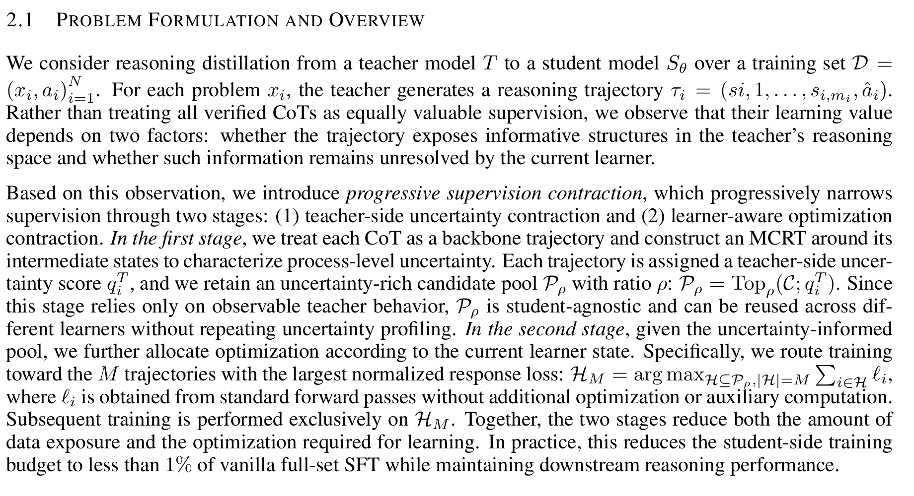

# Learning More by Training Less: Uncertainty-Guided Progressive Contraction for Efficient Reasoning Post-Training

## 论文信息

| 字段 | 内容 |
| --- | --- |
| 论文链接 | [arXiv 2610.12933](https://arxiv.org/abs/2610.12933) |
| 公司/机构 | National University of Singapore / Nanjing University / Fudan University / The University of Sydney / The Chinese University of Hong Kong / Nanyang Technological University |
| 首次公开日期 | 2026-10-09（arXiv v1） |
| 原文开源代码 | 否：原文与关联原始来源未找到本方法已发布源码（2026-10-13核验）；不是宣称全网不存在 |
| Adapter | `progressive-contraction` |
| 本地复现代码 | [`src/auto_research/reproductions/progressive_contraction/`](https://github.com/daiwk/auto-research/tree/main/src/auto_research/reproductions/progressive_contraction/) |
| 实现/评测层级 | 核心算法实际模型路径；L0/L1机制诊断，不是原benchmark完整复现 |
| GPU门禁 | [A100三seed完整机制回执](../../gpu-validations/progressive-contraction-a100-20261014-seeds42-44.json)绑定实际32f源码；仍是L1诊断，不是原benchmark完整验收 |

## 原始论文总结

### 背景与主要改动

正确teacher CoT也可能经过多种正确/错误后续的reasoning fork。论文对真实prefix做Monte Carlo continuation，按branch不确定性先收缩teacher pool，再经真实student probing epoch按当前NLL选top-M并重路由。teacher profiling与student训练曝光必须分开核算。

### 架构与数据流

以下为本地重绘，不冒充原论文图片。


<!-- paper-figure:start -->
### 原论文关键图

[](https://arxiv.org/pdf/2610.12933v1#page=3)

中文图注（原文方法总览截图）：第 2.1 节依次描述教师侧以 MCRT 前缀续写估计过程不确定性、收缩为候选池，再按当前学生的归一化 response loss 路由活动训练集。这是原文段落截图，不是作者绘制的流程图。核对固定 v1 HTML 和完整 PDF 后，未发现专门的架构/流程图；上方 Mermaid 仍明确作为本地机制重绘。

精确来源：[固定 v1 PDF 第 3 页，第 2.1 节](https://arxiv.org/pdf/2610.12933v1#page=3)；[HTML `S2.SS1`](https://arxiv.org/html/2610.12933v1#S2.SS1)。截图只做 300 DPI 渲染与边界裁取，未改写内容；PDF 哈希、页码及裁取参数记录在 [figure-source.json](figure-source.json)。


中文图注（原论文 Figure 1）：正确或高置信 CoT 仍可能包含高过程不确定性；右侧对比原论文方法与全量 SFT 的优化步数和准确率。该图属于原论文动机及结果图，不能当作流程架构图，也不是本地训练结果。

精确来源：[固定 v1 的 Figure 1，HTML `S1.F1`](https://arxiv.org/html/2610.12933v1#S1.F1)；[原始 PNG](https://arxiv.org/html/2610.12933v1/fig1-v2.png)。本地 PNG 为原始字节副本，版权归原作者；与上方本地 Mermaid 重绘分开。

> **原论文 方法总览（第 2.1 节原文截图）（关键图）**：上文说明所选原图或方法截图的范围；并非本地测量。图片来自[原论文](https://arxiv.org/pdf/2610.12933v1#page=3)，版权归原作者所有；点击图片可查看固定版本来源。
<!-- paper-figure:end -->

### 核心公式

$$
\hat p_{i,t}=K^{-1}\sum_kZ^{(k)}_{i,t},\quad
\hat U_{i,t}=4\hat p_{i,t}(1-\hat p_{i,t}),\quad
q_i^T=m_i^{-1}\sum_t\hat U_{i,t}.
$$
保留 $\lfloor\rho N_c\rfloor$ 条高不确定性verified trajectories；student routing为 $q_i^S=-|\mathcal R_i|^{-1}\sum_{j\in\mathcal R_i}\log p_\theta(\tau_{i,j}\mid x_i,\tau_{i,<j})$，选top-M。
三epoch曝光由 $3N$ 变 $|\mathcal P_\rho|+2M$，不包括teacher profiling，不能等于总GPU加速比。

### 论文离线与线上效果

Qwen3.5-4B/rho10%的student exposure为full-SFT的0.74%；AIME25为83.3%、full-SFT56.7%。9B分别90.0%/86.7%。这不含teacher profiling的总计算。v1 HTML部分Appendix为missing-label且无可读附录pipeline，本地按主文Eq1–8实现并记来源缺口。未报告生产线上A/B。

选取的原文稳定标量与出处保存于 [paper-results.json](paper-results.json)，全部标为paper-reported，不是本地测量。

## 本地复现

> **本地对照口径**：基线为同一真实verified teacher全集的full-SFT；相同epochs，teacher profiling成本不并入student exposure比率；实验组仅支持本页L0/L1机制，稳定相对提升不适用。

### 数据与标签访问协议

公开checkpoint/data必须固定revision并通过既有 `checkpoint_source` / `validate_holdout` 的文件hash验证。GSM8K仅从官方train拆train/validation，官方test不打开。Qwen2.5-0.5B-Instruct revision为 `7ae557604adf67be50417f59c2c2f167def9a775`，需要teacher/reasoner时用Qwen2.5-7B-Instruct revision `bb46c15ee4bb56c5b63245ef50fd7637234d6f75`。参考答案仅在外部训练verifier、SFT监督target或明确的train-only数据构建teacher边界读取；被评估student/agent prompt不接收当前题gold/plan。

真实teacher backbone先外部验证；每个reasoning paragraph prefix拼回同一个open assistant token序列，独立MC采样，不用新user提示代替。全部teacher失败/MCRT token计费。floor pool为0则失败，不偷偷max(1,…)补样本。真实probing/NLL routing/full-SFT控制执行。

### 可执行入口与预算

入口为 `scripts/run_oct13_post_training.py --method progressive-contraction`，adapter则从数据目录读取 `oct13_execution.json`。必须提供student/teacher镜像路径、public id/revision、train/validation路径、split manifest与dataset revision。下面是待实跑配置示例，不表示GPU已完成：

```bash
PYTHONPATH=src python scripts/run_oct13_post_training.py \
  --method progressive-contraction --config data/oct13_execution.json \
  --device cuda --seed 42 --train-examples 8 --teacher-attempts 2 --branches 4 --prefix-states 2 --pool-ratio 0.5 --active-size 1 --epochs 3 --max-tokens 512 \
  --output runs/oct13/progressive-contraction-42
```

真实生成、拒绝、难度校准、teacher profiling及监督token预算进入结果；失败写不可覆盖的 `failure.json`，成功写 `result.json` / `report.md`。不能仅以本地目录名伪造source metadata。

### 当前结果与验收状态

[mechanism-contracts.json](metrics/mechanism-contracts.json)保存已CPU执行的公式/行为合同标量，deterministic tensor/fixture协议，`diagnostic_only: true`、`formal_comparison: false`。不替代公开checkpoint训练、GPU回执、同预算能力比较或原benchmark。GPU指标由实际结果核验后另行摘录；本页不声明未执行实验已经完成。

### 2026-10-14 实际失败记录（旧6a源码）

[seed42旧协议负结果](metrics/public-a100-failed-seed42-6aabe57a.json)绑定真实A100 `6aabe57a`：8train中5条verified教师回答全部被判为no reasoning paragraph prefix，未到MC profiling/收缩/SFT。teacher实际生成2484tokens、学生评估1419tokens，elapsed108.03秒，0更新，不签通过。

共享段落helper的Qwen标点/newline融合token漏切已修于32f；此旧失败不能解释为合法算法负结论，更不能代替修后core验证。新单seed同预算完整core及full-SFT control的实际结果见下一节；floor pool0、无verified pool或零更新保持失败，不改定义/门槛。

### 修后完整机制：单seed42

[完整机制结果](metrics/public-a100-complete-seed42.json)与[源码32f绑定GPU回执](../../gpu-validations/progressive-contraction-a100-20261014.json)已独立核验：实际217.54秒，4条verified teacher trajectory各2个真实段落prefix×4个MC continuation；全部reachability1/uncertainty0，teacher收缩tie按原序选2条，不伪造不确定性信号。学生响应NLL路由选1条active，3次方法SFT更新及3次verified-full-SFT控制更新均实际非零。

4validation初始accuracy0.5，方法和full-SFT控制均0.75，没有相对full-SFT收益。方法监督曝光4次、控制12次，1/3仅为监督实例曝光比，排除teacher MC开销，不能写成总计算节省；完整token账另存。此节仅描述seed42，旧回执/native保留，完整三seed结果另见下一节。

### 修后三seed完整机制（42/43/44）

[三seed实际结果](metrics/public-a100-complete-seeds42-44.json)与[独立三seed回执](../../gpu-validations/progressive-contraction-a100-20261014-seeds42-44.json)绑定32f：三个seed实际完成verified teacher backbone、原token prefix MC、teacher收缩、学生响应NLL路由及各3次方法/verified-full-SFT控制更新。各seed验证accuracy为0.75/0.5/0.5，两臂逐seed相同；均值0.5833/std0.1443，初始均0.5，没有相对full-SFT收益。

MC和构造开销全部保留，监督实例曝光比不能改写成总计算或135×收益。默认三个seed的缩小定义链路已完成，但tiny validation、LoRA和公开替代协议仍只支持L1机制，不构成正式能力比较或本批其它方法验收。

### 代码映射

algorithm.py：MC uncertainty、floor pool/NLL routing；checkpoint.py：真实prefix sampling、probing/routed/full SFT及两侧成本。

共享 `post_training/oct13_common.py` 只承担资源装载、成本记录、response likelihood、真实optimizer step和输出；论文机制保留在本目录。行为测试为 `tests/reproductions/test_oct13_post_training.py`；State/GPPO/TAPO还保留既有专属测试。

### 边界与未完成项

Qwen2.5匹配词表、少量GSM/LoRA/prefix/K是缩小协议，不覆盖原cross-family与全benchmark。曝光分母为同一verified corpus full-SFT；不宣称135x总成本收益。

默认42/43/44的缩小完整机制GPU路径已执行并核验；全局目录同步与CI仍需收口。三个seed不会自动升级机制诊断为正式能力证据。本条未注册未经验证的evolve映射。

