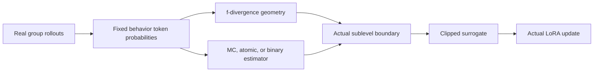
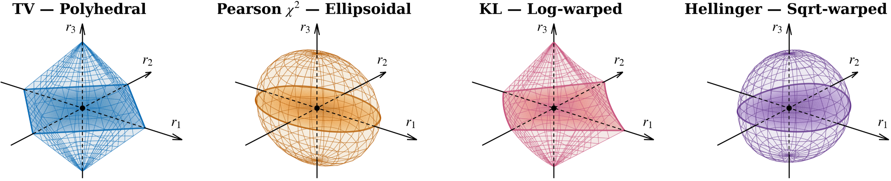

# Generalized Proximal Policy Optimization: Unifying LLM RL Algorithms from the Perspective of Divergence

<!-- source-sha256: fda8b934d2b7bf201ab83aceeb3c81140fd04d3e048f7ef899d0a163635a65ee -->

[简体中文](README.md)

## Paper information

| Field | Value |
| --- | --- |
| Paper | [arXiv 2610.13015](https://arxiv.org/abs/2610.13015) |
| Affiliations | Tsinghua University AIR / ByteDance Seed |
| First public release | 2026-10-09 (arXiv v1) |
| Author code | No release found in the paper-linked primary sources as of 2026-10-13. |
| Adapter | `gppo-framework` |
| Local implementation | [`src/auto_research/reproductions/gppo_framework/`](https://github.com/daiwk/auto-research/tree/main/src/auto_research/reproductions/gppo_framework/) |
| Implementation and evaluation level | Core algorithm on a real model; L0/L1 mechanism diagnostics, not full benchmark reproduction |
| GPU validation requirement | Actual A100/A30 execution and a sanitized receipt tied to source. Paths without a receipt are not validated. |

## Original paper

### Background and contribution

GPPO separates proximal optimization into two choices: the geometry of the f-divergence and the topology of its estimator. MC, atomic, and binary estimators treat the sampled action's probability and its complement differently, inducing different trust regions. All combinations optimize tokens from real rollouts. This is not a registry alias for GRPO and does not replace the existing GPPO from arXiv 2508.07629.

### Architecture and data flow

Local redraw:



<!-- paper-figure:start -->
### Key figure from the paper

[](https://arxiv.org/html/2610.13015v1/div-geo.png)

Three sampled policy ratios centered at 1 illustrate how TV, Pearson chi-square, KL, and Hellinger induce polyhedral, ellipsoidal, log-warped, and square-root-warped regions, respectively. The figure illustrates GPPO's divergence axis, not local training; see the equations for the estimator topology.

Sources: [Figure 1 in v1, HTML S3.F1](https://arxiv.org/html/2610.13015v1#S3.F1) and [original PNG](https://arxiv.org/html/2610.13015v1/div-geo.png). The original bytes and SHA-256 are tracked in [figure-source.json](figure-source.json). Copyright belongs to the authors. This is not the local Mermaid redraw.
<!-- paper-figure:end -->

### Core equations

$$
\widehat{\mathcal R}_f(\delta)=\{r>0:\widehat D_f(r)\le\delta\},\quad
J=\mathbb E[\min(rA,\operatorname{clip}_{\widehat{\mathcal R}_f}(r)A)].
$$

MC uses $f(r)$ and atomic uses $\mu f(r)$; binary adds $(1-\mu)f((1-\mu r)/(1-\mu))$. The four integrands are $\tfrac12|r-1|$, $(r-1)^2$, $(\sqrt r-1)^2$, and $-\log r$. The literal KL of Equations 16/18 disagrees with the two-sided log/DAPO mapping of Section 3.4. The implementation exposes separate `kl` and `two_sided_log` settings without silently changing the formula.

### Paper results

On Qwen3-8B-Base, the math Avg@8 for GRPO, KL/atomic, and chi2/atomic was 27.7, 41.5, and 40.5. The corresponding coding averages were 52.4, 59.7, and 57.2. These are contest benchmarks, not the short GSM8K diagnostic. No production A/B test was reported. [paper-results.json](paper-results.json) records sourced paper-reported scalars separately from local measurements.

## Local reproduction

> The comparison uses an independent GRPO control with the same checkpoint and configuration. Zero-advantage resampling is counted. Only L0/L1 mechanism behavior is tested; no stable relative gain is claimed.

### Data and label access

Pin public checkpoint and data revisions and verify files through `checkpoint_source` and `validate_holdout`. GSM8K train/validation come only from the official training split; official test is unopened. Qwen2.5-0.5B-Instruct is pinned to `7ae557604adf67be50417f59c2c2f167def9a775`; if needed, Qwen2.5-7B-Instruct teacher/reasoner is pinned to `bb46c15ee4bb56c5b63245ef50fd7637234d6f75`. Reference answers are used only by the external training verifier, as SFT supervision, or by an explicitly train-only data-building teacher, never in the evaluated student's or agent's prompt.

Defaults are chi2/atomic/delta 0.04, not the paper's best KL/atomic. Actual generation-policy token probabilities are cached. All-correct and all-wrong groups are counted and resampled only up to the cap. A step fails without a nonzero gradient and parameter change; weight decay is not treated as a learning signal. The GRPO control must run independently with the same configuration.

### Entry point and budget

Use `scripts/run_oct13_post_training.py --method gppo-framework`. The adapter reads `oct13_execution.json` from the data directory. Supply student/teacher checkpoint paths and public IDs/revisions, train and validation paths, split manifest, and dataset revision. This command is an example, not a measurement:

```bash
PYTHONPATH=src python scripts/run_oct13_post_training.py \
  --method gppo-framework --config data/oct13_execution.json \
  --device cuda --seed 42 --steps 2 --group 4 --max-tokens 512 --inner-updates 2 --max-task-attempts 16 --geometry chi2 --topology atomic --delta 0.04 \
  --output runs/oct13/gppo-framework-42
```

Results account for actual generation, rejection, difficulty calibration, teacher profiling, and supervised tokens. Failures write non-overwritable `failure.json`; successes write `result.json` and `report.md`. Directory names do not establish source metadata.

### Current evidence

The [three-seed A100 metrics](metrics/public-a100-seeds42-44.json) bind execution snapshot `7e125fd0`. On the same 8 validation problems, with 3 rollout groups per seed, 2 proximal updates per group, group size 4 and a 512-token cap, GPPO accuracy was 0.75 / 0.75 / 0.625 (mean 0.7083). The independent GRPO control scored 0.75 / 0.50 / 0.625 (mean 0.625). Both started from accuracy 0.50. With this small sample and budget and different realized resampling costs, the results do not establish a stable gain.

[mechanism-contracts.json](metrics/mechanism-contracts.json) records CPU-verified equations and behavior on deterministic tensors and fixtures, marked `diagnostic_only: true` and `formal_comparison: false`. This does not replace real checkpoint training, GPU receipts, matched-budget capability comparisons, or the original benchmark. GPU measurements are separately extracted from actual runs.

### Code map and limitations

`objective.py` implements divergence, the probability-aware trust region, and loss. `post_training/proximal_checkpoint.py` runs real group rollouts and LoRA. Shared `post_training/oct13_common.py` handles resource loading, costs, response likelihood, real optimizer steps, and outputs; the defining mechanism is in this adapter. Behavioral tests are in `tests/reproductions/test_oct13_post_training.py`; State, GPPO, and TAPO also keep their dedicated tests.

All 12 geometry/topology combinations have equation and boundary tests. A short 0.5B/LoRA/GSM8K run differs from original-scale training. Identical caps do not match realized compute or establish stable capability gains when resampling varies. Applicable new paths and controls still require real A100/A30 runs, source-bound sanitized receipts, catalog sync, and CI. Three seeds do not turn a mechanism diagnostic into formal capability evidence. No unverified Evolve mapping is registered.
