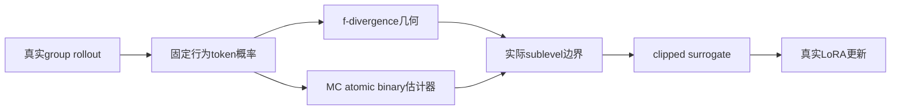

# Generalized Proximal Policy Optimization: Unifying LLM RL Algorithms from the Perspective of Divergence

## 论文信息

| 字段 | 内容 |
| --- | --- |
| 论文链接 | [arXiv 2610.13015](https://arxiv.org/abs/2610.13015) |
| 公司/机构 | Tsinghua University AIR / ByteDance Seed |
| 首次公开日期 | 2026-10-09（arXiv v1） |
| 原文开源代码 | 否：原文与关联原始来源未找到本方法已发布源码（2026-10-13核验）；不是宣称全网不存在 |
| Adapter | `gppo-framework` |
| 本地复现代码 | [`src/auto_research/reproductions/gppo_framework/`](https://github.com/daiwk/auto-research/tree/main/src/auto_research/reproductions/gppo_framework/) |
| 实现/评测层级 | 核心算法实际模型路径；L0/L1机制诊断，不是原benchmark完整复现 |
| GPU门禁 | 必须真实A100/A30执行并提交绑定源码的脱敏回执；未取得者仍未验收 |

## 原始论文总结

### 背景与主要改动

GPPO把近端优化拆成f-divergence几何和估计拓扑。MC、atomic、binary对采样动作概率/补集的处理不同，诱导实际不同信任域。所有组合参与真实rollout token优化，不是给GRPO换registry名；新key不覆盖已有2508.07629的gppo。

### 架构与数据流

以下为本地重绘，不冒充原论文图片。



原图来源：[原文图位置](https://arxiv.org/html/2610.13015v1#S3.F1)；[原始图资源](https://arxiv.org/html/2610.13015v1/div-geo.png)。版本及资源记录在 [figure-source.json](figure-source.json)。原图版权归作者，原始效果图与本地重绘分开。

### 核心公式

$$
\widehat{\mathcal R}_f(\delta)=\{r>0:\widehat D_f(r)\le\delta\},\quad
J=\mathbb E[\min(rA,\operatorname{clip}_{\widehat{\mathcal R}_f}(r)A)].
$$
MC为 $f(r)$，atomic为 $\mu f(r)$，binary加 $(1-\mu)f((1-\mu r)/(1-\mu))$。
四种integrand为 $\tfrac12|r-1|$、$(r-1)^2$、$(\sqrt r-1)^2$、$-\log r$。
原Eq16/18的literal KL与3.4双侧log/DAPO映射不一致；本地显式区分kl与two_sided_log，不暗改公式。

### 论文离线与线上效果

Qwen3-8B-Base数学Avg@8中，GRPO27.7、KL/atomic41.5、chi2/atomic40.5；代码平均分别52.4、59.7、57.2。原文为竞赛benchmark，不是短GSM8K诊断。未报告生产线上A/B。

选取的原文稳定标量与出处保存于 [paper-results.json](paper-results.json)，全部标为paper-reported，不是本地测量。

## 本地复现

> **本地对照口径**：基线为同checkpoint与配置的GRPO-control；零优势重采样成本显式记录；实验组仅支持本页L0/L1机制，稳定相对提升不适用。

### 数据与标签访问协议

公开checkpoint/data必须固定revision并通过既有 `checkpoint_source` / `validate_holdout` 的文件hash验证。GSM8K仅从官方train拆train/validation，官方test不打开。Qwen2.5-0.5B-Instruct revision为 `7ae557604adf67be50417f59c2c2f167def9a775`，需要teacher/reasoner时用Qwen2.5-7B-Instruct revision `bb46c15ee4bb56c5b63245ef50fd7637234d6f75`。参考答案仅在外部训练verifier、SFT监督target或明确的train-only数据构建teacher边界读取；被评估student/agent prompt不接收当前题gold/plan。

默认chi2/atomic/delta0.04，不冒称原最优KL/atomic。缓存真实生成policy token概率；全对/全错组真实计数并限次重采样。无非零梯度和参数变化就失败，weight decay不是学习信号。GRPO-control须同配置独立执行。

### 可执行入口与预算

入口为 `scripts/run_oct13_post_training.py --method gppo-framework`，adapter则从数据目录读取 `oct13_execution.json`。必须提供student/teacher镜像路径、public id/revision、train/validation路径、split manifest与dataset revision。下面是待实跑配置示例，不表示GPU已完成：

```bash
PYTHONPATH=src python scripts/run_oct13_post_training.py \
  --method gppo-framework --config data/oct13_execution.json \
  --device cuda --seed 42 --steps 2 --group 4 --max-tokens 512 --inner-updates 2 --max-task-attempts 16 --geometry chi2 --topology atomic --delta 0.04 \
  --output runs/oct13/gppo-framework-42
```

真实生成、拒绝、难度校准、teacher profiling及监督token预算进入结果；失败写不可覆盖的 `failure.json`，成功写 `result.json` / `report.md`。不能仅以本地目录名伪造source metadata。

### 当前结果与验收状态

[mechanism-contracts.json](metrics/mechanism-contracts.json)保存已CPU执行的公式/行为合同标量，deterministic tensor/fixture协议，`diagnostic_only: true`、`formal_comparison: false`。不替代公开checkpoint训练、GPU回执、同预算能力比较或原benchmark。GPU指标由实际结果核验后另行摘录；本页不声明未执行实验已经完成。

### 代码映射

objective.py：divergence、probability-aware信任域和loss；post_training/proximal_checkpoint.py：真实group rollout与LoRA。

共享 `post_training/oct13_common.py` 只承担资源装载、成本记录、response likelihood、真实optimizer step和输出；论文机制保留在本目录。行为测试为 `tests/reproductions/test_oct13_post_training.py`；State/GPPO/TAPO还保留既有专属测试。

### 边界与未完成项

12种几何/拓扑有公式及边界测试。0.5B/LoRA/GSM8K/短响应不同于原训练规模；重采样次数可能改变，配置上限匹配不等于实际总计算匹配或稳定能力收益。

仍需适用A100/A30路径及对照实跑、新源码绑定脱敏receipt、全局目录同步与CI。三个seed不会自动升级机制诊断为正式能力证据。本条未注册未经验证的evolve映射。

