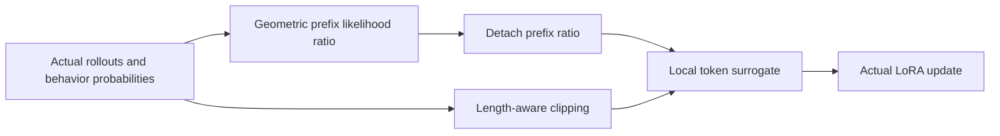
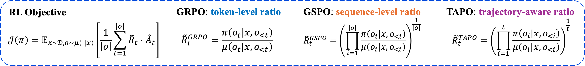
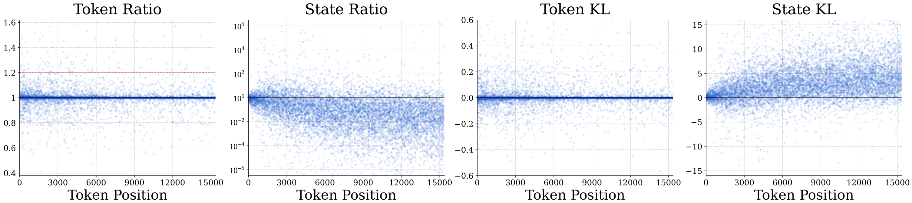

# Trajectory-Aware Policy Optimization: Closing the State Distribution Gap in Long-Horizon LLM RL

<!-- source-sha256: ae88223b20bde3cf59124995e25a6093921aeb40509bb3a2cc24f5cc48f8e156 -->

[简体中文](README.md)

## Paper information

| Field | Value |
| --- | --- |
| Paper | [arXiv 2610.13020](https://arxiv.org/abs/2610.13020) |
| Affiliations | Tsinghua University AIR / ByteDance Seed |
| First public release | 2026-10-09 (arXiv v1) |
| Author code | No release found in paper-linked primary sources as of 2026-10-13. |
| Adapter | `tapo-trajectory` |
| Local implementation | [`src/auto_research/reproductions/tapo_trajectory/`](https://github.com/daiwk/auto-research/tree/main/src/auto_research/reproductions/tapo_trajectory/) |
| Implementation and evaluation level | Core algorithm on a real model; L0/L1 diagnostics, not full benchmark reproduction |
| GPU validation requirement | Real A100/A30 execution with a sanitized receipt bound to source; paths without a receipt remain unvalidated |

## Original paper

### Background and contribution

In an autoregressive trajectory, changes to earlier policy decisions accumulate a state-distribution gap. TAPO uses a geometric mean of prefix likelihood ratios, tightens clipping by length, and detaches the prefix so that earlier tokens receive no gradient from the current action. This adapter does not replace arXiv 2607.27973's TAPO.

### Architecture and data flow

Local redraw:



<!-- paper-figure:start -->
### Key figures from the paper

[](https://arxiv.org/html/2610.13020v1/fig1-1.png)

GRPO uses the current token's ratio; GSPO uses the geometric mean over the entire sequence; TAPO uses the prefix ratio through the current position to correct history-induced state shift. This is the [upper PNG](https://arxiv.org/html/2610.13020v1/fig1-1.png) of [Figure 2 in v1](https://arxiv.org/html/2610.13020v1#S1.F2). It does not include the lower training curve, and the equations have not been redrawn.



The paper's GRPO training samples show relatively stable token-level ratios but accumulating drift in state-level ratios and KL, motivating trajectory correction. This is not local GPU data. See [Figure 1 in v1](https://arxiv.org/html/2610.13020v1#S1.F1) and the [original PNG](https://arxiv.org/html/2610.13020v1/fig1-2.png). The two byte-exact local copies and hashes are tracked in [figure-source.json](figure-source.json). Copyright belongs to the authors.
<!-- paper-figure:end -->

### Core equations

$$
\widetilde R_t=\exp\!\left(t^{-1}\sum_{i\le t}(\ell_{\theta,i}-\ell_{{\rm old},i})\right),\quad
\widehat R_t=\operatorname{sg}[\widetilde R_t]\frac{\pi_\theta(o_t\mid s_t)}{\operatorname{sg}[\pi_\theta(o_t\mid s_t)]}.
$$

$\nabla_\theta\widehat R_t=\widetilde R_t\nabla_\theta\log\pi_\theta(o_t\mid s_t)$, with neither $1/t$ gradient dilution nor cross-position gradients.

$$
\epsilon_t=\epsilon_{\min}+(\epsilon_{\max}-\epsilon_{\min})\frac{t^{-1/2}-T^{-1/2}}{1-T^{-1/2}}.
$$

The surrogate uses per-token ratios and length-aware bounds, excluding prompt and padding tokens.

### Paper results

On Qwen3-8B-Base, math Avg@8 was 27.7 for GRPO and 41.0 for TAPO; coding averages were 52.4 and 58.6. The paper covers multiple competition math and algorithmic coding benchmarks. No production A/B was reported. [paper-results.json](paper-results.json) contains sourced paper-reported scalars, not local measurements.

## Local reproduction

> Compare with GRPO at the same checkpoint and sampling/optimization caps, not the paper's Qwen3-8B Avg@8. This L0/L1 mechanism test does not measure a stable relative gain.

### Data and label access

Pin public checkpoint and dataset revisions and check file hashes with `checkpoint_source` and `validate_holdout`. Split train/validation from official GSM8K train only; official test is unopened. Qwen2.5-0.5B-Instruct uses revision `7ae557604adf67be50417f59c2c2f167def9a775`; when needed Qwen2.5-7B-Instruct teacher/reasoner uses `bb46c15ee4bb56c5b63245ef50fd7637234d6f75`. Reference answers are read only by the external training verifier, SFT supervision, or explicitly train-only teacher data construction; evaluated students and agents do not receive the current problem's gold answer or plan.

Multiple proximal updates share prefixes and actual behavior probabilities. Tests cover forward behavior, Eq. 15 local gradients, prompt/padding, and both clipping endpoints. Zero-advantage groups are rejected; no real update means failure.

### Entry point and budget

Use `scripts/run_oct13_post_training.py --method tapo-trajectory`. The adapter reads `oct13_execution.json` from the dataset directory. Provide student/teacher checkpoint paths, public IDs/revisions, training and validation files, split manifest, and dataset revision. This example is not a GPU receipt:

```bash
PYTHONPATH=src python scripts/run_oct13_post_training.py \
  --method tapo-trajectory --config data/oct13_execution.json \
  --device cuda --seed 42 --steps 2 --group 4 --max-tokens 512 --inner-updates 2 --max-task-attempts 16 \
  --output runs/oct13/tapo-trajectory-42
```

Record actual generation, rejection, difficulty calibration, teacher profiling, and supervised-token cost. Failures write non-overwritable `failure.json`; successes write `result.json` and `report.md`. Directory names do not establish provenance.

### Results and validation

[Three-seed A100 measurements](metrics/public-a100-seeds42-44.json) bind snapshot `7e125fd0`. Using the same 8 validation questions, 3 rollout groups per seed, 2 proximal updates per group, group size 4, and 512-token cap, TAPO scored 0.50 / 0.625 / 0.50 (mean 0.5417) for seeds 42/43/44. Independent GRPO scored 0.75 / 0.50 / 0.625 (mean 0.625). TAPO did not outperform the control. Nonzero gradients and three seeds do not establish capability improvement.

[mechanism-contracts.json](metrics/mechanism-contracts.json) records CPU-executed formula and behavior contracts with deterministic tensors and fixtures, marked `diagnostic_only: true` and `formal_comparison: false`. These do not replace public-checkpoint training, GPU receipts, matched-budget capability evaluations, or the original benchmark. GPU measurements are extracted separately from actual runs.

### Code and limitations

`objective.py` implements trajectory_ratio and length_aware_clipping. `post_training/proximal_checkpoint.py` runs real training and GRPO controls. Shared `post_training/oct13_common.py` handles only loading, costs, response likelihood, optimizer steps, and outputs. The mechanism is in the adapter directory. See `tests/reproductions/test_oct13_post_training.py`; State, GPPO, and TAPO retain dedicated tests.

A short-horizon Qwen2.5-0.5B LoRA run is not the original long-horizon capability comparison. $T=1$ is handled explicitly, not by hidden prompt truncation. Applicable A100/A30 paths and controls, source-bound receipts, catalog sync, and CI remain distinct requirements. Three seeds do not upgrade mechanism diagnostics into capability evidence. No unverified Evolve mapping is registered.
