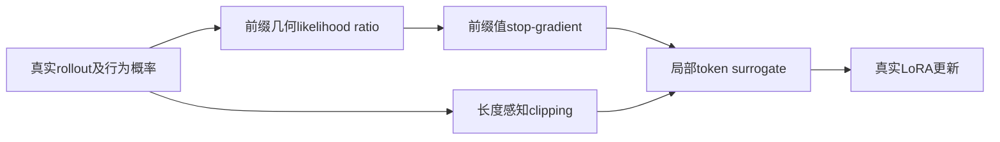
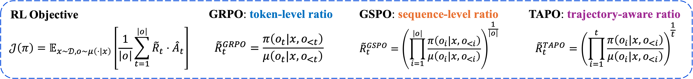
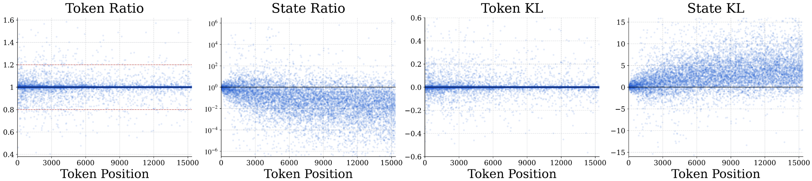

# Trajectory-Aware Policy Optimization: Closing the State Distribution Gap in Long-Horizon LLM RL

## 论文信息

| 项目 | 内容 |
| --- | --- |
| 论文链接 | [arXiv 2610.13020](https://arxiv.org/abs/2610.13020) |
| 公司/机构 | Tsinghua University AIR / ByteDance Seed |
| 首次公开日期 | 2026-10-09（arXiv v1） |
| 原文开源代码 | 否：not released / not found in paper-linked primary sources (2026-10-13) |
| Adapter | `tapo-trajectory` |
| 本地复现代码 | [`src/auto_research/reproductions/tapo_trajectory/`](https://github.com/daiwk/auto-research/tree/main/src/auto_research/reproductions/tapo_trajectory/) |
| 实现/评测层级 | 核心算法实际模型路径；L0/L1机制诊断，不是原benchmark完整复现 |
| GPU门禁 | 必须真实A100/A30执行并提交绑定源码的脱敏回执；未取得者仍未验收 |

## 原始论文总结

### 背景与主要改动

autoregressive轨迹的前序policy变化累积state distribution gap。TAPO对token前缀likelihood ratio取几何均值、按长度收紧clipping，并stop-gradient避免前序token反传进当前动作。新key不覆盖已有2607.27973的tapo。

### 架构与数据流

以下为本地重绘，不冒充原论文图片。



<!-- paper-figure:start -->
### 原论文关键图

[](https://arxiv.org/html/2610.13020v1/fig1-1.png)

中文图注（原论文 Figure 2 上半部）：GRPO 使用当前 token 的比值，GSPO 使用整条序列的几何平均比值；TAPO 则用截至当前位置的前缀轨迹比值，显式纳入历史引起的状态分布修正。这里保存的是 HTML 原始上半图资源，不包含该 Figure 2 的下半训练曲线，也未重新绘制公式。

精确来源：[固定 v1 的 Figure 2，HTML `S1.F2`](https://arxiv.org/html/2610.13020v1#S1.F2)；[上半部原始 PNG](https://arxiv.org/html/2610.13020v1/fig1-1.png)。



中文图注（原论文 Figure 1）：原论文在 GRPO 训练中抽样的点显示，token-level ratio 相对稳定，而 state-level ratio 与 KL 随后续位置累积偏移，给出轨迹修正的动机。这是原论文分析结果，不是本地 GPU 数据。

精确来源：[固定 v1 的 Figure 1，HTML `S1.F1`](https://arxiv.org/html/2610.13020v1#S1.F1)；[原始 PNG](https://arxiv.org/html/2610.13020v1/fig1-2.png)。两张本地原始字节副本与 SHA-256 记录在 [figure-source.json](figure-source.json)，版权归原作者；与上方本地 Mermaid 重绘分开。

> **原论文 Figure 2（上半部）（关键图）**：上文说明所选原图或方法截图的范围；并非本地测量。图片来自[原论文](https://arxiv.org/html/2610.13020v1/fig1-1.png)，版权归原作者所有；点击图片可查看固定版本来源。
<!-- paper-figure:end -->

### 核心公式

$$
\widetilde R_t=\exp\!\left(t^{-1}\sum_{i\le t}(\ell_{\theta,i}-\ell_{{\rm old},i})\right),\quad
\widehat R_t=\operatorname{sg}[\widetilde R_t]\frac{\pi_\theta(o_t\mid s_t)}{\operatorname{sg}[\pi_\theta(o_t\mid s_t)]}.
$$
$\nabla_\theta\widehat R_t=\widetilde R_t\nabla_\theta\log\pi_\theta(o_t\mid s_t)$，无 $1/t$ 梯度稀释或跨位置梯度。
$$
\epsilon_t=\epsilon_{\min}+(\epsilon_{\max}-\epsilon_{\min})\frac{t^{-1/2}-T^{-1/2}}{1-T^{-1/2}}.
$$
surrogate使用每token比率和长度边界，排除prompt/padding。

### 论文离线与线上效果

Qwen3-8B-Base数学Avg@8由GRPO27.7到TAPO41.0；代码平均由52.4到58.6。原文覆盖多个竞赛数学/算法代码benchmark。未报告生产线上A/B。

选取的原文稳定标量与出处保存于 [paper-results.json](paper-results.json)，全部标为paper-reported，不是本地测量。

## 本地复现

> **本地对照口径**：基线为同checkpoint、采样与优化上限的GRPO-control；不是原Qwen3-8B Avg@8结果；实验组仅支持本页L0/L1机制，稳定相对提升不适用。

### 数据与标签访问协议

公开checkpoint/data必须固定revision并通过既有 `checkpoint_source` / `validate_holdout` 的文件hash验证。GSM8K仅从官方train拆train/validation，官方test不打开。Qwen2.5-0.5B-Instruct revision为 `7ae557604adf67be50417f59c2c2f167def9a775`，需要teacher/reasoner时用Qwen2.5-7B-Instruct revision `bb46c15ee4bb56c5b63245ef50fd7637234d6f75`。参考答案仅在外部训练verifier、SFT监督target或明确的train-only数据构建teacher边界读取；被评估student/agent prompt不接收当前题gold/plan。

同前缀、同真实行为概率做多次近端更新。测试覆盖forward、Eq15局部梯度、prompt/padding、最大/最小长度clip端点。零优势组必须拒绝，没有真实更新就失败。

### 可执行入口与预算

入口为 `scripts/run_oct13_post_training.py --method tapo-trajectory`，adapter则从数据目录读取 `oct13_execution.json`。必须提供student/teacher镜像路径、public id/revision、train/validation路径、split manifest与dataset revision。下面是待实跑配置示例，不表示GPU已完成：

```bash
PYTHONPATH=src python scripts/run_oct13_post_training.py \
  --method tapo-trajectory --config data/oct13_execution.json \
  --device cuda --seed 42 --steps 2 --group 4 --max-tokens 512 --inner-updates 2 --max-task-attempts 16 \
  --output runs/oct13/tapo-trajectory-42
```

真实生成、拒绝、难度校准、teacher profiling及监督token预算进入结果；失败写不可覆盖的 `failure.json`，成功写 `result.json` / `report.md`。不能仅以本地目录名伪造source metadata。

### 当前结果与验收状态

[A100 三 seed 实测指标](metrics/public-a100-seeds42-44.json)绑定执行快照 `7e125fd0`。同一 8 题 validation、每 seed 3 个 rollout 组（每组 2 次近端更新）、group=4、512-token 上限：按 seed 42/43/44，TAPO accuracy 为 0.50 / 0.625 / 0.50，平均 0.5417；独立 GRPO-control 为 0.75 / 0.50 / 0.625，平均 0.625。本次未表现出优于该对照的效果；不能以非零梯度或三 seed 替代能力提升证据。

[mechanism-contracts.json](metrics/mechanism-contracts.json)保存已CPU执行的公式/行为合同标量，deterministic tensor/fixture协议，`diagnostic_only: true`、`formal_comparison: false`。不替代公开checkpoint训练、GPU回执、同预算能力比较或原benchmark。GPU指标由实际结果核验后另行摘录；本页不声明未执行实验已经完成。

### 代码映射

objective.py：trajectory_ratio/length_aware_clipping；post_training/proximal_checkpoint.py：实际训练及GRPO-control入口。

共享 `post_training/oct13_common.py` 只承担资源装载、成本记录、response likelihood、真实optimizer step和输出；论文机制保留在本目录。行为测试为 `tests/reproductions/test_oct13_post_training.py`；State/GPPO/TAPO还保留既有专属测试。

### 边界与未完成项

缩小到Qwen2.5-0.5B/LoRA与有限horizon，不是原long-horizon能力比较。T=1明确处理，不通过截断prompt隐式规避长度协议。

仍需适用A100/A30路径及对照实跑、新源码绑定脱敏receipt、全局目录同步与CI。三个seed不会自动升级机制诊断为正式能力证据。本条未注册未经验证的evolve映射。
