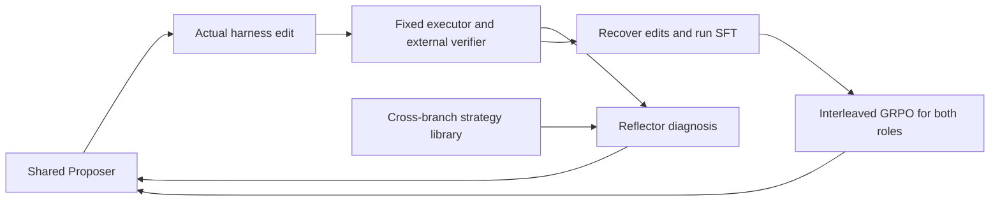
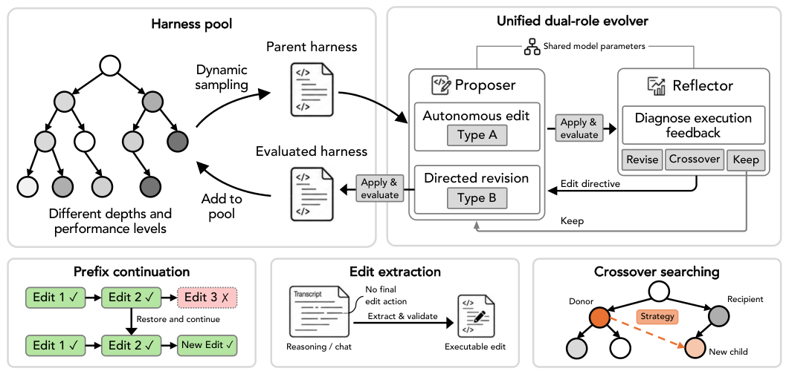

# Evo2: Evolving the Evolver through Weight-Harness Co-Evolution

<!-- source-sha256: beba06642bcc77ada8de20a53169ac3adca988e276f30f8f53d330f5bcabebfe -->

[简体中文](README.md)

> This is a concept_demo / L1 mechanism diagnostic, not a reproduction of the paper's capability benchmark or an Evolve promotion candidate.

## Paper information

| Field | Value |
| --- | --- |
| Paper | [arXiv 2610.13025](https://arxiv.org/abs/2610.13025) |
| Affiliations | Google DeepMind / University of Illinois Urbana-Champaign |
| First public release | 2026-10-09 (arXiv v1) |
| Author code | No public implementation found in the paper or author project links as of 2026-10-12. Affiliations follow the first page of the PDF. |
| Adapter | `evo2` |
| Local implementation | [`src/auto_research/reproductions/evo2/`](https://github.com/daiwk/auto-research/tree/main/src/auto_research/reproductions/evo2/) |

## Original paper

### Background and contribution

Keep the task executor fixed while a shared Proposer and Reflector edit its harness. Execution feedback from tree search and cross-branch crossover then trains the evolver. EvoTIDE recovers productive edit trajectories for SFT, followed by interleaved updates to both roles. See the [full paper](https://arxiv.org/html/2610.13025v1).

### Architecture



Local redraw: [architecture.mmd](assets/architecture.mmd). The [original Figure 2](https://arxiv.org/html/2610.13025v1/fig2.png) depicts the original mechanism; the redraw is not a substitute for it as evidence. See [source-provenance.json](assets/source-provenance.json).

<!-- paper-figure:start -->
### Key figure from the paper

[](https://arxiv.org/html/2610.13025v1/fig2.png)

> **Original Figure 2:** Overview of the method and its components. From the [paper](https://arxiv.org/abs/2610.13025); copyright belongs to the authors.
<!-- paper-figure:end -->

### Core equations

$r_P=\widehat V(h')-\widehat V(h)$ and $r_R=\widehat V(h_1)-\widehat V(h_0)$; keeping the harness yields zero reward. Parent weights are $w(h)=\epsilon+|\widehat V(h)-1/2|$, with a fixed sampling share reserved for the root. Within each role, $A_i=r_i-\bar r$. Token loss is normalized by fixed $L_{max}$ and masks truncated outputs.

### Paper results

| Metric | Paper method | Baseline |
|---|---|---|
| Polyglot pass@1 | 82.1% | GEA 62.6% |
| SWE-bench Verified resolved | 48.3% | HGM 41.0% |
| LiveCodeBench pass@1 | 58.0% | HGM 56.0% |

These are [paper](https://arxiv.org/html/2610.13025v1) results, not local measurements. No production A/B test was reported. Do not compare across models, datasets, scoring rules, or budgets. The [paper-results extract](assets/paper-results.json) is excluded from local metrics and the dashboard.

## Local reproduction

> The baseline is a fixed executor with the initial executable harness. The current implementation runs the experiment arm but establishes neither formal capability comparison nor stable relative improvement.

Implementation: `src/auto_research/agent_research/oct12_evolution.py` and `oct12_checkpoint.py`. A thin adapter reads explicit settings from `oct12.json` and supplies no fixed default candidates or gold answers.

```bash
PYTHONPATH=src python scripts/run_oct12_agents.py \
  --method evo2 --checkpoint /tmp/auto-research-qwen2.5-7b --device cuda \
  --checkpoint-id Qwen/Qwen2.5-7B-Instruct \
  --checkpoint-revision bb46c15ee4bb56c5b63245ef50fd7637234d6f75 \
  --executor-checkpoint /tmp/auto-research-qwen2.5-7b \
  --executor-id Qwen/Qwen2.5-7B-Instruct \
  --executor-revision bb46c15ee4bb56c5b63245ef50fd7637234d6f75 \
  --seed 42 --rounds 2 --group-size 2 --train-steps 2 \
  --max-tokens 1536 --output runs/oct12/evo2-7b-1536-seed42/result.json
```

Run from the repository root in its Python environment. Download and byte-verify the specified public revision before using the checkpoint cache. The location may change, but neither `main` nor a rewritten revision string establishes provenance. The CUDA path uses Linux bubblewrap/prlimit, PyTorch, Transformers, safetensors, and an A100/A30, loading only local checkpoints with remote code disabled. Output paths must not already exist; choose a new directory for reruns. This is a runnable example, not a GPU pass or the receipt command.

The 7B policy + 7B executor configuration also holds a frozen counterpart, so memory must accommodate three model copies and training activations. This batch used an A100; the same configuration is not assumed to fit an A30. Per-trajectory backpropagation and gradient checkpointing reduce peak memory without truncating prompts or changing the loss.

The supplemental `gsm8k-harness` environment uses actual external verification. It neither replaces the default circle task nor overrides its failures. Keep the same checkpoint/ID/revision arguments and change the environment and budget:

```text
--environment gsm8k-harness
--dataset /path/to/gsm8k-holdout/validation.jsonl
--evaluation-examples 8
--max-tokens 768 --executor-max-tokens 256
--rounds 2 --group-size 2 --train-steps 2
--output runs/oct12/evo2-gsm8k-7b-seed42/result.json
```

Only the official `openai/grade-school-math` revision `3101c7d5072418e28b9008a6636bde82a006892c` is accepted, using a train-only holdout. `public_holdout.validate_holdout` checks split hashes, counts, absence of duplicates or overlap, and `test_opened=false` for colocated `split.json`, `train.jsonl`, and `validation.jsonl`. The run uses the first 8 validation items and does not read test. The harness produces a valid PROMPT in the Linux sandbox. The fixed executor receives only the question and PROMPT; gold answers go solely to the external `verified_reward` scorer. The evolving roles receive question hash, correctness, and output hash, not gold answers or raw executor text. The score is real mean accuracy. Identical rewards with no GRPO signal fail; rewards are not fabricated. This is a bounded GSM harness diagnostic, not the original coding benchmark or isolated test improvement. A100 results below are separate from the circle failure.

### Data and implementation

The public-circle-packing-26 input supplies no optimal layout or fixed candidate solution. Harness selection uses only external geometric feedback. `best_validation_score` is a single-task diagnostic search score, not a capability comparison on a separate public test split. Short runs report `diagnostic_only=true`, `capability_comparison=false`, and `evolve_promotion_eligible=false`. Generated code runs under Linux bubblewrap/prlimit only; without isolation it fails closed instead of using host `exec`.

### Validation and limitations

The implementation generates bounded PROMPT strings and edits real `agent.py`. Candidate harnesses and generated solvers run inside bubblewrap/prlimit. It preserves external geometric scoring, the tree, crossover, SFT, role GRPO, and fresh counterpart snapshots, but does not reproduce arbitrary code-harness capability. Retain zero rewards and zero gradients as observed, without claiming paper-level results.

[Historical circle failures](assets/historical-circle-failures.json) are not passing GPU receipts and are excluded from metrics/dashboard. The 7B policy + 7B executor run, seed 42, 2 rounds, produced 21 scored nodes, all with circle score zero. Two SFT steps had positive gradients, but all four GRPO rewards, advantages, losses, and gradients were zero; `updated=false` and `parameters_changed=false`. The run failed. An earlier memory-fixed run marked `updated=true` and changed parameters, but all four steps still had zero advantage and gradient. This was Adam-state drift after SFT, not active GRPO, and did not pass. The earlier record has no independently verified source commit.

The historical 7B circle launch arguments were verified against the cached launch-script SHA and lines. Integration records associate it with `3eae2c8863678692a8cf2de988d4562314c2731f`, whose file hashes can be verified. The raw result JSON lacks command/commit/hash and cannot establish that association by itself. The artifact preserves this provenance limit.

The supplemental GSM mechanism ran on an NVIDIA A100-SXM4-80GB, snapshot `ae68d75ef3c5dd5a3daa16236cb8bf914a559fd5`, default eager attention, 7B policy and separate frozen 7B executor, seed 42, output budgets 768/256, 2 rounds, group 2, and 2 train steps. See [the measured result](metrics/gsm8k-harness-a100-42.json). Two SFT gradients were 0.50494384765625 / 0.674738347530365. All four GRPO steps updated parameters with positive gradients: 0.005053921602666378, 0.0019071860006079078, 0.0009743663831613958, and 0.0018388759344816208. Executor weights stayed fixed across 168 calls.

On the 8 validation examples, the root scored 0.125 and the best of 21 search nodes scored 0.25. **This selects on repeatedly used validation, not a gain on isolated test data**; no test was read. The GSM result does not replace the all-zero circle result. The status remains concept_demo / L1, `capability_comparison=false`, and `evolve_promotion_eligible=false`, without coding benchmark or promotion claims.

The [GPU receipt](../../gpu-validations/oct12-evo2-a100.json) preserves the actual GSM configuration, public data/checkpoint revisions, per-file source hashes from `git show`, and training evidence. `passed` verifies only active SFT/GRPO in that GSM snapshot. It does not cover historical failures or current HEAD and uncommitted changes. Paper and local metrics stay separate. Raw model outputs, machine paths, logs, and weights are not published.

Tests: `python -m pytest tests/test_oct12_agent_algorithms.py tests/test_oct12_agent_delivery.py`.
