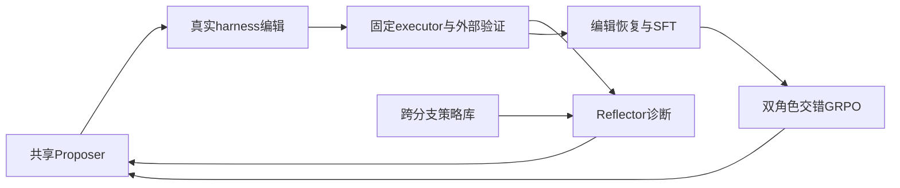

# Evo2: Evolving the Evolver through Weight-Harness Co-Evolution

> 当前是 concept_demo / L1 机制诊断接口；未声称完成原论文能力复测，未接入 Evolve 晋级。

## 论文信息

| 字段 | 内容 |
|---|---|
| 论文链接 | [arXiv 2610.13025](https://arxiv.org/abs/2610.13025) |
| 公司/机构 | Google DeepMind / University of Illinois Urbana-Champaign（一作 Chejian Xu） |
| 首次公开日期 | 2026-10-09（arXiv v1） |
| 原文开源代码 | 否：未找到原作者公开实现（2026-10-12 核查原文与作者项目链接；机构以原 PDF 首页为准） |
| Adapter | `evo2` |
| 本地复现代码 | [`src/auto_research/reproductions/evo2/`](https://github.com/daiwk/auto-research/tree/main/src/auto_research/reproductions/evo2/) |

## 原始论文总结

### 背景与主要改动

固定任务 executor，共享 Proposer/Reflector 编辑 harness；树搜索与跨分支 crossover 的执行反馈反过来训练 evolver。EvoTIDE 恢复有效编辑轨迹，先 SFT，再交错更新两个角色。 事实来源：[原文全文](https://arxiv.org/html/2610.13025v1)。

### 架构流程



重绘源码：[architecture.mmd](assets/architecture.mmd)。[原论文 Figure 2](https://arxiv.org/html/2610.13025v1/fig2.png) 展示原文的整体机制；本地重绘没有替换原图作为证据。来源与核查边界见 [source-provenance.json](assets/source-provenance.json)。

### 核心公式

$r_P=\widehat V(h')-\widehat V(h)$，$r_R=\widehat V(h_1)-\widehat V(h_0)$；keep 的收益为 0。父节点权重 $w(h)=\epsilon+|\widehat V(h)-1/2|$，root 保留固定采样份额。角色组内 $A_i=r_i-\bar r$，token loss 以固定 $L_{max}$ 归一化并屏蔽截断输出。

### 论文离线与线上效果

| 原文指标 | 原文方法 | 原文对照/协议 |
|---|---|---|
| Polyglot pass@1 | 82.1% | GEA 62.6% |
| SWE-bench Verified resolved | 48.3% | HGM 41.0% |
| LiveCodeBench pass@1 | 58.0% | HGM 56.0% |

这些是[原论文](https://arxiv.org/html/2610.13025v1)报告值，不是本地结果；未报告生产线上 A/B。模型、数据、打分或资源协议不同，禁止直接横比。复核摘录见 [paper-results.json](assets/paper-results.json)。原文数值不进入 local metrics/dashboard。

## 本地复现

> **本地对照口径**：基线为固定 executor 与初始可执行 harness；实验组由当前真实实现执行；稳定相对提升不适用，尚无正式能力对照。

实现位于 `src/auto_research/agent_research/oct12_evolution.py / oct12_checkpoint.py`；薄 adapter 从明确的 `oct12.json` 加载运行配置，不注入默认固定候选或 gold。统一入口：

```bash
PYTHONPATH=src python scripts/run_oct12_agents.py \\
  --method evo2 --checkpoint /path/to/public/local/checkpoint --device cuda \\
  --checkpoint-id OWNER/MODEL --checkpoint-revision IMMUTABLE_40_HEX_COMMIT \\
  --seed 42 --rounds 2 --group-size 2 --train-steps 2 \\
  --output runs/oct12/evo2/result.json
```

### 数据协议与代码映射

输入来源为 public-circle-packing-26。候选/参数晋级仅在 validation，test 与训练分开；金标只进入独立外部 scoring。短运行报告 `diagnostic_only=true`、`capability_comparison=false` 与 `evolve_promotion_eligible=false`。生成程序只在Linux bubblewrap/prlimit执行，未具备隔离环境时fail-closed；不在宿主机exec生成代码。

### 结果、验证与边界

本地限定生成 PROMPT 字符串并编辑真实 agent.py；候选 harness 和生成 solver 均在 bubblewrap/prlimit 中执行，无 host exec。保持外部几何分数、树、crossover、SFT、角色 GRPO 与 fresh counterpart snapshot，但不是任意代码 harness 能力复现。短运行的零收益/零梯度必须保留；不据此宣称论文指标。

当前检查为 L0 合同及真梯度测试；本地 NVIDIA 运行由本批集成统一生成脱敏回执，未通过前不得写GPU已验证。CUDA metadata已声明requires_gpu_validation=true，未来回执路径为 docs/gpu-validations/oct12-evo2-a100.json；本文不预填数值。 论文指标与本地指标严格分离；运行日志/模型权重不提交，失败与负结果保留。

测试入口：`python -m pytest tests/test_oct12_agent_algorithms.py tests/test_oct12_agent_delivery.py`。

