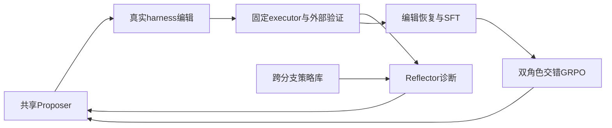
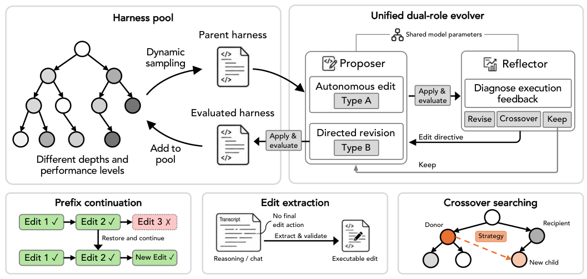

# Evo2: Evolving the Evolver through Weight-Harness Co-Evolution

> 当前是 concept_demo / L1 机制诊断接口；未声称完成原论文能力复测，未接入 Evolve 晋级。

## 论文信息

| 项目 | 内容 |
| --- | --- |
| 论文链接 | [arXiv 2610.13025](https://arxiv.org/abs/2610.13025) |
| 公司/机构 | Google DeepMind / University of Illinois Urbana-Champaign |
| 首次公开日期 | 2026-10-09（arXiv v1） |
| 原文开源代码 | 否：未找到原作者公开实现（2026-10-12 核查原文与作者项目链接；机构以原 PDF 首页为准） |
| Adapter | `evo2` |
| 本地复现代码 | [`src/auto_research/reproductions/evo2/`](https://github.com/daiwk/auto-research/tree/main/src/auto_research/reproductions/evo2/) |

## 原始论文总结

### 背景与主要改动

固定任务 executor，共享 Proposer/Reflector 编辑 harness；树搜索与跨分支 crossover 的执行反馈反过来训练 evolver。EvoTIDE 恢复有效编辑轨迹，先 SFT，再交错更新两个角色。 事实来源：[原文全文](https://arxiv.org/html/2610.13025v1)。

### 架构流程



重绘源码：[architecture.mmd](assets/architecture.mmd)。[原论文 Figure 2](https://arxiv.org/html/2610.13025v1/fig2.png) 展示原文的整体机制；本地重绘没有替换原图作为证据。来源与核查边界见 [source-provenance.json](assets/source-provenance.json)。

<!-- paper-figure:start -->
### 原论文关键图

[](https://arxiv.org/html/2610.13025v1/fig2.png)

> **原论文 Figure 2（关键图）**：展示原论文方法的总体设计和关键组成。图片来自[原论文](https://arxiv.org/abs/2610.13025)，版权归原作者所有；点击图片可查看来源。
<!-- paper-figure:end -->

### 核心公式

$r_P=\widehat V(h')-\widehat V(h)$，$r_R=\widehat V(h_1)-\widehat V(h_0)$；keep 的收益为 0。父节点权重 $w(h)=\epsilon+|\widehat V(h)-1/2|$，root 保留固定采样份额。角色组内 $A_i=r_i-\bar r$，token loss 以固定 $L_{max}$ 归一化并屏蔽截断输出。

### 论文离线与线上效果

| 原文指标 | 原文方法 | 原文对照/协议 |
|---|---|---|
| Polyglot pass@1 | 82.1% | GEA 62.6% |
| SWE-bench Verified resolved | 48.3% | HGM 41.0% |
| LiveCodeBench pass@1 | 58.0% | HGM 56.0% |

这些是[原论文](https://arxiv.org/html/2610.13025v1)报告值，不是本地结果；未报告生产线上 A/B。模型、数据、打分或资源协议不同，禁止直接横比。复核摘录见 [paper-results.json](assets/paper-results.json)。原文数值不进入 local metrics/dashboard。

## 本地复现

> **本地对照口径**：基线为固定 executor 与初始可执行 harness；实验组由当前真实实现执行；稳定相对提升不适用，尚无正式能力对照。

实现位于 `src/auto_research/agent_research/oct12_evolution.py / oct12_checkpoint.py`；薄 adapter 从明确的 `oct12.json` 加载运行配置，不注入默认固定候选或 gold。统一入口：

```bash
PYTHONPATH=src python scripts/run_oct12_agents.py \
  --method evo2 --checkpoint /tmp/auto-research-qwen2.5-7b --device cuda \
  --checkpoint-id Qwen/Qwen2.5-7B-Instruct \
  --checkpoint-revision bb46c15ee4bb56c5b63245ef50fd7637234d6f75 \
  --executor-checkpoint /tmp/auto-research-qwen2.5-7b \
  --executor-id Qwen/Qwen2.5-7B-Instruct \
  --executor-revision bb46c15ee4bb56c5b63245ef50fd7637234d6f75 \
  --seed 42 --rounds 2 --group-size 2 --train-steps 2 \
  --max-tokens 1536 --output runs/oct12/evo2-7b-1536-seed42/result.json
```

从仓库根目录、仓库 Python 环境执行；示例缓存须事先下载并通过固定公开 revision 的字节校验。缓存位置可替换，但不可用 `main` 或仅重写 revision 字符串。需要 Linux bubblewrap/prlimit、PyTorch/Transformers/safetensors 与真实 A100/A30；模型只从本地缓存加载且不信任远程代码。输出路径必须不存在，复跑换新目录。上述是可执行配置示例，不是 GPU 已通过或本次回执命令的预告。

该 7B policy + 7B executor 配置还会持有一份冻结 counterpart，必须同时容纳三份模型及训练激活；本批按 A100 运行，不能推定同一配置能在 A30 上容纳。逐 trajectory 反向传播和梯度检查点降低峰值，不截断 prompt 或改变 loss。

补充的 `gsm8k-harness` 是另一种真实外部验证环境，不替换默认 circle，也不覆盖其失败。保持上面的 checkpoint/id/revision 参数，改用以下环境与预算参数：

```text
--environment gsm8k-harness
--dataset /path/to/gsm8k-holdout/validation.jsonl
--evaluation-examples 8
--max-tokens 768 --executor-max-tokens 256
--rounds 2 --group-size 2 --train-steps 2
--output runs/oct12/evo2-gsm8k-7b-seed42/result.json
```

只允许官方 `openai/grade-school-math` revision `3101c7d5072418e28b9008a6636bde82a006892c` 的 train-only holdout：同目录 `split.json`、`train.jsonl`、`validation.jsonl` 经 `public_holdout.validate_holdout` 校验分区 SHA、计数、无重复/交集、`test_opened=false`，再取前 8 道 validation 题，不读取 test。harness 仍在 Linux sandbox 输出合法 PROMPT；固定 executor 只看到 question + PROMPT，gold 仅由外部 `verified_reward` 评分。给进化角色的逐题 trace 只有 question SHA、correct、output SHA，不含 gold 或 executor 原文。分数为真实正确率均值；全部相同 reward、无有效 GRPO 信号仍失败，不人为加奖励。此处只是有边界的 GSM harness 机制诊断，非原 coding benchmark 复现或隔离 test 能力提升；已发生的 A100 结果见下文，与原 circle 失败分开记录。

### 数据协议与代码映射

输入来源为 public-circle-packing-26，不输入最优布局或固定候选解。harness 只依据外部几何执行反馈选择；代码中的 `best_validation_score` 是单任务诊断搜索分数，没有进行独立公开 test split 的能力比较。短运行报告 `diagnostic_only=true`、`capability_comparison=false` 与 `evolve_promotion_eligible=false`。生成程序只在 Linux bubblewrap/prlimit 执行，未具备隔离环境时 fail-closed；不在宿主机 exec 生成代码。

### 结果、验证与边界

本地限定生成 PROMPT 字符串并编辑真实 agent.py；候选 harness 和生成 solver 均在 bubblewrap/prlimit 中执行，无 host exec。保持外部几何分数、树、crossover、SFT、角色 GRPO 与 fresh counterpart snapshot，但不是任意代码 harness 能力复现。短运行的零收益/零梯度必须保留；不据此宣称论文指标。

历史 circle 负运行见 [historical-circle-failures.json](assets/historical-circle-failures.json)，它不是 GPU 成功回执，也不进入 metrics/dashboard。7B policy + 7B executor、seed 42、2 rounds 的运行产生 21 个评分节点，circle 分数全部为 0；SFT 两步正梯度确实发生，但四次 GRPO 的 reward/advantage/loss/gradient 均为 0，`updated=false`、`parameters_changed=false`，运行明确失败。更早的 memory-fixed 历史记录虽写 `updated=true` 与参数变化，实际四次仍零优势/零梯度，只是 SFT 后 Adam 状态漂移，不计 active GRPO、未通过验证。早期记录没有可独立核实的源码 commit，因此不为它声明执行快照。

历史 7B circle 启动参数已由缓存 launch 脚本的 SHA 与相应行核对；集成操作记录给出 `3eae2c8863678692a8cf2de988d4562314c2731f`，该 Git 快照文件哈希可校验，但原始结果 JSON 未内嵌 command/commit/hash，不能仅凭 JSON 独立证明执行归属。这一来源限制保留在资产中。

新增 GSM 机制运行已在真实 NVIDIA A100-SXM4-80GB 完成，执行快照为 `ae68d75ef3c5dd5a3daa16236cb8bf914a559fd5`、默认 eager：7B policy 与独立冻结 7B executor、seed 42、policy/executor 输出预算 768/256、2 rounds、group 2、train steps 2。数值见 [gsm8k-harness-a100-42.json](metrics/gsm8k-harness-a100-42.json)。SFT 两步梯度为 0.50494384765625 / 0.674738347530365；四次 GRPO 同时满足更新、参数变化和正梯度，梯度依次为 0.005053921602666378、0.0019071860006079078、0.0009743663831613958、0.0018388759344816208。executor 权重未变，共 168 次 executor 调用。

8 道 validation 上 root 为 0.125，21 个搜索节点中的 best 为 0.25。**这是重复使用同一 validation 的搜索选优，不是隔离 test 能力提升**，没有读取 test；GSM 补充不能替代或抹去原 circle 全零结果。维持 concept_demo / L1、`capability_comparison=false` 与 `evolve_promotion_eligible=false`，不宣称原 coding benchmark 或 Evolve 晋级。

[GPU 回执](../../gpu-validations/oct12-evo2-a100.json) 保存 GSM 实际配置、公开 data/checkpoint revision、该执行 commit 的 `git show` 逐文件源码 SHA 与上述训练证据。`passed` 只表示该 GSM 快照完成主动 SFT/GRPO 机制运行，不覆盖历史失败或当前 HEAD/dirty 全部改动。论文指标与本地指标严格分离；不提交模型原始输出、机器路径、日志或权重，保留负结果。

测试入口：`python -m pytest tests/test_oct12_agent_algorithms.py tests/test_oct12_agent_delivery.py`。

