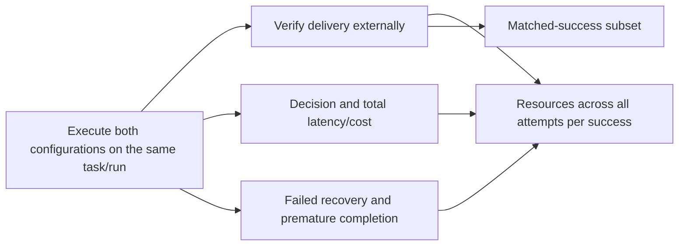
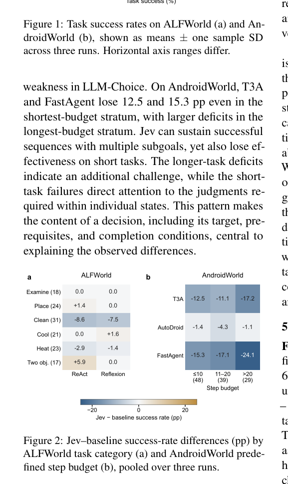

# When Faster Decisions Do Not Make Better Agents: An Empirical Study of Jev in Agent Workflows

<!-- source-sha256: ab9c58424b33eb981cda0f06504a6162f74afd6a6cfb91e08561d7c69c470d93 -->

[简体中文](README.md)

> This is a core_mechanism / L1 diagnostic interface. It does not reproduce the paper's capability evaluation and is not eligible for promotion in Evolve.

## Paper information

| Field | Value |
| --- | --- |
| Paper | [arXiv 2610.13092](https://arxiv.org/abs/2610.13092) |
| Affiliations | Nanjing University / Technical University of Munich |
| First public release | 2026-10-09 (arXiv v1) |
| Author code | No verified release. The authors provided an [anonymous experiment-code link](https://anonymous.4open.science/r/jev-emp-5BF4/), but only its frontend loaded; the API timed out, so usable source was not verified (2026-10-12). |
| Adapter | `jev-workflow` |
| Local implementation | [`src/auto_research/reproductions/jev_workflow/`](https://github.com/daiwk/auto-research/tree/main/src/auto_research/reproductions/jev_workflow/) |

## Original paper

### Background and contribution

This is an evaluation study, not a new self-improvement algorithm. It compares decision latency and cost with successful end-to-end delivery. Recovery failures, premature completion, and resources spent on unsuccessful attempts all affect the resources per delivered success; a faster individual decision is not enough. See the [full paper](https://arxiv.org/html/2610.13092v1).

### Evaluation workflow



Redrawn diagram: [architecture.mmd](assets/architecture.mmd). The [original Figure 2](https://arxiv.org/html/2610.13092v1/conditions.png) shows the original protocol; the redraw does not substitute for it as evidence. See [source-provenance.json](assets/source-provenance.json) for provenance and verification limits.

<!-- paper-figure:start -->
### Key figure from the paper

[](https://arxiv.org/pdf/2610.13092#page=5)

> **Original Figure 2:** The main experimental design and its components. From the [paper](https://arxiv.org/abs/2610.13092); copyright belongs to the authors.
<!-- paper-figure:end -->

### Core equations

$Cost_{success}=\sum_iCost_i/\sum_i1\{success_i\}$, $Time_{success}=\sum_iTime_i/\sum_i1\{success_i\}$, and $FailureCostShare=\sum_{i:fail}Cost_i/\sum_iCost_i$. Matched-success comparisons only include pairs in which both configurations succeeded on the same task/run. They are reported separately from delivery over all attempts.

### Paper results

| Metric | Paper result | Comparison or protocol |
|---|---|---|
| Total executions | 4500 | ALFWorld/AndroidWorld, three repetitions per configuration |
| T3A cost per delivered success, base/Jev | 68.70 / 73.97 mUSD | +7.7%; the 95% interval includes zero |
| FastAgent time per delivered success, base/Jev | 239.4 / 377.8 seconds | Lower success rates offset the per-step savings |

These are results from the [paper](https://arxiv.org/html/2610.13092v1), not local measurements. No production A/B test was reported. Do not compare results directly across different models, datasets, scoring rules, or resource protocols. The [verified extract](assets/paper-results.json) is excluded from local metrics and the dashboard.

## Local reproduction

> **Local comparison:** Pair the original configuration with the replacement decision configuration on the same task/run. The local implementation executes the experiment arm; there is no formal capability comparison or claim of a stable relative gain.

The implementation is in `src/auto_research/agent_research/oct12_memory_tools.py`. A thin adapter reads explicit settings from `oct12.json` and supplies neither fixed default candidates nor gold answers.

```bash
PYTHONPATH=src python scripts/run_oct12_agents.py \
  --method jev-workflow --device cpu \
  --dataset /path/to/public/input --seed 42 --rounds 2 --group-size 2 --train-steps 2 \
  --output runs/oct12/jev-workflow/result.json
```


### Input protocol and implementation

The input is JSONL from actual paired workflow executions. Candidate and hyperparameter promotion use validation only; test data are isolated from training, and gold labels go only to an external scorer. The short run reports `diagnostic_only=true`, `capability_comparison=false`, and `evolve_promotion_eligible=false`. JSONL fields include task_id, run_id, configuration, success, decision_seconds, task_seconds, inference_cost, failed_recovery, and premature_completion. They must come from actual execution records; human annotations retain provenance.

### Validation and limitations

This is executable paired-trace evaluation infrastructure. It neither loads nor simulates Jev weights or APIs and does not register paper tables as local runs. The two configurations must have complete task/run pairing and finite, nonnegative resources. Per-success quantities are null when there are no successes. The anonymous code page loaded only a frontend shell during the review, so runnable upstream source remains unverified.

In addition to the CPU aggregator, the measurement script freezes a byte-verified public SmolLM2-135M-Instruct checkpoint. It compares generation budgets of 64 and 256 on the same public 26-circle task, paired across seeds 42/43/44. It resets Python, NumPy, torch, and CUDA random state for every attempt, alternates execution order, and records synchronized generation time, total sandbox time, and exact generated token counts without updating weights.

```bash
PYTHONPATH=src python scripts/run_oct12_workflow_measurement.py \
  --checkpoint checkpoints/smollm2-135m-instruct \
  --checkpoint-id HuggingFaceTB/SmolLM2-135M-Instruct \
  --revision 12fd25f77366fa6b3b4b768ec3050bf629380bac \
  --device cuda --seeds 42,43,44 --budgets 64,256 --output runs/workflow-measured
PYTHONPATH=src python scripts/run_oct12_agents.py --method jev-workflow \
  --dataset runs/workflow-measured/pairs.jsonl --output runs/workflow-audit.json
```

On 2026-10-12, none of the six real A100 generations delivered a valid geometry solution. Both budgets had zero successes; mean total times were `2.71459 s` and `10.01093 s`, respectively. Cost and time per success were both `null`, so faster generation does not establish a better agent. Cost is measured in **generated token units, not dollars**. The one-shot workflow has no recovery or completion declaration. Its failed_recovery and premature_completion fields are explicitly N/A schema placeholders, not measured zeros.

See the [measured results](metrics/measured-workflows-a100-seeds42-44.json) and the [CUDA receipt](../../gpu-validations/oct12-jev-workflow-measurement-a100.json). The CPU aggregator still does not require CUDA. The receipt verifies the measurement infrastructure, not the Jev model or the paper's 4500 agent runs.

Tests: `python -m pytest tests/test_oct12_agent_algorithms.py tests/test_oct12_agent_delivery.py`.
