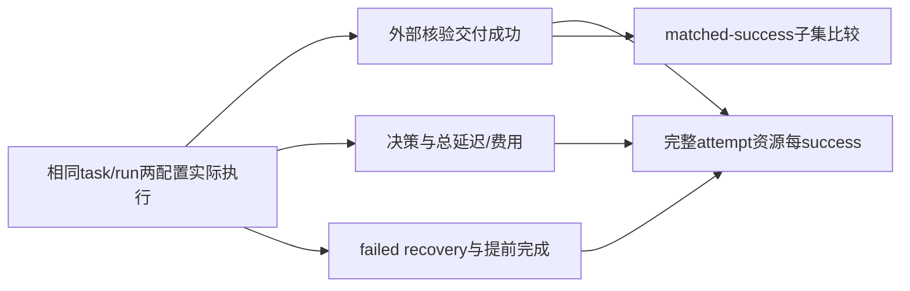
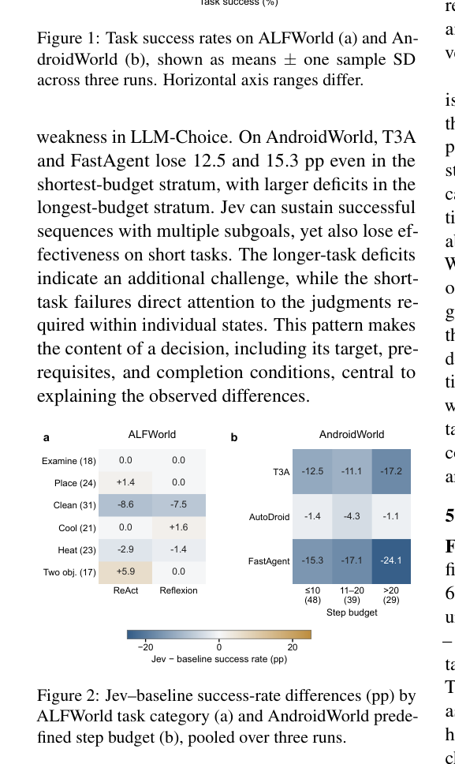

# When Faster Decisions Do Not Make Better Agents: An Empirical Study of Jev in Agent Workflows

> 当前是 core_mechanism / L1 机制诊断接口；未声称完成原论文能力复测，未接入 Evolve 晋级。

## 论文信息

| 项目 | 内容 |
| --- | --- |
| 论文链接 | [arXiv 2610.13092](https://arxiv.org/abs/2610.13092) |
| 公司/机构 | Nanjing University / Technical University of Munich |
| 首次公开日期 | 2026-10-09（arXiv v1） |
| 原文开源代码 | 否：作者提供[匿名实验代码链接](https://anonymous.4open.science/r/jev-emp-5BF4/)，本轮仅取得前端页面，API连接超时，未核实可用源码（2026-10-12） |
| Adapter | `jev-workflow` |
| 本地复现代码 | [`src/auto_research/reproductions/jev_workflow/`](https://github.com/daiwk/auto-research/tree/main/src/auto_research/reproductions/jev_workflow/) |

## 原始论文总结

### 背景与主要改动

这是一篇评测研究，不是新的 self-improvement 算法。比较决策延迟/费用与端到端成功交付；failed recovery、premature completion 和失败开销计入资源每成功，而非只报告单步省时。 事实来源：[原文全文](https://arxiv.org/html/2610.13092v1)。

### 架构流程



重绘源码：[architecture.mmd](assets/architecture.mmd)。[原论文 Figure 2](https://arxiv.org/html/2610.13092v1/conditions.png) 展示原文的整体机制；本地重绘没有替换原图作为证据。来源与核查边界见 [source-provenance.json](assets/source-provenance.json)。

<!-- paper-figure:start -->
### 原论文关键图

[](https://arxiv.org/pdf/2610.13092#page=5)

> **原论文 Figure 2（关键图）**：展示原论文方法的总体设计和关键组成。图片来自[原论文](https://arxiv.org/abs/2610.13092)，版权归原作者所有；点击图片可查看来源。
<!-- paper-figure:end -->

### 核心公式

$Cost_{success}=\sum_iCost_i/\sum_i1\{success_i\}$，$Time_{success}=\sum_iTime_i/\sum_i1\{success_i\}$；$FailureCostShare=\sum_{i:fail}Cost_i/\sum_iCost_i$。matched-success比较只纳入两配置同task/run均成功的配对，并与all-attempt delivery口径分开。

### 论文离线与线上效果

| 原文指标 | 原文方法 | 原文对照/协议 |
|---|---|---|
| total executions | 4500 | ALFWorld/AndroidWorld，各配置三次 |
| T3A cost per delivered success, base/Jev | 68.70 / 73.97 mUSD | +7.7%，95%区间跨0 |
| FastAgent time per delivered success, base/Jev | 239.4 / 377.8 seconds | 成功率下降削弱单步收益 |

这些是[原论文](https://arxiv.org/html/2610.13092v1)报告值，不是本地结果；未报告生产线上 A/B。模型、数据、打分或资源协议不同，禁止直接横比。复核摘录见 [paper-results.json](assets/paper-results.json)。原文数值不进入 local metrics/dashboard。

## 本地复现

> **本地对照口径**：基线为同task/run的原配置与替换decision配置；实验组由当前真实实现执行；稳定相对提升不适用，尚无正式能力对照。

实现位于 `src/auto_research/agent_research/oct12_memory_tools.py`；薄 adapter 从明确的 `oct12.json` 加载运行配置，不注入默认固定候选或 gold。统一入口：

```bash
PYTHONPATH=src python scripts/run_oct12_agents.py \
  --method jev-workflow --device cpu \
  --dataset /path/to/public/input --seed 42 --rounds 2 --group-size 2 --train-steps 2 \
  --output runs/oct12/jev-workflow/result.json
```

### 数据协议与代码映射

输入来源为 actual paired workflow execution JSONL。候选/参数晋级仅在 validation，test 与训练分开；金标只进入独立外部 scoring。短运行报告 `diagnostic_only=true`、`capability_comparison=false` 与 `evolve_promotion_eligible=false`。JSONL含task_id/run_id/configuration/success/decision_seconds/task_seconds/inference_cost，以及failed_recovery/premature_completion。必须由真实执行记录构造，人工标签保留来源。

### 结果、验证与边界

本地是可执行 paired-trace评测基础设施，不加载/伪造 Jev 权重或API，也不把原文表格录入为本地运行。要求两配置 task/run 完全配对、非负有限实际资源，0成功时每success返回null。作者给出匿名代码链接；主页可访问但本次静态获取只有前端壳，未核实可运行源码。

除了CPU聚合器，本轮增加真实测量脚本：冻结已核对全部字节的公开SmolLM2-135M-Instruct，在同一公开26圆任务上，以seed42/43/44配对比较64/256生成预算。每次重置Python/NumPy/torch/CUDA随机状态，交替运行顺序；记录同步生成耗时、沙箱总耗时和精确生成token计数，权重不更新。

```bash
PYTHONPATH=src python scripts/run_oct12_workflow_measurement.py \
  --checkpoint checkpoints/smollm2-135m-instruct \
  --checkpoint-id HuggingFaceTB/SmolLM2-135M-Instruct \
  --revision 12fd25f77366fa6b3b4b768ec3050bf629380bac \
  --device cuda --seeds 42,43,44 --budgets 64,256 --output runs/workflow-measured
PYTHONPATH=src python scripts/run_oct12_agents.py --method jev-workflow \
  --dataset runs/workflow-measured/pairs.jsonl --output runs/workflow-audit.json
```

2026-10-12 A100六次真实generation均未交付有效几何解；两种预算成功率都是0。平均总耗时分别 `2.71459 s` 与 `10.01093 s`，每成功成本/耗时都是 `null`，不能以较快生成宣称更好Agent。成本单位为 **generated token units，不是美元**。该one-shot流程不包含恢复或完成声明，failed_recovery/premature_completion是明确N/A的schema占位，不当作已测为零。

实测见 [measured-workflows-a100-seeds42-44.json](metrics/measured-workflows-a100-seeds42-44.json)，实际CUDA测量回执见 [GPU证据](../../gpu-validations/oct12-jev-workflow-measurement-a100.json)。CPU聚合adapter仍不要求CUDA；这证明测量设施能执行，不是Jev模型或原文4500次Agent复测。

测试入口：`python -m pytest tests/test_oct12_agent_algorithms.py tests/test_oct12_agent_delivery.py`。

