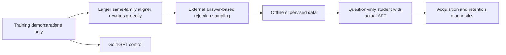
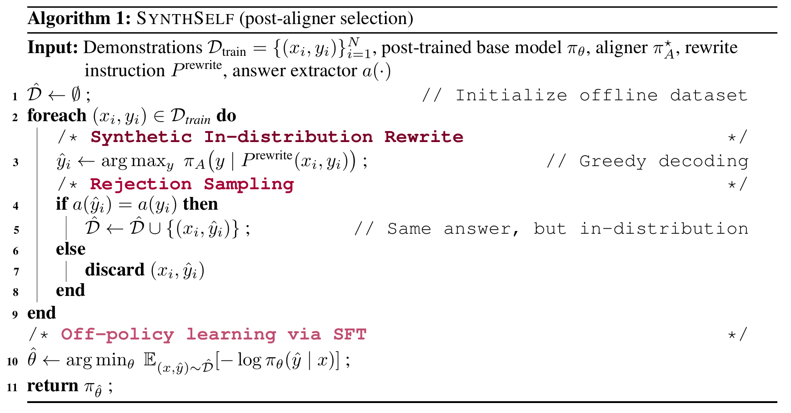
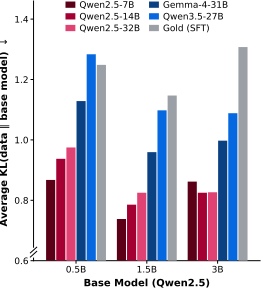

# Continually Post-training Small Models via Synthetic Self-distillation

<!-- source-sha256: 77097294cf1c17a7ea9aea1ebc23bab935aa8d6a238f66fdce323bf7e84c256c -->

[简体中文](README.md)

## Paper information

| Field | Value |
| --- | --- |
| Paper | [arXiv 2610.13113](https://arxiv.org/abs/2610.13113) |
| Affiliations | LG AI Research / KAIST AI |
| First public release | 2026-10-09 (arXiv v1) |
| Author code | No release found in paper-linked primary sources as of 2026-10-13. |
| Adapter | `synthself` |
| Local implementation | [`src/auto_research/reproductions/synthself/`](https://github.com/daiwk/auto-research/tree/main/src/auto_research/reproductions/synthself/) |
| Implementation and evaluation | Core algorithm on a real model; L0/L1 mechanism diagnostics, not full benchmark reproduction |
| GPU validation | [Three-seed A100 mechanism receipt](../../gpu-validations/synthself-a100-20261014-seeds42-44.json) bound to 51b source. This is L1, not original benchmark acceptance. |

## Original paper

### Background and contribution

Self-rewriting with a small model can distort examples, while direct SFT can shift away from its base distribution. SynthSelf uses a larger same-family aligner to greedily rewrite training demonstrations offline, rejects rewrites with incorrect extracted answers, and then performs response SFT. The evaluated student cannot see reference answers. Text filtering alone is not training.

### Architecture and data flow

Local redraw:



<!-- paper-figure:start -->
### Key figures from the paper

[](https://arxiv.org/pdf/2610.13113v1#page=6)

After selecting the aligner, greedily rewrite training demonstrations. Keep a rewrite only if extracted answers match, then train response SFT on the offline dataset. Version 1 does not provide a separate flowchart; this is the original algorithm block, not the local redraw. See [Algorithm 1 in the v1 PDF](https://arxiv.org/pdf/2610.13113v1#page=6), [HTML algorithm](https://arxiv.org/html/2610.13113v1#alg1), and [render provenance](figure-source.json). The crop was rendered at 300 DPI without editing content.



For three Qwen2.5 student sizes, same-family aligners produced data with less mean distribution shift. A stronger cross-family model is not necessarily closer to the student. These are paper results, not local acquisition or retention. See [Figure 4 in v1](https://arxiv.org/html/2610.13113v1#S2.F5.fig1) and [original SVG](https://arxiv.org/html/2610.13113v1/rewrite_premise.svg). The local SVG preserves the original bytes. Copyright belongs to the authors.
<!-- paper-figure:end -->

### Core equations

$$
q_i(y)=\pi_A(y\mid P_{\rm rewrite}(x_i,y_i)),\quad
\hat y_i=\operatorname{greedy}(q_i),\quad
R(\pi_A)=\mathbb E_i[\mathbf1(a(\hat y_i)=a(y_i))].
$$

Keep only correct rewrites, then train student response NLL $-\sum_t\log\pi_\theta(\hat y_{i,t}\mid x_i,\hat y_{i,<t})$. Eq. 6 requires $\mathcal L(\pi_A)<\mathcal L_{\rm gold}$ and $R(\pi_A)>R(\pi)$. The local run records whether both hold; a fixed same-family aligner is no guarantee.

### Paper results

Science/mixture, tool-use, and medicine experiments used 0.5B/1.5B/3B students, 7B/14B aligners, and 14 retention tasks. Table 1 averages: acquisition 56.4 SynthSelf vs. 52.2 SFT; retention 41.7 SynthSelf, 40.5 SFT, 41.8 ASFT. Small differences do not establish dominance. The paper ran full-parameter fine-tuning, one seed 42 per cell, and no reported production A/B. [Paper results](paper-results.json) are distinct from local measurements.

## Local reproduction

> Compare gold-SFT on the same initial student and epochs. An unfiltered-rewrite ablation is also available. Report unequal realized token budgets. This is an L0/L1 mechanism diagnostic, not a stable relative improvement.

### Data and label access

Pin and verify public revisions with `checkpoint_source` and `validate_holdout`. Use train/validation from official GSM8K train only; official test stays unopened. Qwen2.5-0.5B-Instruct revision: `7ae557604adf67be50417f59c2c2f167def9a775`. Qwen2.5-7B-Instruct teacher/reasoner when needed: `bb46c15ee4bb56c5b63245ef50fd7637234d6f75`. Reference answers are available only to external training verification, SFT supervision, or explicit train-only teacher data construction. The evaluated student/agent gets no current-problem gold or plan.

Offline aligner and separate frozen self-builder read demonstrations only from train. The training/evaluated student's generation input is the question alone. Family/size checks read actual parameter counts. LoRA SFT and gold-SFT or unfiltered controls really update parameters. Default GSM validation is split into two disjoint slices; these are in-domain acquisition/retention proxies.

### Entry point and budget

Use `scripts/run_oct13_post_training.py --method synthself` and `oct13_execution.json` in the dataset directory. Supply local checkpoints, public IDs/revisions, train/validation paths, split manifest, and dataset revision. This example is not a GPU receipt:

```bash
PYTHONPATH=src python scripts/run_oct13_post_training.py \
  --method synthself --config data/oct13_execution.json \
  --device cuda --seed 42 --train-examples 8 --validation-examples 4 --max-tokens 512 --epochs 2 --control gold-sft \
  --output runs/oct13/synthself-42
```

Account for actual generation, rejection, difficulty calibration, teacher profiling, and supervised tokens. Failures write non-overwritable `failure.json`; successes write `result.json` and `report.md`. Directory names do not prove provenance.

### CPU contracts

[Mechanism contracts](metrics/mechanism-contracts.json) record deterministic tensor/fixture formula and behavior tests with `diagnostic_only: true` and `formal_comparison: false`. These do not replace public-checkpoint training, GPU evidence, a matched-budget capability comparison, or the original benchmark.

### Historical failure, 2026-10-14 (6a source)

The [sanitized negative seed-42 run](metrics/public-a100-failed-seed42-6aabe57a.json) used A100 and `6aabe57a`. Eq. 6 failed: gold sequence NLL 69.12545 vs. rewrite 76.84698, despite aligner quality 1.0 vs. self 0.75. Two SFT updates occurred before rejection, but do not constitute a pass. Acquisition and retention each used two validation problems and stayed 0.5→0.5; elapsed time was 164.40 seconds.

The old gold responses lacked EOS while rewrites had natural EOS. Do not choose between that protocol and corrected full responses to obtain a pass. The 32f fix keeps sequence SUM and strict inequalities and requires natural termination and one EOS. Truncated or unterminated outputs are partial diagnostics, quality zero, and block selection/SFT. Train-only entry at `51b4718a` neither evaluates validation nor runs LoRA, so it does not validate the complete method.

### Corrected train-only diagnostic

The [51b train-only run](metrics/public-a100-train-diagnosis-seed42-51b4718a.json) took 59.24 seconds on 2026-10-14. It handled 8 aligner and 8 self rewrites under the predeclared full-response EOS protocol; all aligner responses ended naturally. Gold sequence SUM NLL 79.45413 vs. rewrite 76.84698 and quality 1.0>0.75 satisfy Eq. 6. Adding the canonical EOS changed the endpoint convention, not model capability. Generated tokens: 659+857; scored tokens: 770+659. No LoRA/SFT or validation/test evaluation. `not_gpu_receipt` and `whole_method_gpu_validation_passed: false` remain explicit.

### Corrected complete mechanism, seed 42

The [complete result](metrics/public-a100-complete-seed42.json) and [51b GPU receipt](../../gpu-validations/synthself-a100-20261014.json) were independently verified. After passing strict full-response SUM Eq. 6, the method ran two LoRA SFT updates over eight verified rewrites and the independent gold-SFT control ran two updates. Gradients and supervised tokens were nonzero. Elapsed time was 156.30 seconds. On two validation questions per slice, initial, method, and control accuracies were all 0.5.

`gold_in_student_generation: false` refers only to evaluated student inference. The offline aligner and separate frozen self-builder do see TRAIN demonstrations; gold-SFT sees train responses. Real supervised token budgets differ and are retained. This result is seed 42 only.

### Corrected complete mechanism, seeds 42/43/44

The [three-seed runs](metrics/public-a100-complete-seeds42-44.json) and [independent receipt](../../gpu-validations/synthself-a100-20261014-seeds42-44.json) bind 51b. Each seed ran two method SFT updates and two gold-SFT control updates, passing strict full-response SUM Eq. 6. Mean acquisition was 0.5 vs. 0.6667 for gold-SFT. Mean retention was 0.3333 for both vs. initial 0.5; seed-43 method retention fell to zero. The negative results do not establish superiority or stable retention.

The default three-seed mechanism chain completed. Two validation examples per slice, LoRA, and in-domain GSM rather than full multi-domain fine-tuning do not establish formal capability, stable improvement, or acceptance of other methods.

### Code and remaining limits

`algorithm.py` builds prompts and enforces family/size and Eq. 6; `checkpoint.py` handles rewrites, rejection, actual LoRA SFT, both evaluations, and controls. Shared `post_training/oct13_common.py` only handles loading, accounting, response likelihood, real optimizer steps, and outputs. See `tests/reproductions/test_oct13_post_training.py`; State, GPPO, and TAPO also retain dedicated tests.

This does not reproduce 14-task cross-domain retention, continuing acquisition of unseen knowledge, or full fine-tuning. Report rewrite quality, length, and actual cost together. Finite-sample Eq. 6 failures are retained and do not establish native-distribution alignment. When Eq. 6 fails, even a real SFT update yields `failed-aligner-constraints`, a nonzero exit, and no passing receipt. The reduced A100 mechanism was verified for 42/43/44. Catalog sync and CI are separate. No unverified Evolve mapping.
