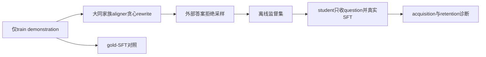

# Continually Post-training Small Models via Synthetic Self-distillation

## 论文信息

| 字段 | 内容 |
| --- | --- |
| 论文链接 | [arXiv 2610.13113](https://arxiv.org/abs/2610.13113) |
| 公司/机构 | LG AI Research / KAIST AI |
| 首次公开日期 | 2026-10-09（arXiv v1） |
| 原文开源代码 | 否：原文与关联原始来源未找到本方法已发布源码（2026-10-13核验）；不是宣称全网不存在 |
| Adapter | `synthself` |
| 本地复现代码 | [`src/auto_research/reproductions/synthself/`](https://github.com/daiwk/auto-research/tree/main/src/auto_research/reproductions/synthself/) |
| 实现/评测层级 | 核心算法实际模型路径；L0/L1机制诊断，不是原benchmark完整复现 |
| GPU门禁 | 必须真实A100/A30执行并提交绑定源码的脱敏回执；未取得者仍未验收 |

## 原始论文总结

### 背景与主要改动

小模型self-rewrite可能失真，直接SFT又可能偏离base分布。SynthSelf用更大的同家族aligner把train demonstration贪心离线改写，通过答案拒绝采样后SFT。不允许student读评测答案，也不以文本过滤替代真实训练。

### 架构与数据流

以下为本地重绘，不冒充原论文图片。



原图来源：[原文图位置](https://arxiv.org/html/2610.13113v1#S2.F5.fig1)；[原始图资源](https://arxiv.org/html/2610.13113v1/rewrite_premise.svg)。版本及资源记录在 [figure-source.json](figure-source.json)。原图版权归作者，原始效果图与本地重绘分开。

### 核心公式

$$
q_i(y)=\pi_A(y\mid P_{\rm rewrite}(x_i,y_i)),\quad
\hat y_i=\operatorname{greedy}(q_i),\quad
R(\pi_A)=\mathbb E_i[\mathbf1(a(\hat y_i)=a(y_i))].
$$
仅保留正确rewrite，对student做响应NLL：$-\sum_t\log\pi_\theta(\hat y_{i,t}\mid x_i,\hat y_{i,<t})$。
Eq6约束为 $\mathcal L(\pi_A)<\mathcal L_{\rm gold}$ 且 $R(\pi_A)>R(\pi)$。本地实测记录约束是否成立，固定同家族aligner不被伪装为保证成立。

### 论文离线与线上效果

science/mixture、tool-use、medicine实验使用0.5B/1.5B/3B学生及7B/14B aligner，14项retention任务。表1平均acquisition：SynthSelf56.4、SFT52.2；retention：SynthSelf41.7、SFT40.5、ASFT41.8，不能把微小差异写成确定优胜。原文全参数finetune，每cell一个seed42。未报告生产线上A/B。

选取的原文稳定标量与出处保存于 [paper-results.json](paper-results.json)，全部标为paper-reported，不是本地测量。

## 本地复现

> **本地对照口径**：基线为同初始学生与epochs的gold-SFT；另可unfiltered-rewrite消融，真实token预算不相同则明确记录；实验组仅支持本页L0/L1机制，稳定相对提升不适用。

### 数据与标签访问协议

公开checkpoint/data必须固定revision并通过既有 `checkpoint_source` / `validate_holdout` 的文件hash验证。GSM8K仅从官方train拆train/validation，官方test不打开。Qwen2.5-0.5B-Instruct revision为 `7ae557604adf67be50417f59c2c2f167def9a775`，需要teacher/reasoner时用Qwen2.5-7B-Instruct revision `bb46c15ee4bb56c5b63245ef50fd7637234d6f75`。参考答案仅在外部训练verifier、SFT监督target或明确的train-only数据构建teacher边界读取；被评估student/agent prompt不接收当前题gold/plan。

offline aligner/独立冻结self-builder仅对train构建可读demonstration；训练/评估student生成只有question。family/larger合同读取实际参数量。真实LoRA SFT和gold-SFT或unfiltered控制均执行。默认GSM validation预先拆不重叠两片，只是同域acquisition/retention诊断。

### 可执行入口与预算

入口为 `scripts/run_oct13_post_training.py --method synthself`，adapter则从数据目录读取 `oct13_execution.json`。必须提供student/teacher镜像路径、public id/revision、train/validation路径、split manifest与dataset revision。下面是待实跑配置示例，不表示GPU已完成：

```bash
PYTHONPATH=src python scripts/run_oct13_post_training.py \
  --method synthself --config data/oct13_execution.json \
  --device cuda --seed 42 --train-examples 8 --validation-examples 4 --max-tokens 512 --epochs 2 --control gold-sft \
  --output runs/oct13/synthself-42
```

真实生成、拒绝、难度校准、teacher profiling及监督token预算进入结果；失败写不可覆盖的 `failure.json`，成功写 `result.json` / `report.md`。不能仅以本地目录名伪造source metadata。

### 当前结果与验收状态

[mechanism-contracts.json](metrics/mechanism-contracts.json)保存已CPU执行的公式/行为合同标量，deterministic tensor/fixture协议，`diagnostic_only: true`、`formal_comparison: false`。不替代公开checkpoint训练、GPU回执、同预算能力比较或原benchmark。GPU指标由实际结果核验后另行摘录；本页不声明未执行实验已经完成。

### 代码映射

algorithm.py：构建prompt、family/size及Eq6合同；checkpoint.py：rewrite/拒绝/真实LoRA SFT、双评测和对照。

共享 `post_training/oct13_common.py` 只承担资源装载、成本记录、response likelihood、真实optimizer step和输出；论文机制保留在本目录。行为测试为 `tests/reproductions/test_oct13_post_training.py`；State/GPPO/TAPO还保留既有专属测试。

### 边界与未完成项

不代表14任务跨域保持、未见新知识持续注入或原full-finetuning效果。rewrite质量、长度和真实token成本一起报告。Eq6有限样本不满足保留失败约束，不宣称native-distribution alignment已成立。

Eq6未满足时，即使真实SFT产生参数变化，也标为failed-aligner-constraints，命令返回非零，不凭权重变化签发通过回执。

仍需适用A100/A30路径及对照实跑、新源码绑定脱敏receipt、全局目录同步与CI。三个seed不会自动升级机制诊断为正式能力证据。本条未注册未经验证的evolve映射。

