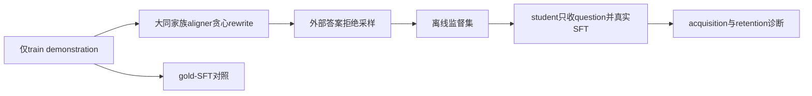
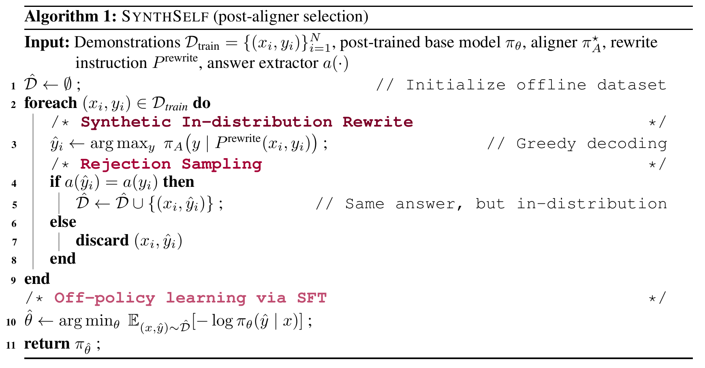
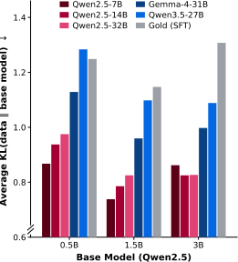

# Continually Post-training Small Models via Synthetic Self-distillation

## 论文信息

| 字段 | 内容 |
| --- | --- |
| 论文链接 | [arXiv 2610.13113](https://arxiv.org/abs/2610.13113) |
| 公司/机构 | LG AI Research / KAIST AI |
| 首次公开日期 | 2026-10-09（arXiv v1） |
| 原文开源代码 | 否：原文与关联原始来源未找到本方法已发布源码（2026-10-13核验）；不是宣称全网不存在 |
| Adapter | `synthself` |
| 本地复现代码 | [`src/auto_research/reproductions/synthself/`](https://github.com/daiwk/auto-research/tree/main/src/auto_research/reproductions/synthself/) |
| 实现/评测层级 | 核心算法实际模型路径；L0/L1机制诊断，不是原benchmark完整复现 |
| GPU门禁 | [A100三seed完整机制回执](../../gpu-validations/synthself-a100-20261014-seeds42-44.json)绑定实际51b源码；仍是L1诊断，不是原benchmark完整验收 |

## 原始论文总结

### 背景与主要改动

小模型self-rewrite可能失真，直接SFT又可能偏离base分布。SynthSelf用更大的同家族aligner把train demonstration贪心离线改写，通过答案拒绝采样后SFT。不允许student读评测答案，也不以文本过滤替代真实训练。

### 架构与数据流

以下为本地重绘，不冒充原论文图片。



<!-- paper-figure:start -->
### 原论文关键图

[](https://arxiv.org/pdf/2610.13113v1#page=6)

中文图注（原论文 Algorithm 1）：完成 aligner 选择后，aligner 对训练 demonstration 贪心改写；答案抽取一致才加入离线数据集，否则拒绝，最后以该数据集进行 response SFT。固定 v1 未提供独立架构流程图，因此这里展示原算法块截图，而非把本地 Mermaid 重绘作为原图。

精确来源：[固定 v1 PDF 第 6 页，Algorithm 1](https://arxiv.org/pdf/2610.13113v1#page=6)；[HTML 算法位置 `alg1`](https://arxiv.org/html/2610.13113v1#alg1)。截图只做 300 DPI 渲染与边界裁取，未改写算法内容；PDF 哈希、页码及裁取参数记录在 [figure-source.json](figure-source.json)。



中文图注（原论文 Figure 4）：对三个 Qwen2.5 学生规模，同家族 aligner 生成的数据具有更低的平均分布偏移；更强的跨家族模型不必然更贴近学生。此图是 aligner 选择的方法依据，数值属于原论文，不是本地 acquisition/retention 测量。

精确来源：[固定 v1 的 Figure 4，HTML `S2.F5.fig1`](https://arxiv.org/html/2610.13113v1#S2.F5.fig1)；[原始 SVG](https://arxiv.org/html/2610.13113v1/rewrite_premise.svg)。本地 SVG 为原始字节副本，版权归原作者；与上方本地 Mermaid 重绘分开。

> **原论文 Algorithm 1（关键图）**：上文说明所选原图或方法截图的范围；并非本地测量。图片来自[原论文](https://arxiv.org/pdf/2610.13113v1#page=6)，版权归原作者所有；点击图片可查看固定版本来源。
<!-- paper-figure:end -->

### 核心公式

$$
q_i(y)=\pi_A(y\mid P_{\rm rewrite}(x_i,y_i)),\quad
\hat y_i=\operatorname{greedy}(q_i),\quad
R(\pi_A)=\mathbb E_i[\mathbf1(a(\hat y_i)=a(y_i))].
$$
仅保留正确rewrite，对student做响应NLL：$-\sum_t\log\pi_\theta(\hat y_{i,t}\mid x_i,\hat y_{i,<t})$。
Eq6约束为 $\mathcal L(\pi_A)<\mathcal L_{\rm gold}$ 且 $R(\pi_A)>R(\pi)$。本地实测记录约束是否成立，固定同家族aligner不被伪装为保证成立。

### 论文离线与线上效果

science/mixture、tool-use、medicine实验使用0.5B/1.5B/3B学生及7B/14B aligner，14项retention任务。表1平均acquisition：SynthSelf56.4、SFT52.2；retention：SynthSelf41.7、SFT40.5、ASFT41.8，不能把微小差异写成确定优胜。原文全参数finetune，每cell一个seed42。未报告生产线上A/B。

选取的原文稳定标量与出处保存于 [paper-results.json](paper-results.json)，全部标为paper-reported，不是本地测量。

## 本地复现

> **本地对照口径**：基线为同初始学生与epochs的gold-SFT；另可unfiltered-rewrite消融，真实token预算不相同则明确记录；实验组仅支持本页L0/L1机制，稳定相对提升不适用。

### 数据与标签访问协议

公开checkpoint/data必须固定revision并通过既有 `checkpoint_source` / `validate_holdout` 的文件hash验证。GSM8K仅从官方train拆train/validation，官方test不打开。Qwen2.5-0.5B-Instruct revision为 `7ae557604adf67be50417f59c2c2f167def9a775`，需要teacher/reasoner时用Qwen2.5-7B-Instruct revision `bb46c15ee4bb56c5b63245ef50fd7637234d6f75`。参考答案仅在外部训练verifier、SFT监督target或明确的train-only数据构建teacher边界读取；被评估student/agent prompt不接收当前题gold/plan。

offline aligner/独立冻结self-builder仅对train构建可读demonstration；训练/评估student生成只有question。family/larger合同读取实际参数量。真实LoRA SFT和gold-SFT或unfiltered控制均执行。默认GSM validation预先拆不重叠两片，只是同域acquisition/retention诊断。

### 可执行入口与预算

入口为 `scripts/run_oct13_post_training.py --method synthself`，adapter则从数据目录读取 `oct13_execution.json`。必须提供student/teacher镜像路径、public id/revision、train/validation路径、split manifest与dataset revision。下面是待实跑配置示例，不表示GPU已完成：

```bash
PYTHONPATH=src python scripts/run_oct13_post_training.py \
  --method synthself --config data/oct13_execution.json \
  --device cuda --seed 42 --train-examples 8 --validation-examples 4 --max-tokens 512 --epochs 2 --control gold-sft \
  --output runs/oct13/synthself-42
```

真实生成、拒绝、难度校准、teacher profiling及监督token预算进入结果；失败写不可覆盖的 `failure.json`，成功写 `result.json` / `report.md`。不能仅以本地目录名伪造source metadata。

### 当前结果与验收状态

[mechanism-contracts.json](metrics/mechanism-contracts.json)保存已CPU执行的公式/行为合同标量，deterministic tensor/fixture协议，`diagnostic_only: true`、`formal_comparison: false`。不替代公开checkpoint训练、GPU回执、同预算能力比较或原benchmark。GPU指标由实际结果核验后另行摘录；本页不声明未执行实验已经完成。

### 2026-10-14 实际失败记录（旧6a源码）

[seed42脱敏负结果](metrics/public-a100-failed-seed42-6aabe57a.json)保留实际A100旧源码 `6aabe57a` 的Eq6失败：gold sequence NLL69.12545，rewrite76.84698；aligner quality1.0/self0.75，但第一条严格不等式不满足。旧流程在拒绝前实际执行过2次SFT更新，仍不算方法通过；获取/保持各2validation均0.5→0.5，elapsed164.40秒，不宣称能力收益。

旧gold不带EOS/rewrite带自然EOS的口径与修后完整响应协议不同，不能择口径求通过。32f修复保留sequence SUM/严格不等式，并要求rewrite自然终止且单EOS；截断或缺终止只记partial诊断、quality0，阻塞selection/SFT。显式train-only诊断入口已冻结 `51b4718a`，不评估validation、不执行LoRA，其结果与下方完整机制实跑分开，不替代整方法GPU验收。

### 修后训练集诊断

2026-10-14 修后 [51b训练-only诊断](metrics/public-a100-train-diagnosis-seed42-51b4718a.json) 已实际运行59.24秒：8aligner/8self均按预声明完整响应EOS口径处理，aligner全部自然终止；gold full-sequence SUM NLL79.45413、rewrite76.84698，quality1.0>0.75，严格Eq6成立。gold增加自然响应边界的canonical EOS后口径与旧69.12545不同，不把端点口径修正称为模型能力提升。生成659+857tokens、scored770+659tokens；0LoRA/SFT、0validation/test评估，明确 `not_gpu_receipt` / `whole_method_gpu_validation_passed: false`。整方法完整SFT及paired gold-SFT控制的实际结果另见下一节，不能用此探针签通过。

### 修后完整机制：单seed42

[完整机制结果](metrics/public-a100-complete-seed42.json)与[源码51b绑定GPU回执](../../gpu-validations/synthself-a100-20261014.json)已独立核验：实际156.30秒，严格完整响应SUM Eq6成立后，8条verified rewrites上执行2次LoRA SFT更新，独立gold-SFT控制亦2次，梯度与监督token均非零。获取/保持各2validation，初始、方法及控制accuracy均0.5，无相对收益。

`gold_in_student_generation: false`只指被评估student推理；offline aligner和独立冻结self-builder（同student checkpoint）均明确看TRAIN demonstration，gold-SFT使用train响应监督。不能泛称所有模型生成都无gold。训练/控制实际监督token不同，完整成本账保留；此节仅描述seed42，旧回执/native保留，完整三seed结果另见下一节。

### 修后三seed完整机制（42/43/44）

[三seed实际结果](metrics/public-a100-complete-seeds42-44.json)与[独立三seed回执](../../gpu-validations/synthself-a100-20261014-seeds42-44.json)均绑定51b：各2次方法SFT+2次gold-SFT控制，严格完整响应SUM Eq6均满足。平均acquisition：方法0.5、gold-SFT0.6667；平均retention两臂均0.3333，低于初始0.5，seed43方法retention降到0。负结果不删除，不宣称方法优于gold-SFT或保持能力稳定。

默认三个seed的缩小定义链路已实际完成；仍只有每片2个validation、LoRA及同域GSM替代原多域full-finetune，不构成正式能力、稳定提升或本批其它方法验收。

### 代码映射

algorithm.py：构建prompt、family/size及Eq6合同；checkpoint.py：rewrite/拒绝/真实LoRA SFT、双评测和对照。

共享 `post_training/oct13_common.py` 只承担资源装载、成本记录、response likelihood、真实optimizer step和输出；论文机制保留在本目录。行为测试为 `tests/reproductions/test_oct13_post_training.py`；State/GPPO/TAPO还保留既有专属测试。

### 边界与未完成项

不代表14任务跨域保持、未见新知识持续注入或原full-finetuning效果。rewrite质量、长度和真实token成本一起报告。Eq6有限样本不满足保留失败约束，不宣称native-distribution alignment已成立。

Eq6未满足时，即使真实SFT产生参数变化，也标为failed-aligner-constraints，命令返回非零，不凭权重变化签发通过回执。

默认42/43/44的缩小完整机制GPU路径已执行并核验；全局目录同步与CI仍需收口。三个seed不会自动升级机制诊断为正式能力证据。本条未注册未经验证的evolve映射。
