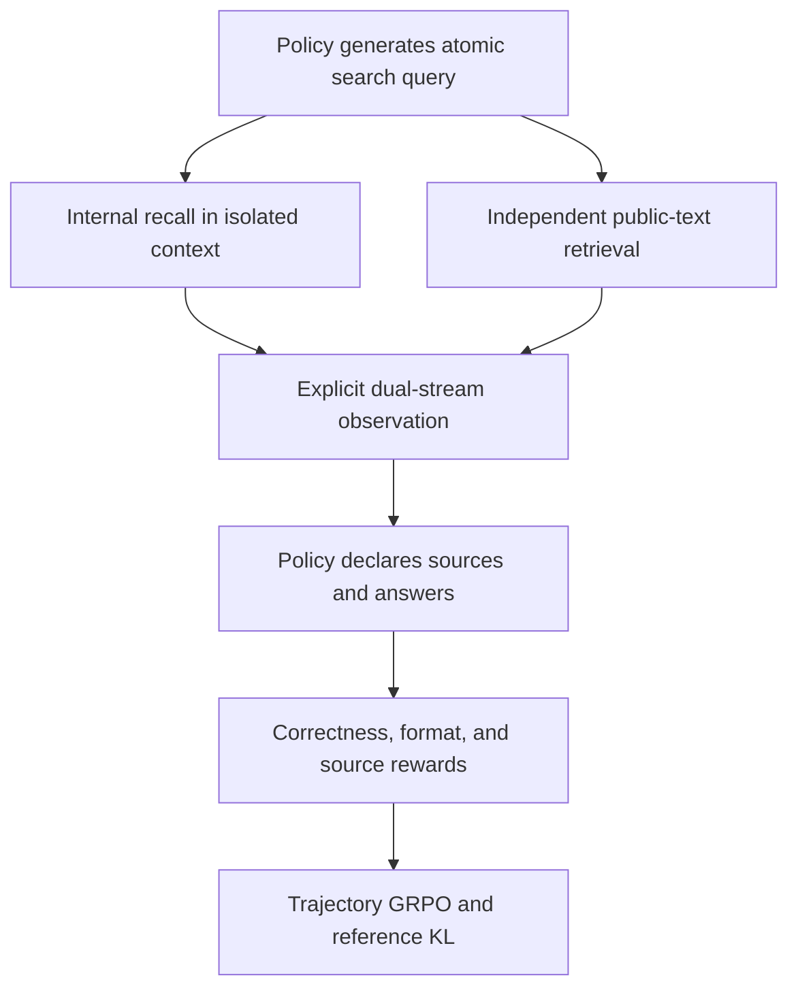
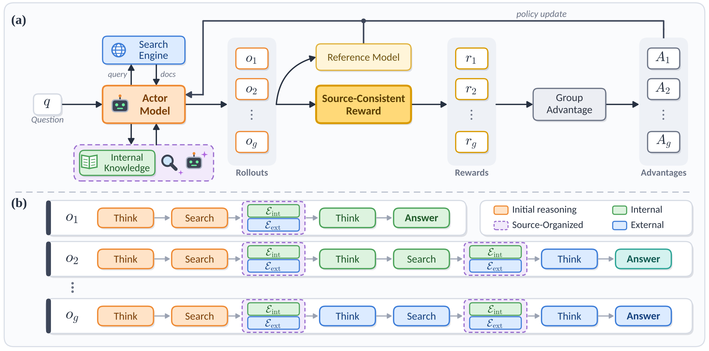

# SOAR: Source-Aware Reinforcement Learning with Precise Credit Assignment for Search Agents

<!-- source-sha256: ca972c329a5f6fef22dd341fc5b6c1211d34aaff20a46d713dc4d6c2af462104 -->

[简体中文](README.md)

## Paper information

| Field | Value |
| --- | --- |
| Paper | [arXiv 2610.13157](https://arxiv.org/abs/2610.13157) |
| Affiliations | Microsoft / Zhejiang University |
| First public release | 2026-10-09 (arXiv v1) |
| Author code | No release found in paper-linked primary sources as of 2026-10-13. |
| Adapter | `soar` |
| Local implementation | [`src/auto_research/reproductions/soar/`](https://github.com/daiwk/auto-research/tree/main/src/auto_research/reproductions/soar/) |
| Implementation and evaluation | Core algorithm on a real model; L0/L1 mechanism diagnostics, not full benchmark reproduction |
| GPU validation | [Source-bound A100 receipt](../../gpu-validations/soar-a100-20261014-seeds42-44.json) for three seeds and two arms. L1 only. |

## Original paper

### Background and contribution

A search agent trained only for correct answers can give the right answer while fabricating its evidence dependency. SOAR records internal recall and external retrieval independently for atomic queries and requires explicit source declarations. Internal recall receives neither earlier reasoning nor external evidence. The policy learns from source agreement, correctness, and format rewards.

### Architecture and data flow

Local redraw:



<!-- paper-figure:start -->
### Key figure from the paper

[](https://arxiv.org/html/2610.13157v1/method.svg)

The top shows actor access to search and internal knowledge across rollouts, with group advantages and updates based on a reference model and source-consistency rewards. The lower panel shows trajectories choosing and combining internal/external evidence to attribute reward to information selection. This is the authors' training setup, not local corpus or results. See [Figure 2 in v1](https://arxiv.org/html/2610.13157v1#S2.F2), [original SVG](https://arxiv.org/html/2610.13157v1/method.svg), and [asset SHA-256](figure-source.json). Copyright belongs to the authors.
<!-- paper-figure:end -->

### Core equations

$$
i_{\rm int}\sim\pi_\theta(\cdot\mid P_{\rm elic},q_j),\quad
R=R_{\rm ans}+0.2R_{\rm fmt}+0.1R_{\rm mat}.
$$

$R_{\rm mat}=\mathbf1[\operatorname{Verify}(y,\mathcal E_{C_y})]$ checks only the declared stream; an answer in the other stream earns no credit. Appendix D specifies normalization. The local implementation explicitly normalizes by total weight before computing trajectory-group GRPO advantages. Tool observations and internal recall tokens receive no policy loss.

### Paper results

The paper uses Qwen2.5-3B/7B, E5-base-v2, and 2018 Wikipedia, training on NQ/HotpotQA and evaluating on seven QA benchmarks. It reports average EM 0.414 for 3B and 0.448 for 7B; 3B fabrication dropped from 16.08% to 4.05%. Some HTML tables did not convert fully; the values come from Section 4.2 and Table 4 text, not reconstructed rows. No production A/B test was reported. [Paper results](paper-results.json) are not local measurements.

## Local reproduction

> Compare the same source-aware workflow with and without source reward, also recording the frozen starting policy. This L0/L1 diagnostic does not establish a stable relative improvement.

### Data and label access

Pin and hash-verify public checkpoints and data with `checkpoint_source` and `validate_holdout`. This run uses explicitly derived **tool-document attribute QA**, not a claim of knowledge QA on mismatched WikiText/GSM. The old 6a arms use Qwen2.5-0.5B-Instruct actor/reference; the later complete paired run uses cached Qwen2.5-7B-Instruct revision `bb46c15ee4bb56c5b63245ef50fd7637234d6f75`. Policy and frozen reference share the checkpoint; another teacher does not generate evidence. Only independent training rewards/offline scorers read reference answers. Agent messages contain questions and actual tool-returned documents, not current gold or plans.

The independent KB comes from the [pinned EcoAgent public catalog](https://github.com/Elliotes/EcoAgent/blob/bc5db40a20b254c5249401d2220ea71b06c86a5c/data/processed/tools_clean_with_reliability.csv), revision `bc5db40a20b254c5249401d2220ea71b06c86a5c`, CSV SHA-256 `1b388d317aeb1004c266eb65ff64a4864e7907412a2fbfb4667c492a871e8d8e`. The preparation script seals 5,172 tools' names, UIDs, sources, URLs, tags, and descriptions as 8,394 contiguous chunks of at most 900 characters, excluding reliability/quality scores, train_pairs, and test labels. It then splits by fixed tool-UID hash and creates 8 train and 4 validation questions asking for the catalog UID or documentation URL. Tool IDs are disjoint across splits, but both share the presealed KB. This is a retrieval/source-stream diagnostic, not unseen-KB generalization.

The manifest identifies `Elliotes/EcoAgent#derived-tool-document-attribute-training-QA-v1`; `source_split=train` names the locally derived source pool, not an official EcoAgent split. Generator, independent KB, source QA, and split SHA-256s are saved. It does not open `eval_real_test.jsonl` or repurpose official evaluation as training. Data preparation does not imply GPU execution.

Supply an independent public corpus with revision, hash, rows, and source URL, without benchmark answer/gold fields. The policy actually emits search queries; recall sees only each query, then the agent gets both streams. LoRA uses actual trajectory reward. The no-source-reward control runs separately. Missing corpus or all-zero group advantages must fail honestly.

### Entry point and budget

Use `scripts/run_oct13_post_training.py --method soar`. The adapter reads `oct13_execution.json` from the dataset directory. Provide the policy mirror and public ID/revision, derived train/validation, split manifest, dataset revision, and KB provenance. The audit's cached `oct14_execution-soar7b-full-v1.json` is not a committed config and the runner does not create it.

Save this template as `data/soar-local.json` and point `student_path` at a verified public mirror with hash/provenance manifest. It is a fresh run example, not a reconstruction of historical config SHA `5ee7cfb1…` or receipt.

```json
{
  "shared": {
    "student_path": "data/public/qwen2.5-7b-instruct",
    "student_id": "Qwen/Qwen2.5-7B-Instruct",
    "student_revision": "bb46c15ee4bb56c5b63245ef50fd7637234d6f75",
    "device": "cuda",
    "context_limit": 4096,
    "learning_rate": 0.00001
  },
  "methods": {
    "soar": {
      "train_path": "data/soar-catalog-qa/train.jsonl",
      "validation_path": "data/soar-catalog-qa/validation.jsonl",
      "split_manifest": "data/soar-catalog-qa/split.json",
      "dataset_revision": "bc5db40a20b254c5249401d2220ea71b06c86a5c",
      "corpus_path": "data/soar-catalog-qa/kb",
      "corpus_id": "Elliotes/EcoAgent",
      "corpus_revision": "bc5db40a20b254c5249401d2220ea71b06c86a5c",
      "train_examples": 8,
      "validation_examples": 4,
      "steps": 4,
      "group": 4,
      "max_turns": 3,
      "max_tokens": 256,
      "verifier": "normalized-em",
      "variant": "source-consistent"
    }
  }
}
```

Point `CATALOG` at the pinned CSV above. Prepare into a new directory without opening official test, then run after saving the config and preparing the checkpoint mirror:

```bash
PYTHONPATH=src python scripts/prepare_soar_catalog_qa.py \
  --catalog "$CATALOG" --output data/soar-catalog-qa
```

```bash
PYTHONPATH=src python scripts/run_oct13_post_training.py \
  --method soar --config data/soar-local.json \
  --device cuda --seed 42 --variant source-consistent \
  --output runs/soar-local/source-consistent-42
```

For the control change only the variant to `without-source-reward` and reinitialize from the same checkpoint/seed. Keep data, 4 steps, 4 trajectories per group, 3 turns, and the 256-token response cap. Each arm has a 36,864 generated-token maximum including isolated recall and before/after evaluation; this is not measured cost or FLOPs. Real search and public descriptions are required. Zero retrieval, missing source matching, or zero advantage do not demonstrate source selection.

Actual generation, rejections, difficulty calibration, teacher profiling, and supervised tokens are recorded. Failures write non-overwritable `failure.json`; successes write `result.json` and `report.md`. Directory names do not prove provenance.

### Validation and historical failures

[Mechanism contracts](metrics/mechanism-contracts.json) record deterministic CPU formula/behavior tests as `diagnostic_only: true` and `formal_comparison: false`, not checkpoint training, a GPU receipt, or formal comparison.

The [old two-arm failure](metrics/public-a100-failed-seed42-6aabe57a.json) on 2026-10-14 binds real A100 `6aabe57a` and the independently sealed catalog KB/QA split, not official RATED or SOAR. Both arms' 4 groups had zero advantage, zero updates, zero answer/format/source-match scores, and one actual search. Each generated 1056 policy and 34 isolated recall tokens, taking 34.11/34.01 seconds. No advantage was forced and no passing GPU receipt was issued.

The [57b train-only 7B format probe](metrics/public-a100-train-format-probe-seed42-57b2314d.json) took 34.61 seconds with pinned Qwen2.5-7B-Instruct, unchanged SYSTEM/parser/reward, 4 train × 2 episodes in original order, 3 turns/cap 256, and 300-second bound. All 8 episodes were invalid on the first turn, none truncated. Search/format/source-match/answer were zero; 433 tokens were generated. No LoRA/optimizer, validation, test, or whole-method receipt. Only output text hashes were preserved, not raw text or token IDs, so neither exact replies nor a specific cause can be inferred. The later revision clarified two legal source templates and added real response tracing without weakening parser/reward gates.

### Corrected 7B mechanism, seed 42

[Native paired results](metrics/public-a100-complete-seed42-b9086275.json) and [sanitized receipt](../../gpu-validations/soar-a100-20261014-seed42.json) bind a real A100, 54 source hashes at `b9086275`, pinned 7B files, and canonical config SHA `5ee7cfb10fe21078104f439a8de1bf48a528a10a138d08bd26ccbf030b1185a3`. Both arms shared checkpoint, seed, data, and initial metrics on 4 validation items. Budgets stayed at 4 steps × 4 trajectories, 3 turns, cap 256.

| Seed-42 arm | LoRA updates | Equal-reward skips | Validation accuracy | Source agreement | Format compliance | Generated tokens | Seconds |
| --- | ---: | ---: | --- | --- | --- | ---: | ---: |
| source-consistent | 4 | 0 | 0→0.25 | 0.25→0.50 | 0.50→0.50 | 1,362 | 87.913 |
| without-source-reward | 3 | 1 | 0→0.25 | 0.25→0.25 | 0.50→0.50 | 1,366 | 85.928 |

The no-source arm's first group's four format rewards were all 1/6, producing exactly zero advantage and no optimizer step. Actual source agreement gave the source arm unequal rewards and nonzero gradients. Updates, skipped groups, search and isolated recall, reference KL, and generation/scoring costs remain recorded. Four validation items do not establish stable improvement; two variants are not two seeds. This seed-42 artifact is kept separate.

### Complete reduced three-seed mechanism

[Three-seed native results](metrics/public-a100-complete-seeds42-44-b9086275.json) and the [independent receipt](../../gpu-validations/soar-a100-20261014-seeds42-44.json) bind all six actual runs to `b9086275`, config `5ee7cfb1…`, and the same public checkpoint/catalog. Each seed reinitializes; within-seed initial metrics match. No test was read and reward, parser, and caps were not tuned.

| Seed | Source / no-source updates | Source / no-source accuracy | Source / no-source agreement |
| --- | --- | --- | --- |
| 42 | 4 / 3 | 0.25 / 0.25 | 0.50 / 0.25 |
| 43 | 4 / 4 | 0.25 / 0.00 | 0.25 / 0.25 |
| 44 | 4 / 3 | 0.50 / 0.25 | 0.50 / 0.25 |

Validation accuracy mean ± sample SD was 0.3333±0.1443 vs. 0.1667±0.1443; source agreement 0.4167±0.1443 vs. 0.25±0. Each uses n=3 and only 4 validation items per seed. Retain the control's zero accuracy at seed 43 and its two zero-advantage groups at seeds 42/44. Actual policy updates were 12 vs. 10. Real generation and scoring costs differ; wall time does not establish throughput. The reduced default mechanism plan is complete, not the original seven-QA benchmark, production A/B, stable capability, or batch-wide validation.

### Code and limits

`algorithm.py` implements dual streams, EM, the text index, and rewards. `checkpoint.py` implements the tool loop, isolated recall, trajectory advantage, KL, and LoRA. `scripts/prepare_soar_catalog_qa.py` builds the allowlisted KB and tool-group split; `tests/reproductions/test_soar_catalog_qa.py` covers isolation and hashes. Shared `post_training/oct13_common.py` handles loading, costs, response likelihood, actual optimizer steps, and outputs. Main behavior tests are in `tests/reproductions/test_oct13_post_training.py`; State, GPPO, and TAPO retain dedicated tests.

The small lexical index substitutes for E5/Wikipedia infrastructure, not for the source policy/reward. The paper did not release EM normalization code; the local explicit word-boundary match is not its GPT-5.6-Sol fabrication metric. Attribute QA is not official RATED tool-selection or SOAR's seven knowledge-QA benchmarks. Tool-group isolation within one KB is not unseen-KB generalization. Never fabricate source text or present gold answers as evidence. The default A100 two-arm plan for seeds 42/43/44 completed with a source-bound receipt; catalog sync and CI are separate. No unverified Evolve mapping.
