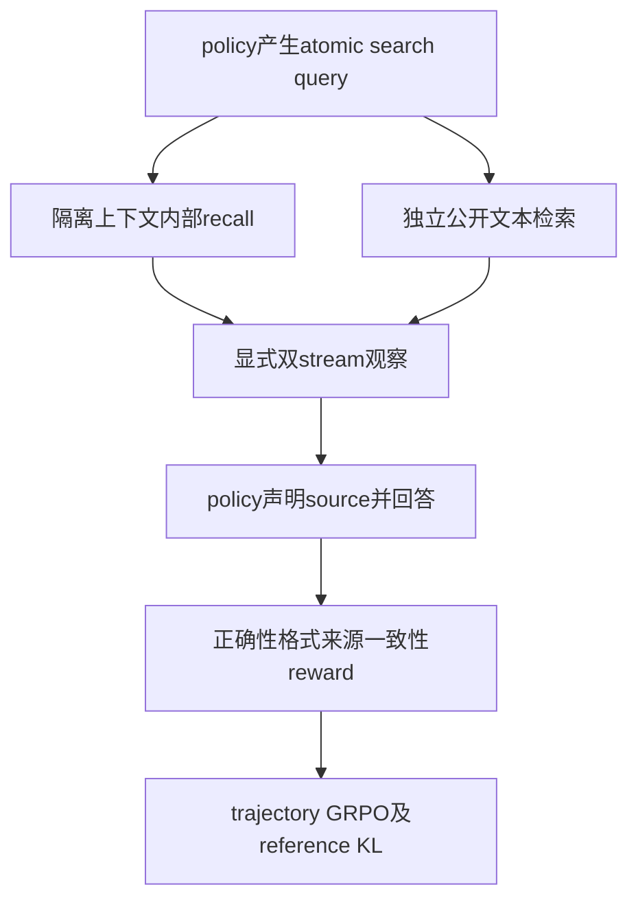

# SOAR: Source-Aware Reinforcement Learning with Precise Credit Assignment for Search Agents

## 论文信息

| 字段 | 内容 |
| --- | --- |
| 论文链接 | [arXiv 2610.13157](https://arxiv.org/abs/2610.13157) |
| 公司/机构 | Microsoft / Zhejiang University |
| 首次公开日期 | 2026-10-09（arXiv v1） |
| 原文开源代码 | 否：原文与关联原始来源未找到本方法已发布源码（2026-10-13核验）；不是宣称全网不存在 |
| Adapter | `soar` |
| 本地复现代码 | [`src/auto_research/reproductions/soar/`](https://github.com/daiwk/auto-research/tree/main/src/auto_research/reproductions/soar/) |
| 实现/评测层级 | 核心算法实际模型路径；L0/L1机制诊断，不是原benchmark完整复现 |
| GPU门禁 | 必须真实A100/A30执行并提交绑定源码的脱敏回执；未取得者仍未验收 |

## 原始论文总结

### 背景与主要改动

只按答案奖训练的search agent可能答对却伪造证据依赖。SOAR独立记录atomic query的internal recall和external retrieval，再要求显式声明source。internal recall不接收旧reasoning或external evidence；来源一致性、正确性与格式reward训练真实策略。

### 架构与数据流

以下为本地重绘，不冒充原论文图片。



原图来源：[原文图位置](https://arxiv.org/html/2610.13157v1#S2.F2)；[原始图资源](https://arxiv.org/html/2610.13157v1/method.svg)。版本及资源记录在 [figure-source.json](figure-source.json)。原图版权归作者，原始效果图与本地重绘分开。

### 核心公式

$$
i_{\rm int}\sim\pi_\theta(\cdot\mid P_{\rm elic},q_j),\quad
R=R_{\rm ans}+0.2R_{\rm fmt}+0.1R_{\rm mat}.
$$
$R_{\rm mat}=\mathbf1[\operatorname{Verify}(y,\mathcal E_{C_y})]$，仅检查声明stream，不能靠另一stream中碰巧有答案给奖。Appendix D规定归一化；本地明示总权重归一化，再按trajectory group计算GRPO优势。工具观察/internal recall token不接受策略loss。

### 论文离线与线上效果

原文Qwen2.5-3B/7B、E5-base-v2和2018 Wikipedia，在NQ/HotpotQA train学习、7个QA benchmark评测。主文报告3B平均EM0.414、7B0.448；3B fabrication从16.08%到4.05%。HTML部分表格转换缺失，以4.2/表4正文为出处，不补造全表。未报告生产线上A/B。

选取的原文稳定标量与出处保存于 [paper-results.json](paper-results.json)，全部标为paper-reported，不是本地测量。

## 本地复现

> **本地对照口径**：基线为相同source-aware工作流的without-source-reward消融；另有冻结初始策略；实验组仅支持本页L0/L1机制，稳定相对提升不适用。

### 数据与标签访问协议

公开checkpoint/data必须固定revision并通过既有 `checkpoint_source` / `validate_holdout` 的文件hash验证。GSM8K仅从官方train拆train/validation，官方test不打开。Qwen2.5-0.5B-Instruct revision为 `7ae557604adf67be50417f59c2c2f167def9a775`，需要teacher/reasoner时用Qwen2.5-7B-Instruct revision `bb46c15ee4bb56c5b63245ef50fd7637234d6f75`。参考答案仅在外部训练verifier、SFT监督target或明确的train-only数据构建teacher边界读取；被评估student/agent prompt不接收当前题gold/plan。

必须有独立public corpus的revision/hash/rows/source URL；documents不得包含benchmark answer/gold字段。policy实际产生search，recall每次只收query，再接双stream观察。按真实trajectory reward做LoRA；without-source-reward另跑。没有corpus或组全零优势必须真实失败。

### 可执行入口与预算

入口为 `scripts/run_oct13_post_training.py --method soar`，adapter则从数据目录读取 `oct13_execution.json`。必须提供student/teacher镜像路径、public id/revision、train/validation路径、split manifest与dataset revision。下面是待实跑配置示例，不表示GPU已完成：

```bash
PYTHONPATH=src python scripts/run_oct13_post_training.py \
  --method soar --config data/oct13_execution.json \
  --device cuda --seed 42 --train-examples 8 --group 4 --max-turns 3 --max-tokens 256 --steps 2 --corpus-path "$CORPUS" --corpus-id "$CORPUS_ID" --corpus-revision "$CORPUS_REV" \
  --output runs/oct13/soar-42
```

真实生成、拒绝、难度校准、teacher profiling及监督token预算进入结果；失败写不可覆盖的 `failure.json`，成功写 `result.json` / `report.md`。不能仅以本地目录名伪造source metadata。

### 当前结果与验收状态

[mechanism-contracts.json](metrics/mechanism-contracts.json)保存已CPU执行的公式/行为合同标量，deterministic tensor/fixture协议，`diagnostic_only: true`、`formal_comparison: false`。不替代公开checkpoint训练、GPU回执、同预算能力比较或原benchmark。GPU指标由实际结果核验后另行摘录；本页不声明未执行实验已经完成。

### 代码映射

algorithm.py：双stream、EM、真实文本index及reward；checkpoint.py：policy工具循环、隔离recall、trajectory优势/KL/LoRA。

共享 `post_training/oct13_common.py` 只承担资源装载、成本记录、response likelihood、真实optimizer step和输出；论文机制保留在本目录。行为测试为 `tests/reproductions/test_oct13_post_training.py`；State/GPPO/TAPO还保留既有专属测试。

### 边界与未完成项

小lexical index替代E5/Wikipedia基础设施，不替代source policy/reward。原文未释放EM normalization代码，本地明示词边界匹配；不把它冒充GPT-5.6-Sol fabrication指标。数字GSM验证不代表原知识QA。不能制造来源文本或用参考答案冒充evidence。

仍需适用A100/A30路径及对照实跑、新源码绑定脱敏receipt、全局目录同步与CI。三个seed不会自动升级机制诊断为正式能力证据。本条未注册未经验证的evolve映射。

