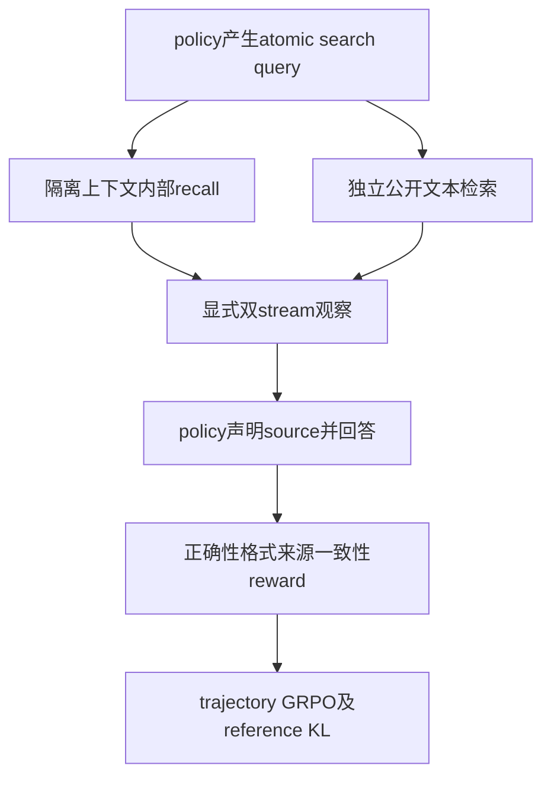

# SOAR: Source-Aware Reinforcement Learning with Precise Credit Assignment for Search Agents

## 论文信息

| 项目 | 内容 |
| --- | --- |
| 论文链接 | [arXiv 2610.13157](https://arxiv.org/abs/2610.13157) |
| 公司/机构 | Microsoft / Zhejiang University |
| 首次公开日期 | 2026-10-09（arXiv v1） |
| 原文开源代码 | 否：not released / not found in paper-linked primary sources (2026-10-13) |
| Adapter | `soar` |
| 本地复现代码 | [`src/auto_research/reproductions/soar/`](https://github.com/daiwk/auto-research/tree/main/src/auto_research/reproductions/soar/) |
| 实现/评测层级 | 核心算法实际模型路径；L0/L1机制诊断，不是原benchmark完整复现 |
| GPU门禁 | 已完成真实A100三种子×两臂核心执行：[新源绑定回执](../../gpu-validations/soar-a100-20261014-seeds42-44.json)；仅L1，不是原benchmark验收 |

## 原始论文总结

### 背景与主要改动

只按答案奖训练的search agent可能答对却伪造证据依赖。SOAR独立记录atomic query的internal recall和external retrieval，再要求显式声明source。internal recall不接收旧reasoning或external evidence；来源一致性、正确性与格式reward训练真实策略。

### 架构与数据流

以下为本地重绘，不冒充原论文图片。



<!-- paper-figure:start -->
### 原论文关键图

[](https://arxiv.org/html/2610.13157v1/method.svg)

中文图注（原论文 Figure 2）：上半部展示 Actor 同时访问搜索引擎与内部知识，形成多条 rollout，结合参考模型和来源一致性规则奖励计算组优势并更新策略；下半部展示不同轨迹如何选择与组合内部、外部证据，把奖励归因到信息选择行为。此图为作者原始训练框架，不是本地检索语料或训练结果。

精确来源：[固定 v1 的 Figure 2，HTML `S2.F2`](https://arxiv.org/html/2610.13157v1#S2.F2)；[原始 SVG](https://arxiv.org/html/2610.13157v1/method.svg)。本地原始字节副本与 SHA-256 记录在 [figure-source.json](figure-source.json)，版权归原作者；与上方本地 Mermaid 重绘分开。

> **原论文 Figure 2（关键图）**：上文说明所选原图或方法截图的范围；并非本地测量。图片来自[原论文](https://arxiv.org/html/2610.13157v1/method.svg)，版权归原作者所有；点击图片可查看固定版本来源。
<!-- paper-figure:end -->

### 核心公式

$$
i_{\rm int}\sim\pi_\theta(\cdot\mid P_{\rm elic},q_j),\quad
R=R_{\rm ans}+0.2R_{\rm fmt}+0.1R_{\rm mat}.
$$
$R_{\rm mat}=\mathbf1[\operatorname{Verify}(y,\mathcal E_{C_y})]$，仅检查声明stream，不能靠另一stream中碰巧有答案给奖。Appendix D规定归一化；本地明示总权重归一化，再按trajectory group计算GRPO优势。工具观察/internal recall token不接受策略loss。

### 论文离线与线上效果

原文Qwen2.5-3B/7B、E5-base-v2和2018 Wikipedia，在NQ/HotpotQA train学习、7个QA benchmark评测。主文报告3B平均EM0.414、7B0.448；3B fabrication从16.08%到4.05%。HTML部分表格转换缺失，以4.2/表4正文为出处，不补造全表。未报告生产线上A/B。

选取的原文稳定标量与出处保存于 [paper-results.json](paper-results.json)，全部标为paper-reported，不是本地测量。

## 本地复现

> **本地对照口径**：基线为相同source-aware工作流的without-source-reward消融；另有冻结初始策略；实验组仅支持本页L0/L1机制，稳定相对提升不适用。

### 数据与标签访问协议

公开checkpoint/data必须固定revision并通过既有 `checkpoint_source` / `validate_holdout` 的文件hash验证。本轮SOAR队列使用明确派生的**工具文档属性QA训练诊断**，不在不匹配的WikiText+GSM上宣称知识QA效果。旧6a两臂Actor/reference为Qwen2.5-0.5B-Instruct；最新完整seed42两臂明确使用已缓存Qwen2.5-7B-Instruct revision `bb46c15ee4bb56c5b63245ef50fd7637234d6f75`，policy与冻结reference同一公开checkpoint，并非另一个teacher生成证据。参考答案只由独立训练奖励/离线scorer读取，agent消息只含问题与真实工具返回的文档，不接收当前题gold/plan。

独立KB来自[固定公开EcoAgent catalog](https://github.com/Elliotes/EcoAgent/blob/bc5db40a20b254c5249401d2220ea71b06c86a5c/data/processed/tools_clean_with_reliability.csv)，revision为 `bc5db40a20b254c5249401d2220ea71b06c86a5c`，原CSV SHA-256为 `1b388d317aeb1004c266eb65ff64a4864e7907412a2fbfb4667c492a871e8d8e`。`scripts/prepare_soar_catalog_qa.py`先封存全部5,172个tool的原始名称、UID、来源、URL、标签和说明（8,394个不超过900字符的连续片段），不使用reliability/quality分数、train_pairs或任何测试标签。之后才按tool UID固定hash分组，生成8条train和4条validation属性问题；两组tool不重叠，查询属性为catalog UID或文档URL。所有问题共享事先封存的完整KB，因此是共享知识库内的检索/来源流诊断，不是未知知识库泛化。

切分清单将source明确标成 `Elliotes/EcoAgent#derived-tool-document-attribute-training-QA-v1`；其中 `source_split=train` 仅表示本地生成的training-QA源池，不冒充EcoAgent官方train split。generator、独立KB、源QA和两分区的SHA-256均保存；不打开 `eval_real_test.jsonl`，不把LongMemEval等官方eval改成训练集。数据与配置已准备不等于GPU训练已完成。

必须有独立public corpus的revision/hash/rows/source URL；documents不得包含benchmark answer/gold字段。policy实际产生search，recall每次只收query，再接双stream观察。按真实trajectory reward做LoRA；without-source-reward另跑。没有corpus或组全零优势必须真实失败。

### 可执行入口与预算

入口为 `scripts/run_oct13_post_training.py --method soar`，adapter则从数据目录读取 `oct13_execution.json`。必须提供policy镜像路径及public id/revision、派生train/validation路径、split manifest、dataset revision与独立KB来源。本次审计中的`oct14_execution-soar7b-full-v1.json`是缓存配置名，**不是仓库已提交的配置文件**，runner不会自动创建它。

新用户可将下面最小模板保存为`data/soar-local.json`，先准备固定revision且带hash/provenance清单的公开checkpoint镜像，修改`student_path`为自己的已核验目录。模板只是新运行路径示例，不含本机路径；不能据此重算或重绑历史配置SHA `5ee7cfb1…`及已测回执。

```json
{
  "shared": {
    "student_path": "data/public/qwen2.5-7b-instruct",
    "student_id": "Qwen/Qwen2.5-7B-Instruct",
    "student_revision": "bb46c15ee4bb56c5b63245ef50fd7637234d6f75",
    "device": "cuda",
    "context_limit": 4096,
    "learning_rate": 0.00001
  },
  "methods": {
    "soar": {
      "train_path": "data/soar-catalog-qa/train.jsonl",
      "validation_path": "data/soar-catalog-qa/validation.jsonl",
      "split_manifest": "data/soar-catalog-qa/split.json",
      "dataset_revision": "bc5db40a20b254c5249401d2220ea71b06c86a5c",
      "corpus_path": "data/soar-catalog-qa/kb",
      "corpus_id": "Elliotes/EcoAgent",
      "corpus_revision": "bc5db40a20b254c5249401d2220ea71b06c86a5c",
      "train_examples": 8,
      "validation_examples": 4,
      "steps": 4,
      "group": 4,
      "max_turns": 3,
      "max_tokens": 256,
      "verifier": "normalized-em",
      "variant": "source-consistent"
    }
  }
}
```

使用上文固定revision/SHA的原catalog文件（`CATALOG`指向该文件），可由真实setup生成模板引用的QA分区和KB；目标目录须为新目录，不读取官方test：

```bash
PYTHONPATH=src python scripts/prepare_soar_catalog_qa.py \
  --catalog "$CATALOG" --output data/soar-catalog-qa
```

保存配置、准备公开镜像及数据后，再运行：

```bash
PYTHONPATH=src python scripts/run_oct13_post_training.py \
  --method soar --config data/soar-local.json \
  --device cuda --seed 42 --variant source-consistent \
  --output runs/soar-local/source-consistent-42
```

对照仅将variant改为 `without-source-reward`，重新从同一checkpoint和seed初始化，保持同一数据、4 steps、4轨迹/组、3 turns和256 token响应上限。两臂各最多36,864个生成token（含内部recall与前后评估），这是配置上界，不是已测成本或FLOPs。真实模型必须产生search并读取公开说明；零检索、无有效来源匹配或零优势不得包装成来源选择能力验证。

真实生成、拒绝、难度校准、teacher profiling及监督token预算进入结果；失败写不可覆盖的 `failure.json`，成功写 `result.json` / `report.md`。不能仅以本地目录名伪造source metadata。

### 当前结果与验收状态

[mechanism-contracts.json](metrics/mechanism-contracts.json)保存已CPU执行的公式/行为合同标量，deterministic tensor/fixture协议，`diagnostic_only: true`、`formal_comparison: false`。不替代公开checkpoint训练、GPU回执、同预算能力比较或原benchmark。GPU指标由实际结果核验后另行摘录；本页不声明未执行实验已经完成。

### 2026-10-14 实际失败记录（旧6a源码）

[seed42两奖励臂负结果](metrics/public-a100-failed-seed42-6aabe57a.json)绑定真实A100 `6aabe57a` 与预先独立封存EcoAgent公开catalog KB/属性QA train split，不是官方RATED/SOAR benchmark。source-consistent/without-source-reward各4groups全部zero advantage、0更新，全部answer/format/source_match0，训练实际各1search。每臂policy生成1056tokens+隔离recall34tokens，elapsed34.11/34.01秒；失败不强制优势，不签GPU通过回执。

### 固定7B训练集格式探针：无信号

[57b 7B训练-only格式探针](metrics/public-a100-train-format-probe-seed42-57b2314d.json)实际执行34.61秒，明确使用已缓存固定Qwen2.5-7B-Instruct，原SYSTEM/parse/reward不变，原序4train×2episodes、最多3turn/cap256、wall300s。8episodes均首turn被原parser判invalid且没有截断，0search/format/source_match/answer，433tokens；没有LoRA/optimizer、validation或test读取/评估，不签整方法GPU回执。

此旧probe仅记录响应text SHA，没有保存原text/token IDs，不能引述原响应或把提示歧义猜成这8次实际失败原因。该次更大模型未提供格式信号，旧两奖励臂与探针失败保持，不以新结果覆盖。后续明确两种合法source模板并增加真实响应追踪，原parser/reward门槛不变。

### 修后固定7B完整机制：seed42两个奖励臂

[完整两臂native结果](metrics/public-a100-complete-seed42-b9086275.json)和[脱敏GPU回执](../../gpu-validations/soar-a100-20261014-seed42.json)绑定真实A100、`b9086275`的54源码SHA、固定公开7B文件及配置canonical SHA `5ee7cfb10fe21078104f439a8de1bf48a528a10a138d08bd26ccbf030b1185a3`。两个臂从相同checkpoint/seed/data初始化，冻结初始4validation指标完全一致。原4steps×4轨迹、3turn、cap256不增。

| seed42臂 | 真实LoRA更新 | 等值奖励组跳过 | validation准确率 | 来源一致性 | 格式合规 | 整次生成tokens | 实际秒数 |
| --- | ---: | ---: | --- | --- | --- | ---: | ---: |
| source-consistent | 4 | 0 | 0→0.25 | 0.25→0.50 | 0.50→0.50 | 1,362 | 87.913 |
| without-source-reward | 3 | 1 | 0→0.25 | 0.25→0.25 | 0.50→0.50 | 1,366 | 85.928 |

无来源奖励臂第1组四轨迹的格式奖励均为1/6，优势精确为零，未执行optimizer；来源臂同组因真实source-match差异产生不同奖励和非零梯度。其余真实更新、零组、policy搜索/隔离recall、reference KL及所有生成/评分成本均保留，不强制优势。四条validation下的来源差异不宣称稳定相对能力提升；两variants不算两个seeds。以上单seed阶段记录保留，下面是随后完整三seed结果，不覆写原raw或单seed回执。

### 完整默认三种子×两臂：实际核心执行完成

[三seed native](metrics/public-a100-complete-seeds42-44-b9086275.json)与[新独立回执](../../gpu-validations/soar-a100-20261014-seeds42-44.json)逐项绑定六个实际run、同一`b9086275`/配置`5ee7cfb1…`/公开checkpoint与catalog。三个种子各自重新初始化，同seed两臂初始指标一致；没有用variants冒充seeds，没有看test或调reward/parser/cap。

| seed | source奖励更新 / no-source更新 | source奖励准确率 / no-source准确率 | source奖励来源一致性 / no-source来源一致性 |
| --- | --- | --- | --- |
| 42 | 4 / 3 | 0.25 / 0.25 | 0.50 / 0.25 |
| 43 | 4 / 4 | 0.25 / 0.00 | 0.25 / 0.25 |
| 44 | 4 / 3 | 0.50 / 0.25 | 0.50 / 0.25 |

方法/消融validation准确率mean±样本std为0.3333±0.1443 / 0.1667±0.1443，来源一致性为0.4167±0.1443 / 0.25±0（各n=3，每seed仅4validation）。消融43准确率0及42/44各一个零优势组均保留。方法12次、消融10次真实策略更新；实际生成与评分成本不相等，不从wall时间推吞吐收益。这完成本方法缩小预算下的默认种子核心计划，不代表整个批次验收，也不把三种子L1诊断升级为稳定能力提升、生产A/B或原七QA基准。

### 代码映射

algorithm.py：双stream、EM、真实文本index及reward；checkpoint.py：policy工具循环、隔离recall、trajectory优势/KL/LoRA。`scripts/prepare_soar_catalog_qa.py`：固定catalog白名单KB与tool-group切分；其隔离与哈希回归在 `tests/reproductions/test_soar_catalog_qa.py`。

共享 `post_training/oct13_common.py` 只承担资源装载、成本记录、response likelihood、真实optimizer step和输出；论文机制保留在本目录。行为测试为 `tests/reproductions/test_oct13_post_training.py`；State/GPPO/TAPO还保留既有专属测试。

### 边界与未完成项

小lexical index替代E5/Wikipedia基础设施，不替代source policy/reward。原文未释放EM normalization代码，本地明示词边界匹配；不把它冒充GPT-5.6-Sol fabrication指标。工具文档属性QA不是RATED官方tool-selection test，也不是SOAR七个知识QA benchmark；共享KB下的tool-group隔离不等于未知KB泛化。不能制造来源文本或用参考答案冒充evidence。

默认42/43/44两臂已实际执行并提交独立源绑定三seed回执；仍需全局同步/CI。三个seed不会自动升级机制诊断为正式能力证据。本条未注册未经验证的evolve映射。
