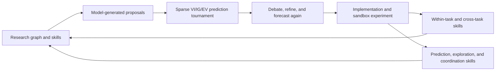
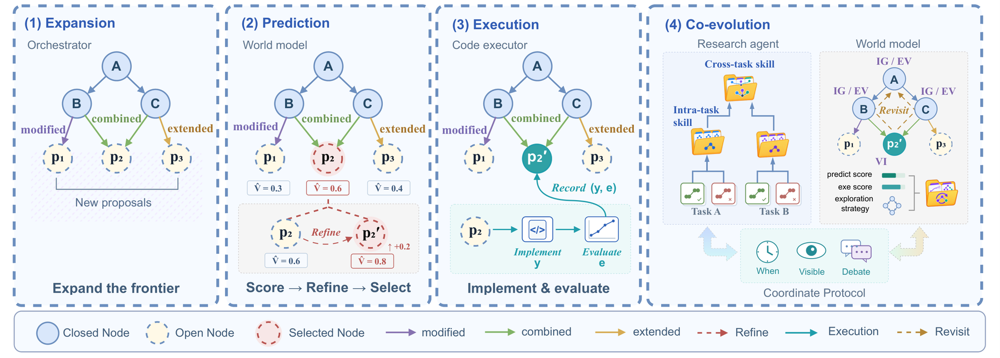

# Janus: Enhancing Long-Horizon Autonomous Research with Co-Evolving World Models

<!-- source-sha256: e39e97b7165759113ef3661a74a990decd77bdc70de0a24f6a78c5f0ed82e2b7 -->

[简体中文](README.md)

> This is a core_mechanism / L1 diagnostic interface, not a reproduction of the paper's capability benchmark or a candidate for Evolve promotion.

## Paper information

| Field | Value |
| --- | --- |
| Paper | [arXiv 2610.13194](https://arxiv.org/abs/2610.13194) |
| Affiliations | Institute of Computing Technology / University of Chinese Academy of Sciences |
| First public release | 2026-10-09 (arXiv v1) |
| Author code | No executable source found as of 2026-10-12. The authors' [project page](https://github.com/bilemond/JANUS) contains a README and assets only. |
| Adapter | `janus` |
| Local implementation | [`src/auto_research/reproductions/janus/`](https://github.com/daiwk/auto-research/tree/main/src/auto_research/reproductions/janus/) |

## Original paper

### Background and contribution

Janus generates unexecuted proposals in a research graph and predicts value improvement, information gain, and exploration value. A sparse pairwise tournament fits soft Bradley–Terry scores. After running the selected experiment, the system abstracts within-task and cross-task skills from successes and failures and updates its prediction, exploration, and coordination procedures. See the [full paper](https://arxiv.org/html/2610.13194v1).

### Architecture



Redrawn diagram: [architecture.mmd](assets/architecture.mmd). The [original Figure 2](https://arxiv.org/html/2610.13194v1/method.png) depicts the original method; the local diagram is not a substitute for it as evidence. See [source-provenance.json](assets/source-provenance.json).

<!-- paper-figure:start -->
### Key figure from the paper

[](https://arxiv.org/html/2610.13194v1/method.png)

> **Original Figure 2:** The architecture, major components, and their connections. From the [paper](https://arxiv.org/abs/2610.13194); copyright belongs to the authors.
<!-- paper-figure:end -->

### Core equations

$\min_g\sum_{(m,n)\in C}\mathrm{BCE}(\rho^{m,n},\sigma(g_m-g_n))$; $\widehat V(x)=[g_{VI}(x)+\beta_tg_{IG}(x)+\gamma_tg_{EV}(x)]/(1+\beta_t+\gamma_t)$, where weights adapt to progress and remaining budget. The skill library evolves as $H_{t+1}=\operatorname{Evolve}(H_t,G_{t+1})$.

### Paper results

| Metric | Paper result | Baseline or protocol |
|---|---|---|
| MLS-Bench-Lite test score, DeepSeek-V4 Flash | 41.07 | Codex 38.91 |
| MLS-Bench-Lite test score, GPT-5.6 Sol | 46.88 | Codex 44.81 |
| MLS-Bench-Lite test score, Codex (GPT-5.6 Sol) | 49.78 | 30 tasks across 12 domains |

These results come from the [paper](https://arxiv.org/html/2610.13194v1), not local runs. No production A/B test was reported. Do not compare results across different models, data, scoring, or resource protocols. The [paper-results extract](assets/paper-results.json) is excluded from local metrics and dashboards.

## Local reproduction

> The local reference is an initial feasible geometry program, whereas the paper compares complete autonomous research systems. The current implementation executes the experiment arm, but does not establish a formal capability comparison or stable gain.

Implementation: `src/auto_research/agent_research/oct12_evolution.py` and `oct12_checkpoint.py`. The thin adapter reads explicit settings from `oct12.json`, without fixed default candidates or gold answers.

```bash
PYTHONPATH=src python scripts/run_oct12_agents.py \
  --method janus --checkpoint /tmp/auto-research-qwen2.5-7b --device cuda \
  --checkpoint-id Qwen/Qwen2.5-7B-Instruct \
  --checkpoint-revision bb46c15ee4bb56c5b63245ef50fd7637234d6f75 \
  --seed 42 --rounds 2 --group-size 3 --max-tokens 1536 \
  --attention-backend sdpa \
  --output runs/oct12/janus-7b-sdpa-1536-seed42/result.json
```

Run from the repository root in its Python environment. The checkpoint directory can point at any byte-verified copy of the specified public revision. The CUDA path requires Linux bubblewrap/prlimit, PyTorch, Transformers, safetensors, and an A100/A30, with remote code disabled. `rounds` is a real trial budget. Three candidates cover the connected sparse comparison pairs plus one uncertain pair. JANUS evolves skill text rather than LM weights, so `train-steps` does not apply. Outputs cannot be overwritten. The sample command by itself is not GPU validation.

The default `--attention-backend` remains `eager`. Explicit `sdpa` delegates the same scaled dot-product attention to PyTorch. Supported kernels may avoid materializing quadratic attention weights; the selected kernel depends on the input and environment. This does not guarantee lower memory, prevent OOM, or establish bit-exact logits. See the [PyTorch SDPA reference](https://docs.pytorch.org/docs/stable/generated/torch.nn.functional.scaled_dot_product_attention.html). The option does not truncate context or change the model, provider, actions, forecasts, or rewards. The result records the actual backend. The completed SDPA run used group size 3, while the earlier eager OOM used group size 2. This is not a controlled speed or memory comparison.

### Data and scoring

The public-circle-packing-26 task uses the same simple legal starting point for all methods and withholds the gold optimum from the agent. VI/IG/EV forecasts are recorded before execution; trial evidence is written afterward. This one-task diagnostic has no separate public test split. It sets `diagnostic_only=true`, `capability_comparison=false`, and `evolve_promotion_eligible=false`. Generated programs run only under Linux bubblewrap/prlimit; execution fails closed without isolation and never uses host-side `exec`.

### Results and limitations

A real checkpoint generates proposals and pairwise forecasts; the controller fits Bradley–Terry scores, reevaluates refinements, and generates and safely runs a full solver. Unexecuted nodes have no realized score. All five skill groups are updated from execution logs. This short geometry diagnostic is not MLS-Bench-Lite or a test of research discovery.

The [sanitized A100-SXM4-80GB SDPA run](metrics/public-circle-sdpa-a100-42.json) used source snapshot `f30bf47278995c72b9b96c19a0806974d73f64bc`, not the later Boundary change, the pinned Qwen2.5-7B-Instruct revision above, seed 42, 2 rounds, 3 candidates per round, and a 1536 output token cap. The shared CLI default of 2 train steps was not changed, but JANUS does not train LM weights.

The graph has 7 rows: one root and six proposals. Each round executed one candidate; four were pruned without realized scores. The final VI/IG/EV tournaments record the pairs `(0,1)`, `(1,2)`, and the extra `(0,2)`, for 18 saved probabilities. Both rounds report `debate_refined=true`; refinement is followed by another tournament and actual execution. The raw output records final comparisons only, not pre-debate probabilities. Beta and gamma were 0.5/0.5 in both rounds, with remaining trial budgets of 2/1.

Both trials scored **0**, failing with an invalid packing and a NameError, respectively. The initial feasible score of 2.166666666666666 remained the best graph result. VI/IG/EV and priority are predictions or ranking scores, not geometric fitness; realized scores are never backfilled as forecasts.

The final within-task, cross-task, prediction, exploration, and coordination skill texts were all nonempty. Public artifacts contain only SHA256s and byte counts. The controller writes the audit only after running skill evolution and receiving all five keys each round. This confirms both evolution calls completed, but no per-round skill snapshots establish that every group changed or improved. Proposal text, generated programs, and feedback are represented by hashes, values, categories, and graph structure; full generated code, skill text, and actual machine paths are not published.

The [historical eager OOM](assets/historical-eager-oom.json) preserves a negative run. Its cached launch script verifies Qwen2.5-7B-Instruct revision `bb46c15ee4bb56c5b63245ef50fd7637234d6f75`, seed 42, 2 rounds, 2 candidates per group, 1536 output tokens, and the unused shared train-step setting of 2. CUDA ran out of memory attempting to allocate **18.64 GiB**. Neither completed trial count nor final score can be inferred. The asset retains only the error category, requested memory, launch budget, and provenance hashes, excluding the original PID, machine identity, paths, and model output.

Integration records associate the old launch with `3eae2c8863678692a8cf2de988d4562314c2731f`, a verified eager-only source snapshot without SDPA. The raw OOM JSON does not embed command, commit, or hash and cannot establish the association by itself. This failure does not verify the full mechanism or capability and has no success metrics or GPU receipt. The new SDPA run with group size 3 is separate and does not relabel the old failure.

The [GPU receipt](../../gpu-validations/oct12-janus-a100.json) verifies the new snapshot's two trials, forecast/debate/execution order, and five skill-evolution paths. It includes source hashes from `git show` at the execution commit, the task fingerprint, checkpoint revision, and measurements. `passed` means that snapshot's CUDA mechanism completed; it covers neither the old OOM nor later Boundary or current working-tree changes. This remains core_mechanism / L1 with `formal_comparison=false`, `capability_comparison=false`, and `evolve_promotion_eligible=false`. It does not establish MLS-Bench-Lite, research discovery, circle-packing improvement, or Evolve promotion. Paper metrics, local metrics, and negative results remain distinct.

Tests: `python -m pytest tests/test_oct12_agent_algorithms.py tests/test_oct12_agent_delivery.py`.
