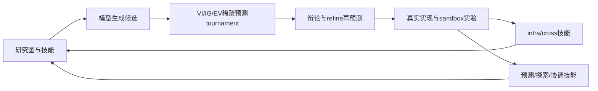
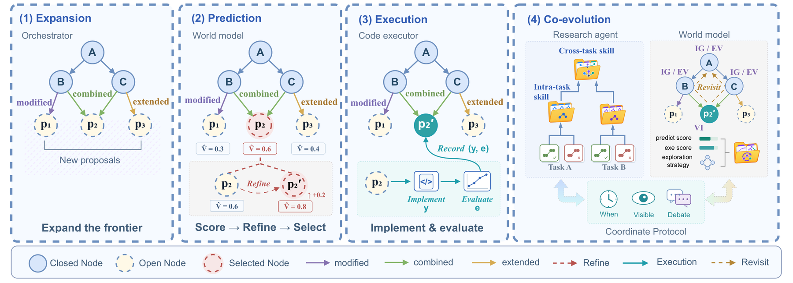

# Janus: Enhancing Long-Horizon Autonomous Research with Co-Evolving World Models

> 当前是 core_mechanism / L1 机制诊断接口；未声称完成原论文能力复测，未接入 Evolve 晋级。

## 论文信息

| 项目 | 内容 |
| --- | --- |
| 论文链接 | [arXiv 2610.13194](https://arxiv.org/abs/2610.13194) |
| 公司/机构 | Institute of Computing Technology / University of Chinese Academy of Sciences |
| 首次公开日期 | 2026-10-09（arXiv v1） |
| 原文开源代码 | 否：作者[项目页](https://github.com/bilemond/JANUS)目前仅 README/assets，未找到可执行实现（2026-10-12） |
| Adapter | `janus` |
| 本地复现代码 | [`src/auto_research/reproductions/janus/`](https://github.com/daiwk/auto-research/tree/main/src/auto_research/reproductions/janus/) |

## 原始论文总结

### 背景与主要改动

在研究图中先生成未执行提案，再预测价值提升、信息增益和探索收益；稀疏 pairwise tournament 拟合软 Bradley–Terry 分数。执行选中实验后，从成功/失败抽象 intra/cross-task 技能并更新预测、探索、协调协议。 事实来源：[原文全文](https://arxiv.org/html/2610.13194v1)。

### 架构流程



重绘源码：[architecture.mmd](assets/architecture.mmd)。[原论文 Figure 2](https://arxiv.org/html/2610.13194v1/method.png) 展示原文的整体机制；本地重绘没有替换原图作为证据。来源与核查边界见 [source-provenance.json](assets/source-provenance.json)。

<!-- paper-figure:start -->
### 原论文关键图

[](https://arxiv.org/html/2610.13194v1/method.png)

> **原论文 Figure 2（关键图）**：展示原论文提出的核心架构、主要模块及其连接关系。图片来自[原论文](https://arxiv.org/abs/2610.13194)，版权归原作者所有；点击图片可查看来源。
<!-- paper-figure:end -->

### 核心公式

$\min_g\sum_{(m,n)\in C}\mathrm{BCE}(\rho^{m,n},\sigma(g_m-g_n))$；$\widehat V(x)=[g_{VI}(x)+\beta_tg_{IG}(x)+\gamma_tg_{EV}(x)]/(1+\beta_t+\gamma_t)$，权重随进度/剩余预算调整。$H_{t+1}=\operatorname{Evolve}(H_t,G_{t+1})$。

### 论文离线与线上效果

| 原文指标 | 原文方法 | 原文对照/协议 |
|---|---|---|
| MLS-Bench-Lite test score, DeepSeek-V4 Flash | 41.07 | Codex 38.91 |
| MLS-Bench-Lite test score, GPT-5.6 Sol | 46.88 | Codex 44.81 |
| MLS-Bench-Lite test score, Codex(GPT-5.6 Sol) | 49.78 | 30任务、12领域 |

这些是[原论文](https://arxiv.org/html/2610.13194v1)报告值，不是本地结果；未报告生产线上 A/B。模型、数据、打分或资源协议不同，禁止直接横比。复核摘录见 [paper-results.json](assets/paper-results.json)。原文数值不进入 local metrics/dashboard。

## 本地复现

> **本地对照口径**：基线为初始几何可行程序；原文对照完整自主研究框架；实验组由当前真实实现执行；稳定相对提升不适用，尚无正式能力对照。

实现位于 `src/auto_research/agent_research/oct12_evolution.py / oct12_checkpoint.py`；薄 adapter 从明确的 `oct12.json` 加载运行配置，不注入默认固定候选或 gold。统一入口：

```bash
PYTHONPATH=src python scripts/run_oct12_agents.py \
  --method janus --checkpoint /tmp/auto-research-qwen2.5-7b --device cuda \
  --checkpoint-id Qwen/Qwen2.5-7B-Instruct \
  --checkpoint-revision bb46c15ee4bb56c5b63245ef50fd7637234d6f75 \
  --seed 42 --rounds 2 --group-size 3 --max-tokens 1536 \
  --attention-backend sdpa \
  --output runs/oct12/janus-7b-sdpa-1536-seed42/result.json
```

从仓库根目录、仓库 Python 环境执行；缓存可换为已按该公开 revision 完成字节校验的本地目录。需要 Linux bubblewrap/prlimit、PyTorch/Transformers/safetensors 与真实 A100/A30，本地加载不信任远程代码。`rounds` 是实际 trial 预算，3 个候选覆盖相连稀疏 pair 与额外不确定 pair 的机制路径；JANUS 在此更新技能文本而非 LM 权重，`train-steps` 不用于该路径。输出不可覆盖，命令示例不等于 GPU 已验证。

`--attention-backend` 默认仍为 `eager`；上述显式 `sdpa` 将同一 scaled-dot-product attention 交给 PyTorch SDPA backend，允许受支持的优化内核避免显式物化长上下文的平方 attention 权重。实际内核由输入与运行环境选择，不保证所有配置都省内存或不会 OOM；不同浮点 backend 也不能在未验证时声称 logits bit-exact，见 [PyTorch 官方 SDPA 说明](https://docs.pytorch.org/docs/stable/generated/torch.nn.functional.scaled_dot_product_attention.html)。这个选项本身不截断 context、不改变模型/provider 或 JANUS 动作、forecast、reward；结果记录模型实际加载的 `attention_backend`。本批 SDPA 实跑已完成，但它使用 group 3，而旧 eager OOM 使用 group 2，因此不是只改 backend 的等预算速度/显存比较，也不据此宣称 SDPA 加速幅度。

### 数据协议与代码映射

输入来源为 public-circle-packing-26，所有方法共用简单合法起点，不把 gold 最优解给 agent。先存未执行候选的 VI/IG/EV forecast，实际 trial 后才写 evidence；单任务诊断没有独立公开 test split，不能视为研究能力对照。短运行报告 `diagnostic_only=true`、`capability_comparison=false` 与 `evolve_promotion_eligible=false`。生成程序只在 Linux bubblewrap/prlimit 执行，未具备隔离环境时 fail-closed；不在宿主机 exec 生成代码。

### 结果、验证与边界

本地使用真实 checkpoint 生成提案、执行前概率预测、Bradley–Terry 拟合、再评估 refinement，随后生成完整 solver 并安全执行。未执行节点不存 realized score；五组技能均从实际日志更新。circle packing 短诊断不是 MLS-Bench-Lite 或研究发现能力对照。

真实 A100-SXM4-80GB SDPA 运行的脱敏结果见 [public-circle-sdpa-a100-42.json](metrics/public-circle-sdpa-a100-42.json)。执行源码快照为 `f30bf47278995c72b9b96c19a0806974d73f64bc`，不是后来的 Boundary 修改；Qwen2.5-7B-Instruct、上述固定 revision、seed 42、2 rounds、每轮 3 candidates、1536 输出 token。CLI 的 train steps 未覆写默认 2，但 JANUS 路径不使用该参数训练 LM 权重。

`graph` 共 7 行：初始 root 与六个提案；两轮各执行一个、另四个 pruned，未执行节点没有 realized score。每轮最终 tournament 的 VI/IG/EV 各记录 `(0,1)`、`(1,2)` 和额外 `(0,2)` 三组成对偏好，共 18 个已保存概率；两轮 `debate_refined=true`，源代码在 refinement 后重新 tournament，再真实执行。raw 只保留最终比较，第一次辩论前的概率没有保存，不补造。两轮 beta/gamma 均为 0.5/0.5，剩余 trial 预算为 2/1。

两次真实 trial 的 circle 分数都为 **0**，分别记录 invalid packing 与 NameError 失败；初始合法程序分数 2.166666666666666 仍是图中最好结果，没有 circle 能力提升。VI/IG/EV 与 priority 是模型预测/排序值，不是外部几何 fitness，不能把 realized score 回填成预测。

最终 intra、cross、prediction、exploration、coordination 五组技能文本均非空，公开产物仅保留 SHA256 与字节数。控制器每轮执行后调用技能演化，并在五组键完整返回后才写 audit，所以两轮演化调用已走完；raw 没有逐轮技能快照，不能声称每组每轮都变化或质量改善。提案、生成程序及失败反馈也只保留哈希、数值、类别和图结构，不发布完整生成代码/技能文本或真实机器路径。

已发生的旧 eager 负运行保存在 [historical-eager-oom.json](assets/historical-eager-oom.json)：缓存 launch 脚本核实 Qwen2.5-7B-Instruct revision `bb46c15ee4bb56c5b63245ef50fd7637234d6f75`、seed 42、2 rounds、每组 2 candidates、1536 输出 token；共享 CLI 还传入 train steps 2，但 JANUS 路径不做 LM 权重训练。实际故障为 **CUDA OOM，尝试分配 18.64 GiB**。已完成 trial 数与最终分数不可从该失败摘要确定，不补填；资产只保存故障类别、请求显存、实际启动预算和来源哈希，不公开原异常中的 PID、机器身份、真实路径或模型输出。

集成操作记录把这次旧启动关联到 `3eae2c8863678692a8cf2de988d4562314c2731f`；其源码固定 eager 且没有 SDPA 选项，Git 快照哈希已核对。原始 OOM JSON 未内嵌 command/commit/hash，所以仅凭 raw 不能独立证明执行归属，资产明确保留该限制。这个失败不是完整 JANUS 机制通过或能力证据，未从它生成成功 metrics/GPU receipt；新的 SDPA、group 3 结果单独记录，旧 eager 失败不改标为通过。

[GPU 回执](../../gpu-validations/oct12-janus-a100.json) 校验了新 SDPA 快照的两次 trial、预测/辩论/执行次序与五组技能演化路径，并保存从该执行 commit 的 `git show` 取出的源码哈希、实际任务 fingerprint、checkpoint revision 与数值。`passed` 只表示这一快照的 CUDA 核心机制运行完成，不覆盖旧 OOM、当前 HEAD/dirty 全部修改或后来的 Boundary 快照。仍为 core_mechanism / L1、`formal_comparison=false`、`capability_comparison=false`、`evolve_promotion_eligible=false`，不支持 MLS-Bench-Lite、研究发现或 circle 能力提升及 Evolve 晋级。论文指标与本地指标严格分离，失败与负结果保留。

测试入口：`python -m pytest tests/test_oct12_agent_algorithms.py tests/test_oct12_agent_delivery.py`。

