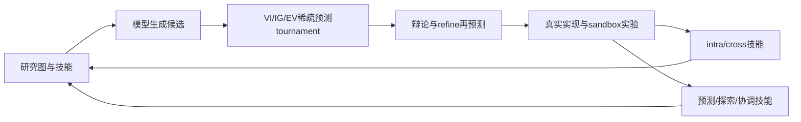

# Janus: Enhancing Long-Horizon Autonomous Research with Co-Evolving World Models

> 当前是 core_mechanism / L1 机制诊断接口；未声称完成原论文能力复测，未接入 Evolve 晋级。

## 论文信息

| 字段 | 内容 |
|---|---|
| 论文链接 | [arXiv 2610.13194](https://arxiv.org/abs/2610.13194) |
| 公司/机构 | Institute of Computing Technology / University of Chinese Academy of Sciences（一作 Mengdi Liu） |
| 首次公开日期 | 2026-10-09（arXiv v1） |
| 原文开源代码 | 否：作者[项目页](https://github.com/bilemond/JANUS)目前仅 README/assets，未找到可执行实现（2026-10-12） |
| Adapter | `janus` |
| 本地复现代码 | [`src/auto_research/reproductions/janus/`](https://github.com/daiwk/auto-research/tree/main/src/auto_research/reproductions/janus/) |

## 原始论文总结

### 背景与主要改动

在研究图中先生成未执行提案，再预测价值提升、信息增益和探索收益；稀疏 pairwise tournament 拟合软 Bradley–Terry 分数。执行选中实验后，从成功/失败抽象 intra/cross-task 技能并更新预测、探索、协调协议。 事实来源：[原文全文](https://arxiv.org/html/2610.13194v1)。

### 架构流程



重绘源码：[architecture.mmd](assets/architecture.mmd)。[原论文 Figure 2](https://arxiv.org/html/2610.13194v1/method.png) 展示原文的整体机制；本地重绘没有替换原图作为证据。来源与核查边界见 [source-provenance.json](assets/source-provenance.json)。

### 核心公式

$\min_g\sum_{(m,n)\in C}\mathrm{BCE}(\rho^{m,n},\sigma(g_m-g_n))$；$\widehat V(x)=[g_{VI}(x)+\beta_tg_{IG}(x)+\gamma_tg_{EV}(x)]/(1+\beta_t+\gamma_t)$，权重随进度/剩余预算调整。$H_{t+1}=\operatorname{Evolve}(H_t,G_{t+1})$。

### 论文离线与线上效果

| 原文指标 | 原文方法 | 原文对照/协议 |
|---|---|---|
| MLS-Bench-Lite test score, DeepSeek-V4 Flash | 41.07 | Codex 38.91 |
| MLS-Bench-Lite test score, GPT-5.6 Sol | 46.88 | Codex 44.81 |
| MLS-Bench-Lite test score, Codex(GPT-5.6 Sol) | 49.78 | 30任务、12领域 |

这些是[原论文](https://arxiv.org/html/2610.13194v1)报告值，不是本地结果；未报告生产线上 A/B。模型、数据、打分或资源协议不同，禁止直接横比。复核摘录见 [paper-results.json](assets/paper-results.json)。原文数值不进入 local metrics/dashboard。

## 本地复现

> **本地对照口径**：基线为初始几何可行程序；原文对照完整自主研究框架；实验组由当前真实实现执行；稳定相对提升不适用，尚无正式能力对照。

实现位于 `src/auto_research/agent_research/oct12_evolution.py / oct12_checkpoint.py`；薄 adapter 从明确的 `oct12.json` 加载运行配置，不注入默认固定候选或 gold。统一入口：

```bash
PYTHONPATH=src python scripts/run_oct12_agents.py \\
  --method janus --checkpoint /path/to/public/local/checkpoint --device cuda \\
  --checkpoint-id OWNER/MODEL --checkpoint-revision IMMUTABLE_40_HEX_COMMIT \\
  --seed 42 --rounds 2 --group-size 2 --train-steps 2 \\
  --output runs/oct12/janus/result.json
```

### 数据协议与代码映射

输入来源为 public-circle-packing-26。候选/参数晋级仅在 validation，test 与训练分开；金标只进入独立外部 scoring。短运行报告 `diagnostic_only=true`、`capability_comparison=false` 与 `evolve_promotion_eligible=false`。生成程序只在Linux bubblewrap/prlimit执行，未具备隔离环境时fail-closed；不在宿主机exec生成代码。

### 结果、验证与边界

本地使用真实 checkpoint 生成提案、执行前概率预测、Bradley–Terry 拟合、再评估 refinement，随后生成完整 solver 并安全执行。未执行节点不存 realized score；五组技能均从实际日志更新。circle packing 短诊断不是 MLS-Bench-Lite 或研究发现能力对照。

当前检查为 L0 合同及真梯度测试；本地 NVIDIA 运行由本批集成统一生成脱敏回执，未通过前不得写GPU已验证。CUDA metadata已声明requires_gpu_validation=true，未来回执路径为 docs/gpu-validations/oct12-janus-a100.json；本文不预填数值。 论文指标与本地指标严格分离；运行日志/模型权重不提交，失败与负结果保留。

测试入口：`python -m pytest tests/test_oct12_agent_algorithms.py tests/test_oct12_agent_delivery.py`。

