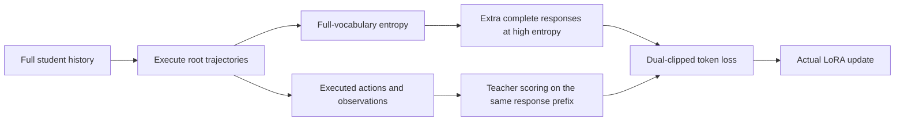
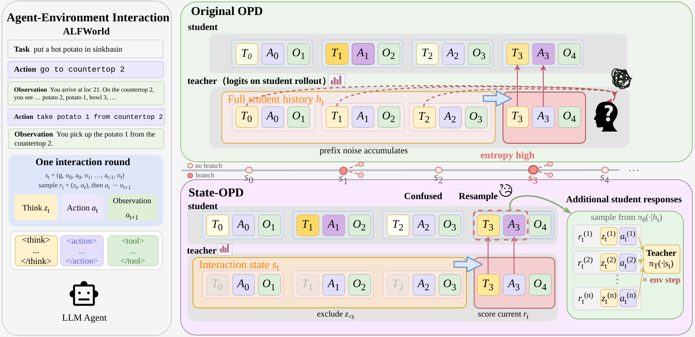

# State-OPD: State-Grounded On-Policy Distillation for Multi-Turn Agents

<!-- source-sha256: 12a63ff09c0e14afb01d76118c204a58c72dd3ab2f3e2ee70de0a4f55344d21b -->

[简体中文](README.md)

## Paper information

| Field | Value |
| --- | --- |
| Paper | [arXiv 2610.13238](https://arxiv.org/abs/2610.13238) |
| Affiliations | Alibaba Group / Tsinghua University / Shanghai Jiao Tong University / University of Science and Technology of China |
| First public release | 2026-10-09 (arXiv v1) |
| Author code | No release found in paper-linked primary sources as of 2026-10-13. |
| Adapter | `state-opd` |
| Local implementation | [`src/auto_research/reproductions/state_opd/`](https://github.com/daiwk/auto-research/tree/main/src/auto_research/reproductions/state_opd/) |
| Implementation and evaluation | Core algorithm on a real model; L0/L1 mechanism diagnostics, not full benchmark reproduction |
| GPU validation | A100 three-arm, three-seed effective updates and a sanitized receipt bound to 6aabe57a. Validation accuracy was zero throughout; no capability improvement is claimed. |

## Original paper

### Background and contribution

Multi-turn OPD can mix stale reasoning with genuine environment records in the teacher context, perpetuating errors. State-OPD supplies only executed actions and observations to the teacher while preserving full student history. Full-vocabulary entropy selects states for extra complete reasoning-and-action samples, whose actions are not executed. The implementation keeps Appendix D.1's actual sampled-K1 dual clipping, not a scoring heuristic.

### Architecture and data flow

Local redraw:



<!-- paper-figure:start -->
### Key figure from the paper

[](https://arxiv.org/html/2610.13238v1/state_opd_pipeline.png)

The upper panel shows noisy teacher prefixes from complete student history. The lower panel shows the teacher seeing executed action/observation state only, while the student keeps full history. High response entropy triggers extra complete responses, but their actions are not executed. See [Figure 1 in v1](https://arxiv.org/html/2610.13238v1#S2.F1), [original PNG](https://arxiv.org/html/2610.13238v1/state_opd_pipeline.png), and [source hash](figure-source.json). These are the authors' original bytes and diagram, not local results. Copyright belongs to the authors.
<!-- paper-figure:end -->

### Core equations

Let $\ell_\theta,\ell_T,\ell_{\rm old}$ be sampled-token log probabilities on the same response prefix.

$$
A=-\operatorname{sg}[\operatorname{clip}(\ell_\theta-\ell_T,-10,10)],\quad
\rho=\exp(\operatorname{clip}(\ell_\theta-\ell_{\rm old},-20,20)).
$$

Set $b=\max(-\rho A,-\operatorname{clip}(\rho,0.8,1.2)A)$. Use $\min(b,-3A)$ when $A<0$, otherwise use $b$, then average over supervised tokens. State entropy averages full-vocabulary $-\sum_{v\in\mathcal V}p_v\log p_v$ over tokens, not selected-token surprisal. Select $\lceil T/\beta\rceil$ states and sample $\beta(M-1)$ additional complete responses at each.

### Paper results

With a Qwen3-32B teacher and 1.7B/4B students, the paper trains for 200 steps on ALFWorld, ScienceWorld, and WebShop, one seed per setting. The 4B five-setting macro success increases from 26.07% for Vanilla OPD to 31.74%; 1.7B increases from 18.90% to 20.76%. These are not calculator results. No production A/B was reported. [Paper results](paper-results.json) are kept separate from local metrics.

## Local reproduction

> Compare the frozen initial student with independent root full-history OPD and no-expansion controls at the same configured budget. Both controls ran; actual supervised tokens and wall time differ. This is an L0/L1 mechanism diagnostic, not a matched-compute capability comparison.

### Data and label access

Pin public checkpoint/data revisions and verify actual hashes using `checkpoint_source` and `validate_holdout`. GSM8K train/validation come from official train only; official test is unopened. Qwen2.5-0.5B-Instruct revision: `7ae557604adf67be50417f59c2c2f167def9a775`. Qwen2.5-7B-Instruct when needed: `bb46c15ee4bb56c5b63245ef50fd7637234d6f75`. References are restricted to the external training verifier, SFT supervision, or explicitly train-only teacher data construction. Evaluated student or agent prompts do not contain current gold answers or plans.

The old three-seed result at 7e125fd0 remains. On 2026-10-14, frozen 6aabe57a ran state, full-history-opd, and state-no-expansion for seeds 42/43/44. All 9 runs completed two real LoRA updates each. On 8 validation examples, before and after accuracy was zero. Neither submission rate nor changes in environment steps establish capability gains.

### Entry point and budget

Use `scripts/run_oct13_post_training.py --method state-opd` with `oct13_execution.json` in the dataset directory. Provide local student/teacher checkpoints, public IDs/revisions, train/validation paths, split manifest, and dataset revision. The reusable command below reflects the measured settings. For controls use full-history-opd or state-no-expansion; use seeds 42/43/44 and 8 validation items in each.

```bash
PYTHONPATH=src python scripts/run_oct13_post_training.py \
  --method state-opd --config data/oct13_execution.json \
  --device cuda --seed 42 --variant state --steps 2 --max-turns 3 --max-tokens 256 --multiplicity 2 --concentration 2 --validation-examples 8 \
  --output runs/oct13/state-opd-42
```

Record actual generation, rejection, difficulty calibration, teacher profiling, and supervised-token costs. Failures write non-overwritable `failure.json`; successes write `result.json` and `report.md`. Directory names do not prove provenance.

### Results and validation

[Older A100 metrics](metrics/public-a100-seeds42-44.json) and their receipt preserve actual updates and negative results at `7e125fd0`; they do not cover the added controls.

[New three-arm measurements](metrics/public-a100-three-arms-seeds42-44.json) and the [2026-10-14 A100 receipt](../../gpu-validations/state-opd-a100-20261014.json) bind the full source and config hashes for 6aabe57a. All three arms have identical initial validation within each seed. Each run has two nonzero-gradient updates. No additional expansion actions are executed; the full-history arm executes two independent root trajectories per step.

| Actual results (42 / 43 / 44) | State | Full-history OPD | No expansion |
| --- | --- | --- | --- |
| Post-training validation accuracy | 0 / 0 / 0 | 0 / 0 / 0 | 0 / 0 / 0 |
| Supervised training response tokens | 831 / 648 / 278 | 327 / 391 / 264 | 228 / 238 / 119 |
| Responses with prior reasoning removed | 10 / 10 / 8 | 0 / 0 / 0 | 4 / 3 / 3 |
| Full call time (seconds) | 108.61 / 116.26 / 82.94 | 79.94 / 114.86 / 91.81 | 90.23 / 93.40 / 105.09 |

These are actual supervised response tokens. The State runner does not record validation generation tokens or complete prompt/FLOP costs; configured caps are not measured total compute. Three seeds, 18 effective updates, and zero accuracy show mechanism execution and a negative result, not stable capability gains.

[Mechanism contracts](metrics/mechanism-contracts.json) record CPU-executed formula and behavior tests with deterministic tensors/fixtures, `diagnostic_only: true` and `formal_comparison: false`. They do not replace real checkpoint training, GPU evidence, matched-budget capability comparisons, or the original benchmark. GPU metrics are extracted from measured runs only.

### Code and limits

`algorithm.py` implements state, full-vocabulary entropy, budget, and dual clipping. `environment.py` provides the safe arithmetic tool. `checkpoint.py` runs rollouts, updates, and independent-root full-history controls. Shared `post_training/oct13_common.py` handles loading, costs, response likelihood, optimizer steps, and output, not the defining mechanism. See `tests/reproductions/test_oct13_post_training.py`; State, GPPO, and TAPO retain dedicated tests.

The calculator is a real public interactive environment, not the original three benchmarks. Full-history-opd executes M independent roots; additional sampled actions never execute. Integer rounding and unequal root lengths change realized token and action costs, which must be reported. The three-arm A100 path and source-bound receipt are complete, separate from catalog sync and CI. Three seeds do not establish formal capability. No unverified Evolve mapping is registered.
