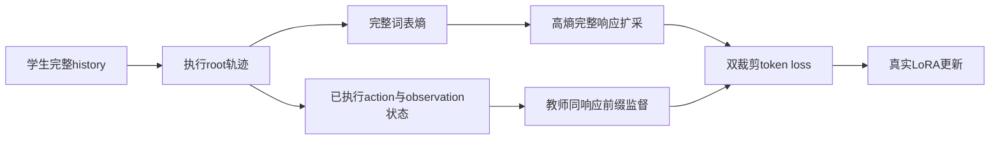
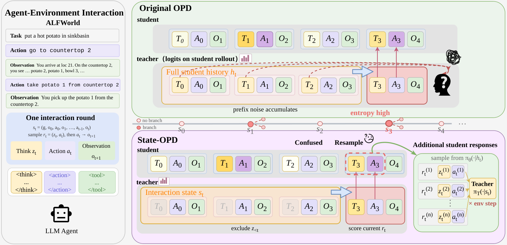

# State-OPD: State-Grounded On-Policy Distillation for Multi-Turn Agents

## 论文信息

| 字段 | 内容 |
| --- | --- |
| 论文链接 | [arXiv 2610.13238](https://arxiv.org/abs/2610.13238) |
| 公司/机构 | Alibaba Group / Tsinghua University / Shanghai Jiao Tong University / University of Science and Technology of China |
| 首次公开日期 | 2026-10-09（arXiv v1） |
| 原文开源代码 | 否：原文与关联原始来源未找到本方法已发布源码（2026-10-13核验）；不是宣称全网不存在 |
| Adapter | `state-opd` |
| 本地复现代码 | [`src/auto_research/reproductions/state_opd/`](https://github.com/daiwk/auto-research/tree/main/src/auto_research/reproductions/state_opd/) |
| 实现/评测层级 | 核心算法实际模型路径；L0/L1机制诊断，不是原benchmark完整复现 |
| GPU门禁 | 已完成绑定6aabe57a的A100三臂三seed有效更新与脱敏回执；验证准确率全部为0，不表示能力提升 |

## 原始论文总结

### 背景与主要改动

多轮OPD把旧reasoning和实际环境记录混在教师上下文中，可能继承错误推理。State-OPD只给教师已执行action/observation状态，学生仍保留完整history；在高完整词表熵状态扩采整段reasoning+action，额外action不执行。实现保留Appendix D.1实际sampled-K1双裁剪，而非打分启发式。

### 架构与数据流

以下为本地重绘，不冒充原论文图片。



<!-- paper-figure:start -->
### 原论文关键图

[](https://arxiv.org/html/2610.13238v1/state_opd_pipeline.png)

中文图注（原论文 Figure 1）：上半部展示完整学生历史带来的教师前缀噪声；下半部让教师只读取已执行的 action/observation 状态，学生仍保留自己的完整历史。高响应熵触发额外完整响应采样，但这些分支的动作不进入环境执行。此图为作者原图，不是本地实验结果。

精确来源：[固定 v1 的 Figure 1，HTML `S2.F1`](https://arxiv.org/html/2610.13238v1#S2.F1)；[原始 PNG](https://arxiv.org/html/2610.13238v1/state_opd_pipeline.png)。本地原始字节副本与 SHA-256 记录在 [figure-source.json](figure-source.json)，版权归原作者；与上方本地 Mermaid 重绘分开。

> **原论文 Figure 1（关键图）**：上文说明所选原图或方法截图的范围；并非本地测量。图片来自[原论文](https://arxiv.org/html/2610.13238v1/state_opd_pipeline.png)，版权归原作者所有；点击图片可查看固定版本来源。
<!-- paper-figure:end -->

### 核心公式

令同一响应前缀的采样token log probabilities为 $\ell_\theta,\ell_T,\ell_{\rm old}$：
$$
A=-\operatorname{sg}[\operatorname{clip}(\ell_\theta-\ell_T,-10,10)],\quad
\rho=\exp(\operatorname{clip}(\ell_\theta-\ell_{\rm old},-20,20)).
$$
$b=\max(-\rho A,-\operatorname{clip}(\rho,0.8,1.2)A)$；$A<0$ 时使用 $\min(b,-3A)$，否则用 $b$，对真实监督token取均值。
状态熵是 $-\sum_{v\in\mathcal V}p_v\log p_v$ 的token均值，不能用selected-token surprisal代替；选中 $\lceil T/\beta\rceil$ 个状态，各扩采 $\beta(M-1)$ 个完整响应。

### 论文离线与线上效果

原文用Qwen3-32B教师、1.7B/4B学生，在ALFWorld、ScienceWorld、WebShop训练200步，每配置一个seed。4B五设置macro success由Vanilla OPD的26.07%到31.74%；1.7B由18.90%到20.76%。不是本地计算器环境结果。未报告生产线上A/B。

选取的原文稳定标量与出处保存于 [paper-results.json](paper-results.json)，全部标为paper-reported，不是本地测量。

## 本地复现

> **本地对照口径**：基线为冻结初始学生、同配置预算的独立root full-history OPD及无扩采对照，均已实际执行；实际监督token与耗时不同，不宣称实际总计算匹配或能力提升；实验组仅支持本页L0/L1机制，稳定相对提升不适用。

### 数据与标签访问协议

公开checkpoint/data必须固定revision并通过既有 `checkpoint_source` / `validate_holdout` 的文件hash验证。GSM8K仅从官方train拆train/validation，官方test不打开。Qwen2.5-0.5B-Instruct revision为 `7ae557604adf67be50417f59c2c2f167def9a775`，需要teacher/reasoner时用Qwen2.5-7B-Instruct revision `bb46c15ee4bb56c5b63245ef50fd7637234d6f75`。参考答案仅在外部训练verifier、SFT监督target或明确的train-only数据构建teacher边界读取；被评估student/agent prompt不接收当前题gold/plan。

旧快照7e125fd0的三seed结果继续保留。2026-10-14另在固定源码6aabe57a运行state/full-history-opd/state-no-expansion三臂×seed42/43/44：9项都完成两步真实LoRA更新，8题validation训练前/后accuracy均为0。所有选择不读取官方test；不能把submission rate或环境step变化解释成能力提升。

### 可执行入口与预算

入口为 `scripts/run_oct13_post_training.py --method state-opd`，adapter则从数据目录读取 `oct13_execution.json`。必须提供student/teacher镜像路径、public id/revision、train/validation路径、split manifest与dataset revision。以下是已实跑配置的可复用命令；另外两臂分别将variant改为full-history-opd/state-no-expansion，seed使用42/43/44，validation-examples均为8：

```bash
PYTHONPATH=src python scripts/run_oct13_post_training.py \
  --method state-opd --config data/oct13_execution.json \
  --device cuda --seed 42 --variant state --steps 2 --max-turns 3 --max-tokens 256 --multiplicity 2 --concentration 2 --validation-examples 8 \
  --output runs/oct13/state-opd-42
```

真实生成、拒绝、难度校准、teacher profiling及监督token预算进入结果；失败写不可覆盖的 `failure.json`，成功写 `result.json` / `report.md`。不能仅以本地目录名伪造source metadata。

### 当前结果与验收状态

[A100 三 seed 实测指标](metrics/public-a100-seeds42-44.json)及对应 GPU 回执保留了旧快照 `7e125fd0` 的真实更新和负结果；不覆盖新增 full-history / 无扩采控制。

新增[三臂三seed指标](metrics/public-a100-three-arms-seeds42-44.json)与[2026-10-14 A100回执](../../gpu-validations/state-opd-a100-20261014.json)绑定实际执行的完整6aabe57a源码哈希和配置哈希，三臂初始validation逐seed完全相同。每项均两次非零梯度更新；新增扩采动作实际执行数始终为0，full-history每步实际执行两条独立root。

| 三臂实测（42 / 43 / 44） | State | Full-history OPD | 无扩采 |
| --- | --- | --- | --- |
| 训练后validation准确率 | 0 / 0 / 0 | 0 / 0 / 0 | 0 / 0 / 0 |
| 训练监督response token | 831 / 648 / 278 | 327 / 391 / 264 | 228 / 238 / 119 |
| 实际移除历史推理的response数 | 10 / 10 / 8 | 0 / 0 / 0 | 4 / 3 / 3 |
| 完整调用耗时（秒） | 108.61 / 116.26 / 82.94 | 79.94 / 114.86 / 91.81 | 90.23 / 93.40 / 105.09 |

上述token仅为真实训练监督response token；现State runner未记录validation生成token或完整prompt/FLOP成本，不把配置上界作为实测总成本。三seed、18次有效更新与零准确率仅支持机制执行和负结果，不支持稳定相对能力提升。

[mechanism-contracts.json](metrics/mechanism-contracts.json)保存已CPU执行的公式/行为合同标量，deterministic tensor/fixture协议，`diagnostic_only: true`、`formal_comparison: false`。不替代公开checkpoint训练、GPU回执、同预算能力比较或原benchmark。GPU指标由实际结果核验后另行摘录；本页不声明未执行实验已经完成。

### 代码映射

algorithm.py：状态、完整词表熵、预算与双裁剪；environment.py：安全算术工具；checkpoint.py：实际rollout/更新与独立root full-history控制。

共享 `post_training/oct13_common.py` 只承担资源装载、成本记录、response likelihood、真实optimizer step和输出；论文机制保留在本目录。行为测试为 `tests/reproductions/test_oct13_post_training.py`；State/GPPO/TAPO还保留既有专属测试。

### 边界与未完成项

计算器是实际执行的公开交互环境，不是原三个benchmark。full-history-opd执行M条独立root轨迹；额外扩采动作仍不会执行。整数取整及各root长度不同会改变实际监督token/动作成本，均须报告，不能声称总成本完全相等。

三臂A100路径、固定执行源码绑定回执已完成；仍需随本批完成全局目录同步与CI。三个seed不会自动升级机制诊断为正式能力证据。本条未注册未经验证的evolve映射。
